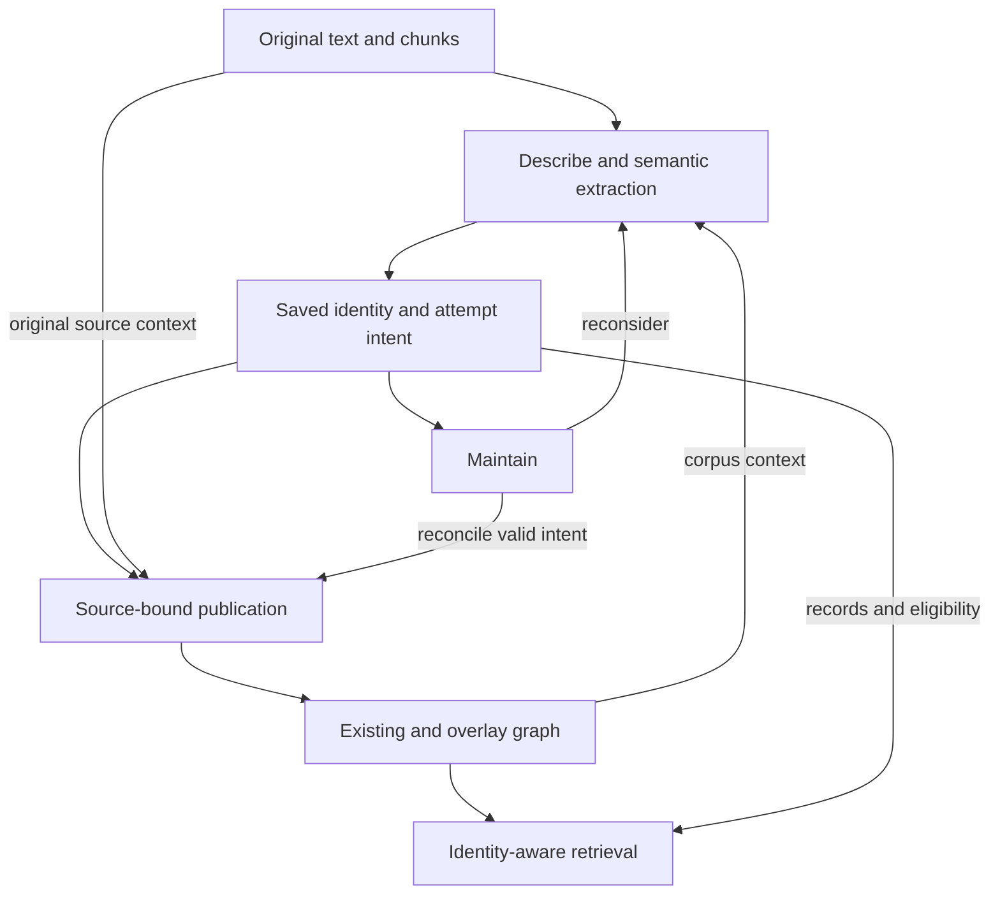

# Cognee identity integration — Stage-6 implementation handoff

**Consolidated:** 2026-10-15 (America/Detroit).

**Editorial revision:** 2026-10-20. STE-flavored technical prose.

**Inspected Cognee baseline:** Version 1.6.2, commit `ba3631f2ed363a6ea50d649c34c56885af6b36fe`.

**Test configuration:** Ladybug, LanceDB and SQLite with shared physical storage. These providers do not define implementation dependencies.

**Current status (2026-10-22):** The architecture review is complete. Bounded implementations cover parts of Stage-6 steps 1–4, including one general occurrence map for every text change. Step 4 remains partial. Standard entry-point integration and broader retrieval remain incomplete.

Start a new session with [SESSION_HANDOFF.md](../docs/SESSION_HANDOFF.md). It records the delivered code baseline, verification limits and next task. Section 11 defines the implementation sequence. Section 12 records dated checkpoints.

## 1. Authority, scope and first build

R1–R6 in [cognee_stage5_4_5_requirements_review.md](cognee_stage5_4_5_requirements_review.md) define the outcome requirements. [The representation proposal](cognee_stage5_4_5_identity_representation_proposal.md) records approved choices and their rationale. Later explicit decisions supersede earlier proposals.

The [extension reference](cognee_extension_architecture_reference_v1.6.2.md) records native mechanisms and limits for the inspected version. This document specifies the technical contract and build sequence. Contract statements describe selected behavior. Section 11 distinguishes implemented behavior from remaining work.

| Target | Initial boundary |
|---|---|
| Environment | Use local Python. Ladybug, LanceDB and SQLite form the initial test configuration. |
| Source processing | Use ordinary text on the STANDARD route with project Tasks. |
| Native entry points | Step 5 targets Cognify, standard Remember and full-rebuild Update through the B Task-transform extension. Current fixtures compose custom Tasks and native operations. |
| Lifecycle | Cover overlapping ingest, selected maintenance, original/generated source removal and dataset cleanup. Current fixtures demonstrate publication, withdrawal, corrections and bounded text rebuilds/retirement. |
| Retrieval | Step 5 targets a registered project Retriever/SearchType. Current code provides a bounded fixture retriever with identity rules. |
| Maintenance selection | Select whole original documents and map them to generated identity sources. The caller does not select individual assignments or fragments. |
| Optional stages, backends and transport | Check mutations and consumed stores before admitting a path. Remote callables and native incremental Update are outside the initial profile. |

The initial runnable profile uses captured deterministic decisions and explicit collection selection. It disables answer-cache reuse and feedback application. A diagnostic Triplet collection does not establish support for consuming its vectors. Exclude Triplets from every enabled discovery path, or verify their lifecycle before consumption.

The runtime profile was accepted on 2026-10-17, subject to the portability rules below. Do not invoke Improve/Memify automatically in the initial profile. Admit each maintenance path after checking its mutations and consumed stores. These reversible choices do not change conditional R5/R6.

### Backend portability — agreed 2026-10-17

Integration code must use Cognee's configured graph/vector factories, their interfaces, and the configured relational engine/session layer. Ladybug, LanceDB and SQLite identify the first tested configuration only.

The integration must not depend on the following:

- Concrete graph/vector adapter imports or construction.
- Calls to adapter clients.
- Backend-specific graph or SQL queries.
- Dependencies on storage-file layouts.
- Branches in domain logic based on backend names.

Use the vector interface for logical collection operations. Runtime discovery and configuration do not authorize access to LanceDB internals.

Use backend-neutral relational models and operations for the publication ledger and recovery events. Access them through Cognee's configured SQLAlchemy/session facilities and a small project bookkeeping interface. Do not use a separate SQLite database, `sqlite3`, PRAGMAs, SQLite-only SQL/types, or dialect-specific migrations. Do not use file locks for database concurrency.

Expected-revision checks and writer coordination must use a defined portable mechanism. A common interface does not establish equivalent transaction or lock behavior across adapters.

Use interfaces for provenance attachment/removal, shared edge properties, index writes/deletes and lookup. Check required capabilities before mutation. Report unsupported capabilities explicitly. Do not bypass an interface to compensate for a missing capability.

Tests establish behavior only for the tested configuration. This boundary supersedes earlier wording that tied project bookkeeping or integration mechanics to one backend.

### Architecture at the integration boundary



The saved identity description and the minimal change plan are separate artifacts in the saved-intent box. Section 6 defers complete semantic-output capture and replay of individual execution steps. Publish writes original facts/markers and generated-source contributions under different owners. The graph box does not imply one ownership context.

## 2. Physical model and identity rules

Reusable forms and local mention groups use ordinary Entity nodes. Added `entity_role` fields do not provide identity authority. An identity group has no privileged canonical member.

| Concept | Selected meaning |
|---|---|
| Singleton | An Entity outside the applicable variant group that is not a marked mention. |
| Identity group | Reusable variants connected under applicable relationships. The group has no permanent stored ID. |
| Mention group | One local binding with one or more exact text occurrences. Initially, groups remain within paragraphs but may cross physical chunks. |
| Variant relationship | A physically directed `resolves_to` edge interpreted bidirectionally and transitively within one applicable context. |
| Mention relationship | A directed, occurrence-scoped `resolves_to` reference. It does not establish variant equivalence. |

A reusable Entity cannot also serve as a mention. Distinct bindings with equal text use different explicit UUIDs.

Occurrences use sorted, nonempty, nonoverlapping Unicode code-point `[start,end)` ranges into checked extracted document text. Context passages do not define group membership.

Initially, each original document has one generated JSON Data item containing its identity assignments. Generated identity prose, generated chunks and support nodes for individual assignments are optional.

### Graph and ownership matrix

| Object/relationship | Content authority / provenance | Native retention and write rule |
|---|---|---|
| Original text/chunks | Original Data and native processed text. | Use the native original-source lifecycle. Validate versioned document/chunk mappings. |
| Generated identity TextDocument | Registered identity Data. | Publish under its actual source context. This document is not the mention-marker anchor. |
| Required reusable/mention Entity | Exact UUID and minimal saved construction recipe. Ordinary fields do not define identity authority. | The generated identity source retains required endpoints. Original producing chunks may retain them independently. Reference existing nodes without ordinary-field writes. |
| C -> M has_identity_mention | Original occurrence group and checked ranges. | Each occurrence-covering chunk C owns its marker. Context-only chunks do not own markers. |
| Entity -> Entity resolves_to | Saved accepted assignments. | Generated identity sources own their contributions and edges. Aggregate surviving contribution payloads. |
| Ordinary semantic fact, including M -> D | Original producing passage/chunk and the binding used for extraction. | Preserve native chunk ownership, contains/production records, edge evidence and indexing. Do not transfer fact ownership to identity Data. |

Physical edge identity comprises the source UUID, relationship name and target UUID. Native upserts replace ordinary edge properties. Native owners accumulate separately.

Shared identity edges store `resolution_kind` and a contribution collection. Each contribution identifies its assignment, generated source and applicability. This identity-specific aggregation does not automatically apply to ordinary semantic facts.

### Operational invariants and checks

| Invariant | Required observable result | Planned checks |
|---|---|---|
| I01 | Locators refer to checked text. Source evidence remains distinct from generated ownership. | T01, T03, T07, T20 |
| I02 | Identity authority survives ordinary Entity upserts. Referencing or retaining an endpoint does not rewrite its ordinary fields. | T02, T06 |
| I03 | Shared-edge applicability reflects surviving assignments. Native owner survival alone is insufficient. | T04, T09 |
| I04 | Captured records replay exact IDs. Explicit rules govern continuity, splits and retirement. | T06–T08, T19 |
| I05 | Unresolved mentions retain classification. Scoped mentions do not become global aliases or equivalence bridges. | T13, T15 |
| I06 | Known invalid inputs and failed publications cannot supply current identity interpretation. | T03, T09, T15 |
| I07 | Each consumed store returns the intended current content/IDs, or the affected result remains unavailable. | T05, T09, T11, T20 |
| I08 | Identity work has limits separate from semantic depth. Incomplete identity traversal cannot establish absence or disconnection. | T12, T15 |
| I09 | Repeated artifacts do not consume duplicate result slots. Distinct statements retain original provenance and local bindings. | T14 |
| I10 | One annotation contract governs output modes. Accepted identity does not establish scientific correctness. | T15, T16 |
| I11 | Enabled QA reuse and feedback application satisfy conditional R6 and the relevant writer checks. | T18 |

These invariants consolidate selected behavior. They do not define a universal SDK contract or require optional stages to run.

## 3. Saved forms: implementation draft

The [draft schema](../schemas/cognee_identity_source_schema_draft.json) and [example](../tests/fixtures/identity/cognee_identity_source_example.json) specify the initial serialized forms. Their field names, version tag, input kinds and configuration spelling remain implementation choices. They do not add approved semantic requirements or define native Cognee models.

| Draft field | Purpose |
|---|---|
| kind/schema_version | Identify the source type and serialization version. Validate registered source identity independently of the filename suffix. |
| dataset_id/identity_data_id/revision | Identify the registered generated source and guarded description revision. |
| original_input_ref | Reference the original source-text entry in the shared input manifest. |
| inputs | Share references and fingerprints for source text, exact chunks/spans, supplied corpus objects and saved records. |
| producers | Share the implementation, configuration and provenance of rules, models or fixtures. |
| entity_constructions | Declare retained Entities by exact UUID. Supply minimal creation names/descriptions for required endpoints and supported singletons, including existing Entities. |
| mention_groups | Store a stable record key, explicit M UUID, checked document/ranges, original chunk locators and supplied input references. |
| mention_resolutions | Store a stable assignment key, group reference, decision, target or separately labeled candidates, inputs and producer. Decisions are accepted, unresolved or ambiguous. |
| variant_assignments | Store a stable assignment key, exact reusable endpoints, explicit applicability, inputs and producer. Initially, published variant assignments are accepted. |

Records inherit source identity and revision from the envelope. They reference shared inputs and producers rather than copying those entries. The group defines mention applicability. A resolution record does not duplicate the group's ranges.

Variant assignments specify their own corpus, document or text-span applicability. Generated-source ownership does not imply document-limited applicability.

The example's synthetic original input is:

```text
Helios controller (HC) regulates plasma heating. The controller adjusts coil current; it limits oscillations.
```

The exact fixture text includes a trailing newline. A denotes an existing reusable controller. V denotes HC. M groups The controller and it. Construction recipes cover A, V and M, including existing A.

The expected identity output contains:

1. One marker from the original chunk to M.
2. One mention resolution M -> A.
3. One document-applicable variant relationship V -> A.

Semantic extraction generates domain facts from the original text. Creating identity edges does not generate those facts.

`mention_groups` maps record keys to local groups with exact occurrences. `mention_resolutions` references a group and, when accepted, an exact target Entity UUID. Variant assignments record relationships established independently by this source. They do not cache a traversal of an existing identity group.

Reusing a corpus identity does not copy its variant edges into local assignments. Store supplied corpus context as inputs when needed. New graph connectivity alone does not require rewriting every existing mention.

### Mention locations and chunk mapping — agreed 2026-10-17

Occurrence positions refer to the complete extracted document string identified by `document_ref` and its fingerprint. Positions use Unicode code points and `[start,end)` ranges. They are neither chunk-local positions nor byte offsets. Stored occurrence text must equal the specified document slice.

`has_identity_mention` links an original DocumentChunk to a mention Entity. It provides classification and location even when resolution remains unknown. Accepted identity uses a separate `resolves_to` relationship. Only chunks that cover occurrences own markers. Valid rechunking can replace marker edges while preserving group/M UUIDs.

The initial profile uses the standard nonoverlapping TextChunker. Native DocumentChunk stores document references, `chunk_index`, text and a content hash. It does not persist document start/end fields.

Use the following mapping procedure:

1. Order actual chunk texts by `chunk_index`.
2. Call `cognee.modules.chunking.incremental_chunking.chunk_offsets` with the exact checked document string and ordered texts.
3. Check that each chunk matches its expected slice and that all chunks cover the complete document.
4. Associate each returned range with its actual chunk UUID.
5. Store the validated ranges in the shared chunk inputs.

This procedure calculates cumulative Python-string offsets. It does not select the first occurrence of a repeated substring. Reusing this helper does not admit native incremental Update as a project path.

Recompute and validate mappings after text changes or rechunking. Before marker publication, verify chunk/document identities and complete coverage of each listed occurrence under the checked text version.

Overlapping or text-transforming chunkers remain unsupported initially. They require explicit construction-time offsets or a separate validated mapping adapter. An ambiguous substring match cannot repair a mapping failure.

The mapping test inventory includes:

- Repeated equal chunks and Unicode text.
- Preserved whitespace and newlines.
- Shifted positions and changed boundaries.
- Groups and individual occurrences across chunk boundaries.
- Stale chunk IDs and failure to reconstruct the document.

Later native fixtures verify mapping for selected edits and chunk boundaries. These fixtures do not establish compatibility with every chunker. Section 12 and the linked guides identify the tested cases.

### Assignment cardinality and variant density — reviewed 2026-10-17

Each source has one current mention-resolution record per group. The record stores accepted, unresolved or ambiguous state, actual `input_refs`, a `producer_ref` and an optional concise explanation. Only an accepted record has an accepted target. Candidate UUIDs neither establish links nor authorize creation.

The group defines resolution applicability. The publication ledger records unavailability separately. Retargeting preserves the continuing assignment ID and replaces its contribution. Other valid sources retain their own contributions.

Variant assignments do not impose one outgoing link per Entity. Each independently established relationship has its own contribution, source and applicability. Store declared relationships without generating every pair implied by transitive traversal.

The initial design imposes no spanning tree, one-parent rule or hard density limit. Cycles and redundant paths alone do not establish invalid identity. Removing an apparently redundant edge can discard source-specific contributions or change connectivity under another context or after withdrawal. Any later sparsification must preserve those meanings and lifecycle behavior.

Future size reports and offline diagnostics should record these values for each evaluated group/context:

- Member count and applicable physical variant-edge count.
- Distinct unordered endpoint-pair count for bidirectional interpretation.
- Degree distribution and contribution count.
- Actual expansion work and identity-limit hits.

Distinguish structural redundancy from independent contributions on one edge. Record both group size and density. Large size alone does not establish density as the cause of a limit.

Diagnostics must reuse traversal predicates and counters. Reports must identify the evaluated context and incomplete coverage. A truncated traversal cannot establish complete group size or density. These measurements do not require retrieval-time pruning, automatic graph changes or an additional initial runtime gate.

### Construction and publication checks — agreed 2026-10-17

Each `entity_constructions` entry declares an Entity that this source intends to retain. It is not an inactive historical recipe. Every required endpoint needs an entry:

- A mention group requires its M UUID.
- An accepted mention resolution also requires its target UUID.
- An accepted variant assignment requires both endpoint UUIDs.

A supported singleton may have a declaration without a resolution edge. Candidate IDs alone do not authorize creation or retention. Maintain removes a declaration when the source withdraws its retention intent and no remaining local intent requires it.

Publish validates intent, inspects existing objects, compiles explicit actions, executes those actions and verifies the result. It makes no fresh identity judgment.

An existing node is compatible when its exact UUID denotes an ordinary Entity and its intended use matches the current declarations and replacement/retirement plan. Compile the initial UUID-use view by scanning saved descriptions, including the selected intended revision.

Reject the following conditions:

- One UUID serves both reusable and mention roles.
- A mention UUID belongs to an incompatible group.
- The stored node has a conflicting type.

Missing or contradictory classification does not authorize an inferred role. These checks require no permanent role registry.

An existing name or description may differ from its construction recipe. Reference and retain compatible existing nodes without rewriting ordinary fields. A changed field that Describe consumed is a dependency-validity failure. It is separate from representation compatibility.

Before publication, validate:

- Source registration and the expected saved revision/attempt.
- Current original text, exact ranges and chunk mappings.
- Actual supplied input identities and fingerprints.
- Explicit withdrawal intent.

An attempt may proceed under its own pending ledger state. Retrieval still excludes the unfinished publication.

Missing output and missing reasoning input require different handling. Publish can create a new output with its exact UUID and recipe when required inputs and intent remain valid. The same rule covers an expected gap in a validated captured rebuild plan.

An unexpected loss of a consumed corpus Entity does not establish a valid reconstruction. A recipe and old fingerprint do not contain the consumed field values. Initially, leave saved-intent reconciliation unavailable and select the document for reconsideration. Independent reconstruction outside captured plans requires a future dependency/capture policy.

Graph absence alone establishes neither retirement nor permission to restore. An explicit replacement/retirement plan prevents restoration from stale intent. It does not cancel valid independent intent from another current source.

Current runtime checks cover recipes, UUID use, supported inputs, minimal operation capture, portable writer/revision guards and final verification for admitted fixture paths. Broader dependency propagation and operation coverage remain incomplete. Native lookup and reference attachment do not perform domain checks. A check before writing does not coordinate unsupported independent writers.

### Producer bookkeeping — agreed 2026-10-17

Use the shared `producers` structure. Each record's `producer_ref` identifies one source-level entry. The entry contains method, implementation, version and relevant configuration. The method is `rules`, `llm`, `decision_model` or `captured_fixture`. `run_id` is optional.

Configuration records the settings that produced the decision. Examples include model, prompt-template version, parameters, rule settings and context policy. Implementation version, schema version and saved-description revision are distinct.

A `run_id` identifies a Describe execution. It does not identify a publication attempt. A publication retry preserves producer information and receives a new ledger attempt. Sharing producer entries requires neither a model registry nor a permanent prompt archive.

### Fingerprint contract — agreed 2026-10-17

A fingerprint is SHA-256 of explicitly defined bytes, stored as 64 lowercase hexadecimal characters. It detects content changes. It is not an embedding, Entity identifier or semantic-equivalence judgment. The draft schema version defines the hashing rules. A change to those rules requires an explicit format-version change.

| Input | Exact hash input |
|---|---|
| source_text | UTF-8 encoding of the complete extracted document string used by the pipeline. |
| text_span | UTF-8 encoding of `document_text[start:end]` under the checked source version. |
| corpus_object | RFC 8785 JCS canonical UTF-8 encoding of selected field names and their supplied values. |
| saved_record | JCS canonical UTF-8 encoding of the complete supplied record. Exclude the enclosing source envelope and revision. |
| chunk | This is currently a locator without an independent digest. Represent text supplied for reasoning with a hashed text input. |

Text hashing preserves whitespace, case, punctuation, newlines and Unicode. Do not trim, normalize or append a newline. Ingestion conversion precedes hashing. Offsets and text digests use the same extracted string.

`source.txt` contains one trailing LF and 110 UTF-8 bytes. Its SHA-256 is `7c21fbfdd7e16f28cace089933071c5c280b42dc7a346cd23c523f1c6d8dd4d5`.

Use the [RFC 8785 JSON Canonicalization Scheme](https://www.rfc-editor.org/rfc/rfc8785) for structured content. Arbitrary pretty-printing or an assumed equivalent Python serializer does not establish JCS conformance. JCS preserves array order and string content and defines deterministic object/number serialization.

Use a conformant routine. Reject unsupported or nonfinite values, or encode them through an explicitly declared typed-input contract. Do not silently coerce values or lose precision. The example's selected fields contain strings.

For `corpus_object`, construct exactly `{field: supplied_value}` for `selected_fields`. A missing selected field is a validation error. It differs from explicitly supplied `null`. Exclude metadata that Describe did not select or receive.

A saved-record projection requires an explicitly defined projection input. A full-record hash does not describe only selected fields. Generated inventories and context require signatures of their actual supplied text or structured payload. The complete document fingerprint alone is insufficient.

A text-span hash excludes its offsets and parent document digest. Those values remain locator/version metadata. Validated prefix edits can change the document digest and offsets while preserving selected passage content.

Compare corresponding input identities and projections only after validated remapping. Equal hashes from different sources do not make the inputs interchangeable. Compare actual input membership, meaningful order and relevant processing configuration. A changed digest selects maintenance work. It does not prove a changed meaning.

The example's text digest and selected A-field digest match these definitions. That ASCII string-only check did not establish general JCS conformance or native integration. Later runtime tests provide separate evidence, as recorded in section 12.

### Checks beyond JSON Schema

Before publication, validate the following:

- Cross-references, exact source text, fingerprints and slices.
- Sorted disjoint ranges and chunk coverage.
- The global distinction between mention and reusable UUID use.
- Exact UUID compatibility and permitted construction.
- One current resolution per group and valid supplied inputs.

Never infer offsets from the first matching repeated substring. Query-scoped candidate/context adapters must record supplied material and its selection policy. Extend the draft input forms explicitly when a fixture requires richer context.

The corpus-backed schema includes endpoint recipes. An external dependency that permits references only requires a separately validated adapter or extension. An old recipe does not authorize recreation of a retired object.

Unresolved or candidate interpretations publish no accepted resolution edge. Withdrawing a resolution differs from retiring its group. Pending and failed publication states belong to the ledger. They are not additional saved identity decisions.

### Continuity rules to implement

The table defines selected continuity rules. Section 11 identifies their implementation status.

| Change | Identity treatment |
|---|---|
| Validated offset shift, rechunking or same-binding edit | Preserve group/M IDs. Rebase versioned ranges and compare supplied interpretation inputs. |
| Whole-group retarget | Preserve group and assignment IDs. Replace the group's contribution. |
| Partial membership addition/removal | Preserve the continuing valid group. Retire the group when empty. |
| Split or explicit combination | Allocate fresh IDs for every resulting group. Retire predecessors. Do not copy all predecessor facts onto every result. |
| Reusable variant scope/endpoint correction | Preserve the stored decision ID. Replace only its contribution and physical edge as needed. |
| Independent source support | Use a separate assignment. Preserve other sources during withdrawal. |
| Mention/reusable representation change | Use a separate suitable Entity and kind-specific assignment. Do not promote M in place. |

Substantive binding changes and regrouping require refreshed semantic extraction from original text. Harmless position shifts alone do not require new model calls. The accepted document-level fallback avoids an initial requirement for optimal partial refresh.

## 4. Commands and shared storage boundary

These interfaces define responsibilities. Their labels are not final function names or native API claims.

| Interface | Required behavior |
|---|---|
| Read description | Return the current source description and revision. |
| Guarded apply/replace | Validate supplied intent, expected revision and explicit retirement. Preserve unrelated records. Return changed/retired IDs and publication keys. |
| Reconcile selected documents | Map originals to generated sources. Apply valid saved intent without a new Describe call. |
| Reconsider selected documents | Process selected documents with current corpus context and existing continuity. Save the resulting intent and publish through the same reconciler. |
| Retrieve | Accept ordinary query, dataset and native controls through the project Retriever. Resolve IDs/context internally and apply the selected rules. |
| Diagnose identity graph | Scan explicitly or offline with shared eligibility rules, traversal and counters. Report limits and coverage. Optional post-update invocation does not imply automatic repair. |

Callers select whole documents. Internal record updates and contribution cleanup may use finer granularity. Code, Tasks and operators can invoke these operations. Explicit selection does not require a separate approval step.

## 5. Execution sequence and native integration

The selected execution sequence is:

1. Check source identity, generated-source registration, supported route and consumed stores.
2. Read the previous description and data needed for retirement/remapping before destructive native operations.
3. Find known affected/dependent sources by scanning saved input references and selection information.
4. Mark affected sources pending before the supported mutation.
5. Preserve independently valid sources.
6. Prepare original text/chunks and document-level identity state.
7. Run Describe to obtain exact bindings.
8. Run semantic extraction/conversion with original text and bindings before final persistence.
9. Save validated intent and required retirement/retry data durably before destructive writes.
10. Apply guarded description updates.
11. Publish original markers/facts and generated-source contributions under their actual source contexts.
12. Verify the intended graph, owners, evidence and each consumed index.
13. Verify that obsolete contributions and locators are absent or unavailable.
14. Acknowledge only the matching saved revision and attempt with valid inputs.
15. Leave incomplete attempts unavailable and record incidents that require recovery.

Explicit selected-document recovery uses one of two paths. Reconcile valid saved intent without a new identity judgment. Select labeled reconsideration/rebuild when invalid inputs or uncaptured semantic output require regeneration. Section 11 identifies the implemented subset of this sequence.

The proposed B patch transforms STANDARD Tasks after native construction, before route assembly and `needs_llm` calculation. Preserve the native Cognify pipeline name, runtime setup and result behavior. Standard Remember forwards the transform. Update with customization forces the full-rebuild path and forwards the transform to Cognify.

Reject unsupported callable transport, dry-run and nonstandard-route combinations explicitly. The B patch remains unimplemented.

Custom Tasks bound to actual sources consume the structured JSON directly. `calculate_chunk_graphs` remains an optional computation interface for chunks. It is not a prerequisite for identity publication.

Conversion must map keys to exact saved UUIDs. Model-local extraction IDs do not guarantee stored Entity UUIDs. Populated nested existing DataPoints must not enter the ordinary-property write set. Preserve native production and evidence records for each producing chunk, including facts that already exist.

## 6. Initial failure handling and recovery visibility — revised 2026-10-17

The initial recovery scope retains:

- Guarded saved JSON and a publication ledger.
- Writes and withdrawal under actual source contexts.
- A minimal durable change plan.
- Final verification and explicit recovery.

This scope supersedes earlier proposals for complete semantic capture and exact replay of individual execution steps. Automatic continuation from arbitrary writes, comprehensive semantic-output capture and automatic recovery orchestration remain deferred. A general replay framework and A/B copies are not prerequisites. Interfaces should permit later extensions.

The ledger is the sole authority for publication eligibility. Its key comprises dataset and generated Data ID. It records pending/current/failed/withdrawn state, intended revision, verified published revision, attempt token and diagnostics.

Mark a source pending before affected mutations. Acknowledge only its matching verified revision and attempt. Withdrawn sources retain their description and revision for inspection. They provide no active identity interpretation. Failed or incomplete publications remain unavailable until explicitly handled. Event history supplies diagnostics rather than a second eligibility registry.

The minimal plan retains information needed after saved-record changes or native removal:

- Source, revisions and attempt.
- Previous and intended marker, edge and contribution keys.
- Entity declarations and withdrawal intent.

Save required information before destructive operations. Do not reconstruct retirement intent from missing graph state. Files, ledger and graph do not share one transaction. A missing or incompatible plan requires a diagnostic and an explicit recovery choice. Complete semantic payload capture and guaranteed reproduction of interrupted extraction remain deferred.

Recovery selection uses whole original documents. Identity-only reconciliation reapplies valid saved assignments programmatically. It preserves exact UUIDs, source-specific contributions and other owners.

Invalid inputs or missing uncaptured semantic output require explicit document reconsideration/rebuild. That path may produce new model decisions. It does not guarantee exact replay of the failed attempt.

Before acknowledging currentness, recovery must withdraw or withhold obsolete and partial source output. Hiding an identity contribution alone does not make stale semantic output valid. The initial design does not select automatic retry.

### Durable recovery-event records

Record actual recovery needs to support later prioritization by frequency, cause and outcome. Use a small `recovery_events` table through the configured backend-neutral relational layer. Provide simple listing/export and incident identifiers in failure/status output. Diagnostic outcomes do not override ledger eligibility. The initial design requires no monitoring service, dashboard or scheduler.

The selected event policy covers:

1. Unexpected operation failures that leave publication incomplete or unavailable.
2. Abandoned pending attempts discovered during startup or explicit status inspection.
3. Inconsistencies that require explicit recovery after verification or diagnostics.

An ordinary scheduled update is not a recovery incident. Neither is a preflight rejection when no affected state needs recovery. Label injected test incidents separately from runtime failures.

| Recorded information | Purpose |
|---|---|
| recovery_event_id, dataset_id, original_data_id, identity_data_id | Locate the incident and affected source. |
| Failed/incomplete attempt ID, operation, intended revision and last verified revision | Identify the attempted change and link its minimal plan when present. |
| first_detected_at and last_observed_at (UTC) | Record discovery and repeated observations. Discovery time does not establish the exact crash time. |
| Failed stage, extensible reason_code and concise error/diagnostic reference | Distinguish validation, retirement, graph, reference, index, verification and acknowledgement failures. Optional details exclude corpus text and complete payloads. |
| Integration version, runtime profile and origin (runtime or test/fault_injection) | Support reproduction and interpretation. |
| Recovery method, linked attempt IDs and outcomes | Distinguish reconciliation, reconsideration/rebuild and investigation. Retain failed recovery attempts. |
| resolved_at, resolving revision/attempt, or superseding-event reference | Record verified restoration or replacement while preserving the original failure. |

Repeated observations of one source/failed attempt update the same incident. Restarting or listing status must not increase its incident count. Recovery attempts append linked outcomes. A new independent failure after restoration creates a new incident.

Close an incident as restored only after matching publication verification and acknowledgement. Label superseded incidents explicitly. Supersession is not successful repair. Retain compact event history after temporary-plan cleanup. Permanent semantic-output archives are unnecessary.

Caught failures record events immediately in current admitted paths. A hard crash may prevent that write. The selected policy calls for ledger inspection to record such abandoned attempts later. General hard-crash inspection and writer-reservation abandonment remain incomplete. Current caught-failure tests do not establish that broader recovery behavior.

If event recording fails, report the unavailable source/attempt and the diagnostic-write failure. Do not mark publication current. The selected policy recovers missing diagnostics during later ledger inspection. It requires no background scanner.

Initially, expose unresolved incidents and include event IDs in failure/recovery results. Later reports can group runtime incidents by stage, reason and version. They can measure repeated failures, recovery success and detection-to-restoration time. Exclude test incidents from runtime prioritization. Use those measurements to assess additional capture, replay or automation.

## 7. Operation contract

This table defines selected behavior. Section 11 records implementation gaps.

| Operation | Saved identity and graph behavior | Completion/failure handling |
|---|---|---|
| New document | Describe against the eligible corpus. Register generated JSON. Publish original markers/facts and identity contributions. | Verify actual source contexts and consumed stores before acknowledging currentness. |
| Overlapping ingest | Reuse exact compatible UUIDs without rewriting existing properties from recipes. Attach deliberate owners and contributions. | Preserve independent earlier decisions and evidence. |
| Original Update | Initially rebuild the complete project-processed document. Validate continuity/context and refresh bindings/facts. | Invalidate known dependents. Failed or deferred dependents remain unavailable. |
| Original Forget | Retire the original document's generated identity records and contributions. Native removal handles actual original-source references. | Coordinate generated-source removal. Native Forget does not automatically remove registered identity Data. |
| Generated-source rebuild/removal | Withdraw its contributions and retention. Preserve original chunk markers/facts while their owners retain them. | Validate surviving M classification and temporary endpoint gaps. Restore only current valid intent. |
| Reconcile saved source | Restore declared graph, references and indexes without a new Describe call or ordinary-field writes to existing nodes. | A new attempt may use the same revision. Stale intent cannot recreate retired endpoints. |
| Explicit reconsideration | Run Describe and semantic refresh on selected documents. Use the same continuity rules and guarded save path. | Do not require fine-grained caller selection or automatic corpus-wide reconsideration. |
| Dataset Forget | Coordinate original/generated source retirement and enabled-store cleanup. | Leave no usable dangling references. Dataset arguments alone do not establish row isolation in shared stores. |
| New corpus opportunity without known dependency | Link a new document to the corpus normally. Permit explicit selection of older records later. | Do not invalidate all older records automatically or add a retrieval freshness state. |

Deferring recomputation does not permit known invalid dependents to remain current. Initially, report affected documents and require explicit refresh. A dependency index or background scheduler is unnecessary. Diagnostics identify missing structures and excessive work. They do not decide semantic equivalence or mutate the graph.

## 8. Retrieval and delivery contract

Preserve the native public request envelope. Query resolution supplies IDs and context internally. Optional caller seeds/anchors remain future extensions. The initial project adds no public fact-source-filter feature.

1. **Resolve the query.** Resolve identity before semantic expansion. Preserve ambiguity. Distinguish ambiguity from intentional requests for several Entities.
2. **Apply relationship meanings.** Traverse applicable variants bidirectionally and transitively in one context. Follow accepted mention references only in their occurrence context. Reverse mention collection finds eligible facts but does not establish equivalence.
3. **Bound identity work.** Identity movement consumes no semantic hops. Bound work, contributions, mentions and fact candidates separately. Track context-aware visited states and allocate work across branches.
4. **Rank substantive content.** Accepted identity establishes eligibility. It supplies neither a relevance bonus for repeated paths nor a penalty for variant-path length. Weak mention-name matching alone cannot exclude an otherwise useful attached fact.
5. **Deduplicate artifacts.** Remove repeated physical artifacts before final selection. Group distinct variant/mention statements for presentation while preserving entries, exact IDs/properties and original evidence. The initial design has no semantic-predicate equivalence model.
6. **Apply one annotation contract.** Use proposal section 38 for accepted/unresolved/ambiguous/unavailable states, targets/candidates, context and specific reasons or identity-expansion limits. Accepted binding may coexist with limited expansion. An unfinished identity check cannot establish disconnection or conflict. Empty evidence is not a fifth state.
7. **Preserve meanings across outputs.** Render one compact shared meaning guide and relevant local annotations unless consumer instructions already define those meanings reliably. Objects, ordinary output, verbose and `only_context` must preserve the same meanings. Semantic depth, `top_k` and context limits are not identity-expansion limits.

Exclude helper edges from subject-matter facts. Independent passages may remain useful when identity is unknown. State their attribution limits. Preserve unaffected evidence when part of the result is unavailable. Native evidence does not provide historical per-source property snapshots or scientific-support judgments.

## 9. Consumed-store admission matrix

Define the concrete runtime manifest before declaring a path supported. The manifest covers stores consumed by the selected profile. It does not guarantee every Cognee store.

| Store/path | Expected contents/check | Initial treatment |
|---|---|---|
| Graph Entities, facts, markers and identity edges | Verify exact IDs, current contributions and ownership. Exclude obsolete usable links. | Required. |
| Native Entity name index | Verify current/new Entities and the absence of retired UUIDs. | Required when candidate search consumes it. Common mention labels are not global aliases. |
| Native relationship-text/EdgeType index | Verify current relation content. Do not assume one independent vector per statement. | Verify when consumed. Exclude helper relations from semantic output. |
| Original chunk text vectors | Verify current text and Data/chunk locators. | Required for an enabled passage retrieval path. |
| Edge-evidence sidecar | Verify producing original Data, chunk and edge. Exclude usable retired mappings. | Required when the profile enables evidence lookup. |
| Optional Triplet vectors | Verify endpoint text, edge coverage, same-ID refresh and cleanup after indirect deletion. | Initially exclude from all discovery paths, or admit explicitly with T11. Expanding text to include every alias is not required. |
| Answer/session caches and feedback writers | Prevent stale reuse and unexamined mutations. | Initially disable reuse/application. Enabling either activates conditional R6 and relevant writer tests. |

Verify returned IDs, content and source references. Collection existence, row counts, successful Improve and watermarks alone do not establish correctness.

## 10. Sequence-driven test suite

This inventory defines planned scenario coverage. Section 12 records dated implementation evidence. [SESSION_HANDOFF.md](../docs/SESSION_HANDOFF.md) records current verification status. Passing a small fixture does not establish every case below.

| ID | Sequence and expected observation | Requirements | Reusable lesson |
|---|---|---|---|
| T01 | Publish captured decisions, markers/resolutions and a new M-anchored fact. Verify exact UUIDs and original chunk evidence. | R1–R3, R5 | G01–G05, G11 |
| T02 | Reference compatible existing A with ordinary fields different from its recipe. Preserve fields and attach references. Separately reject changed fields consumed by Describe. | R1, R2 | G02, G07, G10 |
| T03 | Update one of two independent documents. Preserve the other interpretation. Invalidate a dependent variant that consumed changed input. | R2, R4 | G06, G07 |
| T04 | Withdraw one of two contributions on a shared edge. Preserve surviving payload and owners. Withdraw the last contribution and verify no usable link remains. | R1, R4 | G04, G06 |
| T05 | Rebuild/remove generated identity source I while original chunks remain. Preserve original markers/facts according to their ownership. | R2, R4, R5 | G05, G06 |
| T06 | Reconcile a captured expected endpoint gap after last-owner removal. Recreate its UUID only with valid inputs/intent. Unexpected consumed-input loss selects reconsideration. Permit same-revision/new-attempt recovery where valid. | R1, R2, R4 | G07–G10 |
| T07 | Apply a prefix edit and rechunking. Verify ID continuity and exact rebased spans. A changed antecedent requires reconsideration and refreshed facts. | R2–R4 | G01, G07 |
| T08 | Edit, split, combine or correct a group's representation. Verify selected retained/fresh IDs. Do not copy every old fact onto every result. | R1–R4 | G01, G09 |
| T09 | Inject failures at save, write, verification and acknowledgement boundaries. Verify unavailability, durable events, explicit recovery and stale-attempt rejection. Detailed execution-step replay remains deferred. | R1, R4, R5 | G08, G09 |
| T10 | Run native Cognify/Remember/full Update with the transform and a no-transform control. Reject unsupported routes and callable transport. | R1, R4, R5 | G03, G06 |
| T11 | Change indexed text under the same ID, add an edge and delete an endpoint. Verify intended current IDs/content in each consumed store. | R5 | G14 |
| T12 | Traverse long chains from several seeds, dense/cyclic variants and many mentions/contributions. Verify limits and visited-state behavior against offline diagnostics. | R3, R5 | G11, G15 |
| T13 | Test equal-text mentions with distinct M UUIDs, incompatible scoped paths and unresolved markers. Verify local bindings without equivalence bridges. | R1–R3 | G01, G11 |
| T14 | Reach one artifact through several alias paths. Return it once. Preserve separate variant/mention statements, evidence and interpretations. | R3, R5 | G05, G13 |
| T15 | Test four effective states, valid survivors during pending publication, empty evidence, accepted binding with identity limits, and unfinished checks. Verify consistent object/ordinary/verbose/only_context delivery. | R3–R5 | G08, G12 |
| T16 | Supply annotated context to representative model consumers. Measure interpretation accuracy and annotation/evidence token share. | R3 | G12, G18. This tuning study is not an initial runtime gate. |
| T17 | Test seeded Describe with names, initials, definitions, shortenings and context-only references. Assess repeated and edited inputs separately. | R2–R4 | G07, G18. Quality evaluation is separate from captured tests. |
| T18 | Keep cache reuse/application disabled initially. If enabled later, change/delete a consumed source. Exclude stale QA/vectors and test feedback writers. | Conditional R6, R1–R5 | G14, G18 |
| T19 | Explicitly reconsider a document after a new corpus opportunity. Preserve valid continuity and revise intent deliberately. Do not invent an earlier dependency. | R2–R4 | G07, G09, G16 |
| T20 | Run original and dataset Forget. Verify coordinated generated-source retirement, surviving shared owners, graph/vector cleanup and evidence eligibility. | R2, R4, R5. R6 applies if enabled. | G05, G06, G14 |

Each case should retain its fixture, initiating operation, expected saved records, graph/references, active stores, delivery eligibility and failure/recovery observations. Shared-code unit tests do not replace real-backend fixtures.

### Publication and construction edge-case matrix

These planned subcases elaborate T01–T09, T13, T19 and T20. They add neither high-level requirements nor claims of completed tests. Use deterministic captured decisions to isolate lifecycle assertions from LLM variability. Test meaningful interactions as well as successful isolated operations.

| Case | Setup/operation | Required observation |
|---|---|---|
| P01 | Reference an existing UUID with different recipe name/description and unchanged reasoning inputs. | Attach intended owners without changing ordinary properties or creating a duplicate Entity. |
| P02 | Reference an existing UUID after a field consumed by Describe changes. | Reject invalid dependency before publication. Withhold the source until reconsideration. Do not overwrite from its recipe. |
| P03 | Reference a UUID that denotes a non-Entity. | Report incompatibility without conversion or overwrite. |
| P04 | Declare one UUID as reusable and mention, or assign it to incompatible mention groups. | Reject inconsistent intent. Do not infer a role from graph corruption. |
| P05 | Publish an absent new output with valid inputs. | Create its exact UUID from the minimal recipe. Verify owners, markers/edges and consumed indexes. |
| P06 | Omit a required M, accepted-target or variant-endpoint recipe. | Reject before writes. Parameterize each endpoint position. |
| P07 | Declare a singleton without an identity edge, then withdraw only that source's declaration. | Create/retain the singleton initially. Withdrawal removes only that source's retention and preserves independent owners. |
| P08 | Supply unresolved/ambiguous candidates without independent declarations. | Publish no accepted edge. Candidate IDs alone authorize neither creation nor retention. |
| P09 | Reconcile expected missing identity output using a valid minimal plan and the same revision. | Recreate exact UUIDs without new identity judgment. Preserve unique owners/contributions across retries. Label uncaptured semantic regeneration as reconsideration. |
| P10 | Lose a previously consumed corpus input unexpectedly. | Do not reconstruct from an old hash/recipe alone. Select reconsideration and exclude stale interpretation. |
| P11 | Remove/change the original, supply a stale revision, or explicitly replace a record/UUID. | Reject stale intent and prevent stale recreation. Preserve valid independent sources. |
| P12 | Change ordinary fields, insert a prefix, edit occurrence content or rechunk. | Distinguish changed dependencies from compatible properties and validated position changes. Refresh bindings/facts according to policy. |
| P13 | Let two valid sources retain A, then update/remove either source first and the last source afterward. | Preserve remaining retention in both orders. Removing the first producer must not discard the other source's required Entity. |
| P14 | Test a pending publication, stale acknowledgement, concurrent supported revision change or restart. | Permit the owning attempt to execute while retrieval withholds it. Reject stale completion through revision/attempt guards. |
| P15 | Inject failures at plan, save, write, verification and acknowledgement boundaries. | Record an incident and withhold partial results. Require explicit reconcile/reconsideration. Repeated inspection does not duplicate incidents. Exact semantic replay is not guaranteed. |
| P16 | Supply a missing/corrupt plan, abandoned pending attempt or contradictory marker/classification state. | Record an event and withhold results. Do not invoke a model silently. Record the selected method and verified outcome. Distinguish test incidents and diagnostic-write failures. |

Parameterize a small fixture set across these dimensions:

- Mention, reusable and singleton roles.
- Present, missing and conflicting nodes.
- Unchanged, changed and missing dependencies.
- One or several owners.
- Initial publication, retry, rebuild and withdrawal.

Extend meaningful combinations, especially missing corpus inputs with surviving owners and failures during retirement. Exhaustive Cartesian coverage is not promised. Add a regression fixture for each discovered implementation defect.

Assertions cover saved records/revisions, exact graph IDs, preserved properties, native owners, contributions, active indexes, retrieval eligibility and diagnostics. Use pure validation/planning tests for combinatorial coverage. Use representative real Ladybug/LanceDB sequences for persistence, ownership and restart behavior. A mocked graph does not establish native compatibility.

Develop relevant tests alongside M0–M4. The complete inventory is not a prerequisite for the first fixture. Keep Describe quality and nondeterminism evaluation separate under T17.

## 11. Build order and unresolved engineering work

The build order was accepted on 2026-10-17. Implementation now reaches a partial M3. These are implementation steps within Stage 6. They do not correspond to the roadmap's subsection numbers 6.1–6.6.

Develop sequence tests with each step. [SESSION_HANDOFF.md](../docs/SESSION_HANDOFF.md) records the delivered baseline and independently reviewed Mac results.

| Milestone / accepted step | Concrete output and current boundary |
|---|---|
| M0 / 1 | Runtime forms/schema, exact native chunk mapping and portable bookkeeping/capability checks exist. Tests cover only the initial backend profile. |
| M1 / 2 | Captured custom Tasks publish a useful mention-anchored fact with original evidence. Explicit reconciliation works. Standard Cognify wiring and a registered public SearchType remain incomplete. |
| M2 / 3 | Multi-source overlap, shared contributions, both withdrawal orders, singleton retention and unresolved mentions have fixtures. General exact-ID semantic conversion remains broader than the captured writer. |
| M3 / 4 | Corrections, captured prefix/rechunk edits, partial removal, unresolved/resolved group retirement, captured additions/new-group publication, a captured split and combination, one general occurrence map and a captured mixed edit are implemented. The remaining areas appear below. |
| M4 / 5 | Standard-entry-point wiring, consumed-store admission and broader scoped retrieval/delivery/offline diagnostics remain unimplemented. |
| M5 / 6 | Seeded rules/model Describe and separate consistency/quality evaluation remain unimplemented. |
| Checkpoint | Review R1–R6 evidence and G01–G18 transfer status before Stages 7–8. |

### Step 4 / M3: remaining coverage

The remaining areas are:

1. **Occurrence/group changes.** Representation-kind changes remain. Since 2026-10-21 one general occurrence map admits any mix of kept, removed, added and regrouped occurrences under the approved rules, with captured fixtures for removal, retirement, addition, split, combination and one mixed edit. These fixtures do not establish automatic matching.
2. **Changed interpretation and semantic refresh.** Handle changed referents, definitions or applicability with coordinated saved decisions and regenerated facts/evidence. On 2026-10-22 the user decided that a changed decision retires the group and the reviewer declares a fresh group. Unchanged-text retargeting and captured same-binding edits do not establish general semantic refresh.
3. **Dependencies.** Identify and reconsider sources that consumed changed documents, corpus fields or saved records. Support admitted span/record remapping. Current text edits reject known dependent sources. Positive dependencies alone do not identify new corpus opportunities.
4. **Full source lifecycle.** Coordinate original removal, generated-source retirement/rebuild and authorized endpoint reconstruction. Preserve remaining owners. Distinguish missing reasoning inputs from missing reconstructible output. Identity withdrawal retains Data/descriptions and original facts, so it does not implement full source Forget.
5. **Verification and recovery.** Extend revision/attempt, eligibility, ownership, index, evidence and retirement checks across these operations. Include incomplete/missing-plan diagnostics. General crash recovery is not a new prerequisite.

[SESSION_HANDOFF.md](../docs/SESSION_HANDOFF.md) records the rules, the decisions, the proposed order and the next task. Group continuity alone does not authorize fact transfer.

### Step 5 / M4: integration and retrieval

The selected scope includes:

- Implement the B Task transform for standard Cognify and forwarding through standard Remember and full-rebuild Update.
- Integrate source-removal hooks and the required lifecycle coordination.
- Preserve native routing, runtime setup and result behavior within admitted paths.
- Register the project Retriever/SearchType.
- Extend scoped identity traversal, grouped delivery and offline structural diagnostics.
- Verify stores consumed by each enabled path.

Sections 5, 7–10 define the relevant contracts and scenarios. Step 5 does not yet have an ordered schedule of code deliveries.

### Step 6 / M5: Describe and quality evaluation

Use seeded rules/model examples through the same pipeline. Cover names, abbreviation definitions/initials, corpus matching, shortenings and contextual references. Keep candidate providers and inference backends replaceable.

Prioritize representative end-to-end examples before comprehensive linguistic coverage. Evaluate consistency and model quality separately from captured lifecycle tests under T17. The roadmap's sections 6.2 and 6.6 provide the broader Describe plan. Step 6 does not yet have an ordered schedule of code deliveries.

### Engineering details and deferred work

Resolve these details within the smallest relevant fixtures:

- Data registration and discriminator routing.
- Safe conversion of existing endpoints.
- Serialized writer/revision guards, file/ledger ordering and attempt cleanup.
- Actual consumed collection names and configuration.
- Shared-edge property serialization through the graph interface.
- Markers under actual source contexts and validated chunk offsets.

Some admitted fixture paths already implement these mechanisms. Broader wiring and compatibility still require verification. If a fixture contradicts an invariant, record the mismatch and make the smallest explicit adaptation. Do not silently weaken the invariant or reopen an unrelated policy review.

The following remain deferred:

- Automatic opportunity selection and autonomous repair.
- Caller APIs for individual fragments.
- Native incremental Update compatibility.
- Whole-store A/B staging.
- Comprehensive semantic-output capture and exact execution-step replay.
- Permanent semantic-output archives.
- Triplet text containing every alias.
- Universal ontology/scope frameworks and scientific-support reasoning.

A/B remains optional if measured complexity justifies it. General hard-crash recovery, A/B staging and comprehensive replay are not initial completion gates.

### Future size measurement tooling — noted 2026-10-17

Plan a small programmatic report/export as examples accumulate. This is evaluation work, not an initial runtime gate or monitoring subsystem.

| Measurement | Required distinctions |
|---|---|
| Saved-description UTF-8 bytes and record counts | Report by source/document and section: inputs, producers, entity_constructions, mention_groups/occurrences, mention_resolutions and variant_assignments. Include input/producer reference reuse. |
| Graph objects, relationships and contributions | Count Entities/mentions, markers, resolution edges and contributions per edge. Include context-specific variant-group size, density, degree and measured expansion cost. Reuse offline diagnostics. |
| Plans and failure artifacts | Report count/bytes. Add semantic-capture metrics only when implemented. Track compact event history separately and distinguish runtime incidents from injected failures. |

Report corpus totals, per-source median/p95/maximum and growth relative to source-text size or occurrence count. Distinguish corpus growth from representation overhead. Reuse T16 for annotation-token share relative to substantive evidence.

Use measurements to assess sharing, grouping and cleanup. Do not impose hard size limits or automatic compaction before measuring actual costs. Carry this process into other integrations through the playbook.

## 12. Reuse and evidence status

The [integration playbook](cognee_knowledge_integration_playbook.md) maps identity findings to reusable methods and measurement-transfer questions. Each finding identifies its Describe, Publish, Maintain and Retrieve activities. During Stage 6, attach actual source references and test results to that register.

Extract shared mechanics only after demonstration. Keep identity-specific grouping, equivalence and range rules in the identity adapter.

The following sections record dated checkpoints. Their implementation limits apply at the stated checkpoint. Later entries supersede earlier limits where they demonstrate additional behavior. Use section 11 and [SESSION_HANDOFF.md](../docs/SESSION_HANDOFF.md) for current work and verification scope.

At the 2026-10-15 consolidation, validation covered:

1. A draft JSON Schema generated from Pydantic models.
2. Example validation through those models and a JSON round-trip.
3. Source SHA-256 and exact occurrence slices.
4. Rejection of six malformed examples.

The six rejected cases were:

- Missing accepted target.
- Accepted target supplied for unresolved state.
- Missing endpoint recipe.
- Reference to a missing group.
- Overlapping spans.
- Competing current group records.

JSON Schema cannot express every cross-record/source check. At that checkpoint, no separate JSON-Schema-engine validation or native Cognee execution ran. No repository implementation changed. The first implementation checkpoint below supersedes that implementation status.

### First implementation checkpoint — 2026-10-17

The repository gained code in `src/cognee_lab/identity`, a generated schema in `schemas`, and exact fixtures in `tests/fixtures/identity`. The [first-slice guide](../docs/stage6_identity_first_slice.md) records commands and limits.

The initial source registers as an actual Cognee Data item. Publish uses actual source contexts and configured interfaces. Backend-neutral project tables store serialized JSON, eligibility, minimal plans and events. The registered generated Data item holds a matching JSON snapshot.

The runtime did not support revision replacement at this checkpoint. Later entries implement guarded replacement and selected text/group changes.

The fixture preserved a borrowed Entity's differing ordinary fields and sentinel. It created exact variant/M UUIDs, chunk-owned mention markers and a local `limits -> oscillations` fact. Retrieval returned original native evidence and an accepted scoped identity annotation.

The query selected HC as its seed. Retrieval followed its document-applicable variant relationship and then the accepted local mention. A fresh process reopened the stores. Repeated explicit same-revision reconciliation remained idempotent.

The checkpoint recorded 22 passing pytest cases. Tests used actual configured Ladybug/LanceDB/SQLite stores in subprocesses and local deterministic embeddings. Coverage included:

- Injected-failure withholding and reconciliation.
- Changed consumed-field invalidation and recovery events.
- Portable ledger/revision guards and event deduplication after failed recovery.
- Strict forms, repeated Unicode positions, RFC 8785 hashing and JSON-Schema-engine validation.

The fixture used no paid model/API extraction and did not mutate the lab corpus. No native dependency source changed. These results establish neither complete T01–T20/P01–P16 coverage nor compatibility with other backends.

The native `get_edges` return shape/direction differed from its interface annotation on the tested path. The project instead uses `get_edge_delete_data` for exact edge/provenance reads and `iter_bounded_neighborhood` for uniform EdgeData. It adds no backend-specific queries. Actual backend work bounds still depend on the configured adapter.

Limits at this checkpoint included revision replacement, withdrawal, the standard-entry-point transform and a public SearchType. The next checkpoint supersedes withdrawal status.

The fixture retriever uses document context and declines span-applicable variant expansion. Complete corpus traversal, unresolved/ambiguous passage delivery and offline diagnostics remain incomplete. A hard crash can leave a writer reservation. Pending-attempt inspection and explicit abandonment remain later recovery work.

Comprehensive semantic capture/replay, autonomous repair, A/B staging and metrics tooling remain deferred.

### Multi-source withdrawal checkpoint — 2026-10-17

The two-source fixture and `Publisher.withdraw` implement generated-source retirement within M2. Each original document has a registered description, local mention UUIDs, original-owned facts/evidence and an unresolved group. Both descriptions independently retain a singleton and contribute document-scoped payloads to one physical variant edge.

Tests exercise both retirement orders, repeated retirement, last-owner singleton/name-vector cleanup, borrowed-field preservation and original marker/fact/evidence survival.

Withdrawal saves a minimal retirement plan under the existing revision/writer guards. It withholds the source, removes its contribution payloads and invokes `UnifiedStoreEngine.delete_by_source_ref` through configured engines. Native removal handles ownership, graph and vector cleanup. Other contributors retain their payloads and owners.

Completion records `withdrawn` in the ledger. Registered Data and the saved description remain available for history. Withdrawal does not retract original semantic output or implement native Data deletion.

Caught interruptions require an explicit withdrawal retry. Successful completion marks the original event withdrawn. Publication reconciliation cannot reverse pending retirement.

Testing exposed an endpoint-retention obligation. A chunk-owned marker also needs the chunk's source reference on M. Without it, generated-source withdrawal can delete an unresolved M and cascade into the independently owned marker. The revised writer explicitly retains M. Tests cover unresolved groups without facts.

Retrieval reports failed/pending sources and their unresolved event IDs. Deliberately withdrawn sources are inactive rather than recovery incidents. The seed-selection correction reads candidate names through the graph interface rather than assuming a vector payload field.

The user independently reproduced the first Mac fixture and caught-publication-failure recovery. See the [first-slice guide](../docs/stage6_identity_first_slice.md) for commands and scope. Revision replacement, original-source lifecycle, standard wiring and general retrieval remained incomplete at this checkpoint.

### Step 4 / M3: unchanged-text revision checkpoint — 2026-10-19

`Publisher.replace` accepts the intended next description under the existing source ID and an expected-revision guard. This mode admits changed assignments and retention with unchanged original text, chunks and mention groups.

The replacement saves revision 2 as pending, together with the previous description and retirement keys. It updates registered Data through native ingestion, publishes exact-ID intent and retires obsolete contributions through native reference removal. Verification precedes acknowledgement. An interrupted replacement retains last verified revision 1.

The captured correction retargets doc01's mention and document-scoped variant to a new exact Entity UUID. It removes doc01's obsolete controller/private-singleton declarations and preserves doc02's interpretation. Original mention/fact UUIDs, positions and evidence remain unchanged.

Changed assignments receive a separate correction producer. Unchanged groups retain their producer. The former shared edge retains only doc02's payload and native owner. The borrowed original Entity retains its ordinary fields and independent owners.

Injected failures after saved intent, registered Data, additive graph writes and retirement withhold doc01 while doc02 remains usable. Explicit reconcile completes the exact saved revision-2 intent and retirement plan. It neither reruns Describe nor restores revision 1.

Revision/attempt guards reject stale writes and protect an incomplete replacement plan from unrelated operations. Publication and retrieval check registered JSON and raw-content metadata.

This mechanism provides verified forward completion. It does not provide a transaction or rollback across stores. Native readers that ignore the ledger can observe intermediate structures.

An explicit semantic verifier checks this fixture's unchanged local fact. Real identity corrections may require semantic regeneration. Text edits, changed groups, dependencies, Data removal and standard wiring remained later work at this checkpoint. See the [revision guide](../docs/stage6_identity_revision_replacement.md).

### Step 4 / M3: captured source-text edit checkpoint — 2026-10-19

The explicit `TextChange` mode of `Publisher.replace` admits one captured prefix insertion. It preserves the original Data ID, continuing group UUIDs and reviewed assignments.

Captured Describe output supplies the new fingerprint, complete chunk mappings, exact shifted ranges and producer attribution. The pending plan retains the previous description and exact old/new text before native memory removal.

Maintain composes memory-only Forget, explicit-ID ingestion, native chunk reconstruction/storage and the supplied semantic writer. Common publication verification follows. Resolved and unresolved groups move. Checks cover retired chunk graph/vector output and old evidence.

Development found a missing doc02 owner on a reused fact endpoint in the captured writer. Native doc01 removal could delete that endpoint and cascade into doc02's fact. The writer now attaches each producing chunk's owner without ordinary-field overwrite.

A preflight guard refuses unsafe endpoint cascades. Verification checks doc02's independent fact and evidence before acknowledgement. This finding concerns integration-writer ownership. It does not establish a native deletion defect.

The edit path rejects other saved sources that depend on the changed original. It does not reconsider them. Caught interruptions after memory removal, ingestion, chunk storage and graph publication use the exact saved transition for explicit full-rebuild retry.

Pending/failed doc01 remains unavailable while doc02 remains usable. Replay makes no LLM judgment. The fixture establishes neither rollback, atomic native visibility nor hard-crash lock recovery.

This prefix fixture used one native chunk. Pure tests covered a split occurrence. Later multi-chunk/removal checkpoints extend those cases. General extraction, changed meaning, additions/regrouping, dependencies, full source removal and standard wiring remained incomplete at this date. See the [text-edit guide](../docs/stage6_identity_text_changes.md).

### Step 4 / M3: native multi-chunk checkpoint — 2026-10-19

The captured `chunked-fixture` uses native budget 9, with six doc01 chunks and eight doc02 chunks. A 10-character Unicode prefix changes boundaries. Doc01's “the controller” occurrence crosses two chunks, and its group requires three marker chunks.

Each captured fact has two producing/evidence chunks. The final continuation chunk contains no mention occurrence. Publish records native production, contains relationships and evidence for the exact captured fact span. Verification distinguishes those chunks from marker locations and checks exact owners plus current chunk UUID/index evidence.

Retrieval requires some checked fact evidence to cover an occurrence. It preserves checked continuation evidence even when the continuation has no marker. Conversely, marker/context membership does not make a chunk provenance for every fact.

Healthy reconcile reads the actual native chunk budget. Failed-edit recovery uses the budget in the saved transition. Repeated edits verify that content-derived IDs may recur while indexes change. The implementation still rebuilds the complete document. ID continuity does not establish incremental execution reuse.

Native sequences cover publication, edits, reopen/reconcile, another edit to revision 3 and original-memory survival after identity withdrawal. They also cover explicit recovery after chunk storage and graph publication. Doc02's fact, evidence and contribution remain unchanged.

Arbitrary group changes, Describe quality, dependency propagation and full source removal remained incomplete. The six-step order remains unchanged. See the [multi-chunk guide](../docs/stage6_identity_multichunk.md).

### Step 4 / M3: reviewed occurrence-removal checkpoint — 2026-10-19

`remove-occurrences` supplies an explicit transition manifest. g01 retains old occurrence index 1 (`it`). g02 retains none. The intended description supplies exact new document ranges.

Code validates old/new slices, continuing UUIDs, complete ordered survivor indices and unchanged surviving decisions. It does not infer continuity or semantic irrelevance from deletion. The default admission remains prefix-only unless a retention manifest selects removal.

The common rebuild regenerates the surviving captured fact and current evidence. It updates markers and removes the empty group's saved record, resolution and Entity declaration. Cleanup retires its now unowned Entity and vector. Other owners and doc02's independent interpretation must survive.

The failure plan retains old/new text, chunk budget, previous description and explicit retention. Recovery reuses those inputs without another identity judgment. Diagnostics distinguish net text-length change from global position shift. They also report retired group, node, index and marker state.

Additions, splits/combinations, changed continuing interpretations and resolved-group fact retirement were outside this fixture. The next checkpoint implements the last case. Broader semantic refresh, dependencies and original-source removal remained incomplete. This checkpoint added no source-schema field, provider implementation, native Cognee modification or recovery framework. See the [removal guide](../docs/stage6_identity_occurrence_removal.md).

### Step 4 / M3: resolved-group retirement checkpoint — 2026-10-19

`retire-resolved-group` removes both g01 occurrences, r01 and the M construction declaration. It preserves unresolved g02 and independent reusable/singleton declarations.

Native memory removal retires doc01's old local `limits` fact and evidence. The rebuilt document has no captured replacement fact. Generated-source cleanup releases the mention's remaining retention and obsolete resolution contribution. This reuses the existing coordinator and schema.

Verification checks absence of the Entity, its vector, resolution edge, fact, old evidence and current primary markers. It checks absent per-edge Triplet entries only if the collection exists. The fixture does not build Triplets.

Doc02's distinct fact/evidence, shared oscillations endpoint/vector and shared relationship-text index survive. Healthy reconciliation must preserve retirement. Caught failures after chunk storage and before final cleanup use the exact saved transition and explicit forward recovery.

The captured adapter admits empty primary semantic output only with a valid complete chunk map and no remaining captured fact phrase. Empty output does not authorize skipped extraction. The known primary UUID remains a fixture diagnostic constant after retirement. It does not define a runtime classification registry.

This fixture preserves a different physical doc02 fact. It does not establish every foreign-owner case on the same fact triple. Additions/regrouping, changed meaning, dependencies and full source lifecycle remained step-4 work at this checkpoint. See the [retirement guide](../docs/stage6_identity_resolved_retirement.md).

Describe quality remains step 6. Standard wiring and broader retrieval remain step 5. Incremental reuse, A/B staging, automatic retry and comprehensive replay remain deferred.

### Step 4 / M3: captured occurrence additions — 2026-10-20

`TextChange.occurrence_continuity` maps each old occurrence to its reviewed index in the intended group's new occurrence array. Existing groups, UUIDs, decisions and recipes continue. Additional current occurrences and explicitly declared fresh groups represent additions.

Before writes, validation checks exact slices/fingerprints and native chunk mapping. The mode rejects removals, implicit retargeting, reused new-group UUIDs and new reusable recipes. It cannot combine with retention/removal mode.

The captured command adds a reference to g01 and a separate paragraph-local g03 with equal surface text. g03 has a fresh UUID, accepted r03 to the existing controller and a local fact with original chunk evidence/ownership.

The fixture reuses whole-document replacement, the common publisher, eligibility checks and explicit recovery of saved intent. Diagnostics distinguish continuing and added groups. Automatic grouping/extraction, splits/combinations, interpretation changes, dependency propagation and full source lifecycle remain incomplete.

The [addition guide](../docs/stage6_identity_occurrence_addition.md) and [session handoff](../docs/SESSION_HANDOFF.md) record current execution evidence. Native addition assertions used a host-only launcher after ordinary Linux CLI output exposed an interpreter-teardown timeout. The application has no forced-exit workaround. Those results do not establish clean ordinary Linux teardown.

The user independently reproduced ordinary Mac addition, reopened retrieval, healthy reconcile and `replace_published` failure/recovery. Mac `text_chunks` failure, a later prefix edit and withdrawal after addition remain unreviewed. These evidence boundaries remain separate from the selected contract and broader scenario inventory.
