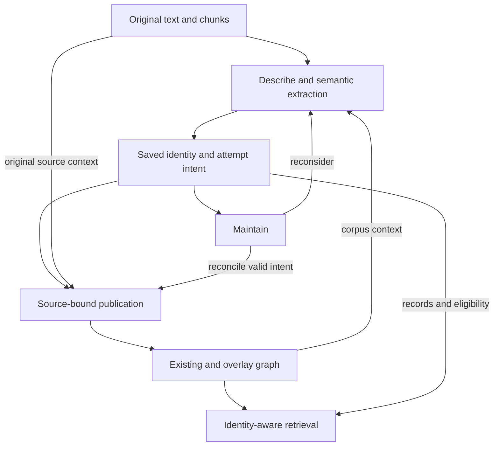

# Cognee identity integration — Stage-6 implementation handoff

**Consolidated:** 2026-10-15 (America/Detroit).  
**Baseline:** Cognee 1.6.2, commit `ba3631f2ed363a6ea50d649c34c56885af6b36fe`; Ladybug/LanceDB/SQLite, shared physical storage.  
**Status:** handoff review completed 2026-10-17. The first deterministic implementation slice now has native fixture evidence (section 12); full lifecycle, standard entry-point integration and broader retrieval remain in progress.

## 1. Authority, scope and first build

R1–R6 in [cognee_stage5_4_5_requirements_review.md](cognee_stage5_4_5_requirements_review.md) remain the outcome requirements. [The representation proposal](cognee_stage5_4_5_identity_representation_proposal.md) records approved choices and their rationale; later explicit supersessions govern older discussion. The extension reference records pinned native seams and limits. This handoff provides one current implementation view rather than another requirements list.

| Target | Initial boundary |
|---|---|
| Environment | Local Python; Ladybug/LanceDB/SQLite is the initial integration-test configuration, not an implementation dependency |
| Source processing | Local Python, ordinary text STANDARD route, project Tasks |
| Native entry points | Cognify/standard Remember and project-model full-rebuild Update through the proposed B Task-transform seam |
| Lifecycle | Overlapping ingest, selected document maintenance, original/generated source removal and dataset cleanup |
| Retrieval | Registered project Retriever/SearchType, native public request envelope |
| Maintenance selection | Original documents mapped to generated identity sources; no caller-facing per-assignment/fragment selection |
| Optional native stages/backends/transport | Admit only after checking their actual mutations and consumed stores; remote callables and native incremental Update are not initial project paths |

For the smallest runnable profile, use captured deterministic decisions, no answer-cache reuse/feedback application, and explicit consumed-collection selection. Triplet vectors are not admitted merely because a diagnostic collection exists: either exclude them from every enabled collection-discovery path or implement/verify their lifecycle before using them. The runtime profile was accepted on 2026-10-17 subject to the interface-only implementation boundary below. Do not invoke Improve/Memify automatically initially; admit specific maintenance paths only after checking mutations and consumed-store behavior. These are reversible first-build choices, not changes to conditional R5/R6.

### Backend portability — agreed 2026-10-17

Integration code must use Cognee's configured graph/vector engine factories and their interfaces, plus its configured relational engine/session layer. Ladybug, LanceDB and SQLite identify the first tested configuration only. Do not construct/import concrete graph/vector adapters, call their clients, issue backend-specific graph/SQL queries, depend on storage-file layouts or branch domain logic on backend names. Obtain logical collection operations through the vector interface; runtime discovery/configuration is not permission to inspect LanceDB internals.

The project ledger and recovery-event storage follow the same rule: use backend-neutral relational models/operations through Cognee's configured SQLAlchemy/session facilities, behind a small project bookkeeping boundary. Do not open a separate SQLite database or use sqlite3, PRAGMAs, SQLite-only SQL/types, dialect-specific migrations or file locks as the database concurrency mechanism. Expected-revision and writer coordination must use a defined portable mechanism; do not assume a lock/transaction behavior is shared merely because all adapters expose a common method.

Use interface capabilities for provenance attachment/removal, shared edge properties, index writes/deletes and lookup. An interface method may be unsupported by a particular adapter; preflight required capabilities, fail clearly for an unsupported path and record gaps rather than bypassing the interface. No backend-specific implementation is authorized by this test profile. Test the initial real configuration without claiming untested adapters have equivalent behavior. This boundary supersedes earlier wording tying project bookkeeping or integration mechanics to a particular backend.

### Architecture at the integration boundary



The saved identity description and minimal publication change plan are different artifacts inside the saved-intent box. Complete semantic-output capture and stepwise replay are deferred for the initial implementation (section 6). Publication dispatches original facts/markers and generated-source contributions under different real owners; the graph box does not imply one ownership context.

## 2. Physical model and identity rules

- All reusable forms and local mention groups are ordinary Entity nodes. No authoritative entity_role field or privileged canonical member.
- A singleton is outside the applicable variant group and is not a marked mention. Groups follow applicable connectivity; there is no permanent group ID.
- Physical resolves_to edges are directed. Variant interpretation is bidirectional/transitive under one applicable context; mention interpretation is directional and occurrence-scoped.
- A reusable Entity is not also a mention. Distinct same-text bindings have different explicit UUIDs. Initially group references within paragraphs; groups may cross physical chunks.
- Exact occurrences are sorted nonempty/nonoverlapping Unicode code-point [start,end) ranges into checked extracted document text. Context passages are separate from group membership.
- Identity assignments live in one generated registered JSON Data item per original document initially. No required generated identity prose, chunks or graph support node per assignment.

### Graph and ownership matrix

| Object/relationship | Content authority / provenance | Native retention and write rule |
|---|---|---|
| Original text/chunks | Original Data and native processed text | Native original-source lifecycle; validate versioned document/chunk mappings |
| Generated identity TextDocument | Registered identity Data | Publish under its real source context; it is not the mention-marker anchor |
| Required reusable/mention Entity | Exact UUID and minimal saved construction recipe; ordinary fields are not identity authority | Generated identity source intentionally retains required endpoints; original producing chunks may independently own them. Existing nodes bypass ordinary-field writes |
| C -> M has_identity_mention | Original occurrence group and checked ranges | Original occurrence-covering chunk C owns marker; context-only chunks do not |
| Entity -> Entity resolves_to | Saved accepted assignments | Generated identity sources own their contributions/edges; aggregate surviving contribution payloads |
| Ordinary semantic fact, including M -> D | Original producing passage/chunk; current binding used for extraction | Preserve native chunk ownership, contains/production bookkeeping, edge evidence and indexing. Do not transfer fact ownership to identity Data |

Physical edge identity is source UUID + relationship name + target UUID. Native property upsert replaces ordinary properties; owners accumulate separately. Store resolution_kind and a contribution collection on shared identity edges; each contribution identifies assignment, generated source and applicability. This application aggregation is not automatically required for ordinary semantic facts.

### Operational invariants and checks

| Invariant | Required observable result | Planned checks |
|---|---|---|
| I01 | Original locators are bound to checked text; source evidence and generated ownership remain distinct | T01, T03, T07, T20 |
| I02 | Identity authority survives ordinary Entity upserts; existing endpoint fields are not rewritten merely to reference/retain them | T02, T06 |
| I03 | Shared edge applicability reflects surviving assignments, not merely native owner survival | T04, T09 |
| I04 | Stable captured records replay exact IDs; source continuity, split and retirement follow explicit rules | T06–T08, T19 |
| I05 | Unresolved mentions retain classification; scoped mentions never become global aliases/equivalence bridges | T13, T15 |
| I06 | Known invalid inputs or failed publication cannot supply current identity interpretation | T03, T09, T15 |
| I07 | Every enabled consumed store returns intended current content/IDs or is withheld | T05, T09, T11, T20 |
| I08 | Identity work is bounded separately from semantic depth; partial identity traversal proves no absence/disconnection | T12, T15 |
| I09 | Repeated artifacts consume no duplicate result slots; distinct statements preserve original provenance and local bindings | T14 |
| I10 | One annotation contract drives output modes; scientific correctness is not inferred from identity acceptance | T15, T16 |
| I11 | Enabled QA reuse/feedback application obey conditional R6 and the relevant writer checks | T18 |

These consolidate selected behavior; they do not add a universal SDK contract or require all optional stages to be enabled.

## 3. Saved forms: implementation draft

[cognee_identity_source_schema_draft.json](cognee_identity_source_schema_draft.json) and [cognee_identity_source_example.json](cognee_identity_source_example.json) make the selected concepts concrete. Field names, the draft version tag, input-kind enumeration and configuration spelling are draft implementation choices, not additional approved semantic requirements or an existing Cognee model.

| Draft field | Purpose |
|---|---|
| kind/schema_version | Explicit identity-source discriminator and serialization version; validate registered source identity, not just a filename suffix |
| dataset_id/identity_data_id/revision | Registered generated source identity and guarded description revision |
| original_input_ref | Reference to the original source-text entry in the shared manifest |
| inputs | Shared source-text, exact chunk/span and supplied corpus-object/saved-record references/fingerprints |
| producers | Shared rule/model/fixture implementation and configuration provenance |
| entity_constructions | Explicit declaration of Entities this source intends to retain, keyed by exact UUID, with minimal creation name/description; includes required endpoints and supported singletons, even when already present |
| mention_groups | Stable record key, explicit M UUID, checked document/ranges, original chunk locators and actual supplied input references |
| mention_resolutions | Stable assignment key, group reference, accepted/unresolved/ambiguous decision, accepted target or separately labeled candidates, inputs/producer |
| variant_assignments | Stable assignment key, exact reusable endpoints, explicit applicability, inputs/producer; initial published assignments are accepted |

Source identity/revision are inherited by records; inputs/producers are referenced rather than copied into every record. The group reference defines mention occurrence applicability; do not duplicate its ranges in the resolution record. A variant carries its own explicit corpus/document/text-span applicability. Generated-source ownership is not an implicit document applicability restriction.

The example's synthetic original input is:

```text
Helios controller (HC) regulates plasma heating. The controller adjusts coil current; it limits oscillations.
```

The exact fixture text includes a trailing newline. A is an existing reusable controller, V is HC, and M groups The controller and it. Recipes cover A/V/M even though A exists. Expected identity output is one original-chunk marker to M, one mention resolution M -> A and one document-applicable variant V -> A. Domain facts still come from semantic extraction of original text, not from creating these identity edges.

Reviewed organization: mention_groups is a map of local reference-group records containing exact text occurrences; mention_resolutions references a group and exact target Entity UUID. Variant assignments are the relationships independently established by this source, not a cached walk or copy of existing identity-group structure. Reusing a corpus identity does not copy its variant edges into local assignments. Store supplied corpus context as inputs where needed. New graph connectivity alone does not require rewriting every old mention.

### Mention locations and chunk mapping — agreed 2026-10-17

Mention-group occurrences use Unicode code-point [start,end) positions into the complete, exact extracted document text identified by document_ref and its fingerprint, not chunk-local positions or byte offsets. The stored occurrence text must equal that document slice. has_identity_mention is the integration's original-DocumentChunk-to-mention-Entity edge, not an additional node or native identity feature. It supplies graph classification/location even when unresolved; accepted identity is represented separately by resolves_to. Only occurrence-covering chunks own markers; context-only chunks do not. Valid rechunking can replace marker edges without replacing group/M UUIDs.

Initially use the standard nonoverlapping TextChunker. Native DocumentChunk carries document references, chunk_index, text and a content hash, but no persisted document start/end fields. Reuse cognee.modules.chunking.incremental_chunking.chunk_offsets on the exact checked document string and actual chunk texts ordered by chunk_index. It calculates cumulative Python-string offsets while checking every chunk matches the expected slice and the entire document is covered; it does not locate repeated text with a first-match search. Associate each returned range with the actual chunk UUID and store validated ranges in the shared chunk inputs already present in the draft schema. This reuse does not admit native incremental Update as a project path.

Recompute/validate the mapping after text changes or rechunking. Before publishing markers, verify chunk/document identities and that referenced chunks cover the listed occurrences under that text version. Overlapping or text-transforming chunkers require explicit construction-time offsets or another validated mapping adapter and are initially unsupported. Do not silently recover mapping failure through ambiguous substring matching. Fixture coverage must include repeated equal chunks, Unicode, preserved whitespace/newlines, shifted positions, changed boundaries, cross-boundary groups/occurrences, stale chunk IDs and failure to reconstruct the checked document. This contract is source-inspected design; actual pipeline text/chunk agreement still needs integration verification.

### Assignment cardinality and variant density — reviewed 2026-10-17

Retain one current mention-resolution record per group within a source, with accepted/unresolved/ambiguous saved state, a target only when accepted, actual input_refs/producer_ref and optional concise explanation. Candidate UUIDs are not accepted links or implicit creation intent. Resolution applicability comes from the group; publication unavailability remains ledger state. Retargeting preserves the continuing assignment ID and replaces only its contribution; other valid sources survive.

This cardinality does not impose one outgoing variant link per Entity. A variant can participate in multiple independently established relationships, each with its own source/contribution and applicability. Store those declared relationships rather than generating every pairwise edge implied by transitive traversal. No initial spanning-tree, one-parent or hard density constraint is selected. Cycles/redundant paths alone do not establish an invalid identity structure. Removing apparently redundant edges can lose source-specific support or change connectivity under another context or after withdrawal, so any later sparsification needs to preserve those meanings and lifecycle behavior explicitly.

Keep density/cost visible through the future size report and planned offline identity diagnostics. For each evaluated identity group/context, record member count, applicable physical variant-edge count, distinct unordered endpoint-pair count (for bidirectional logical interpretation), degree distribution and contribution count, together with actual expansion work and identity-limit hits. Distinguish structural redundancy from independently justified contributions sharing one edge. Large group size alone is not evidence that density caused a limit; record both. Reuse shared traversal predicates/counters, report the evaluated context and incomplete coverage, and do not infer complete group size/density from a truncated traversal. These are future diagnostic measurements, not retrieval-time pruning, automatic graph rewriting or an initial runtime gate.

### Construction and publication checks — agreed 2026-10-17

Each entity_constructions entry declares an Entity this source intends to retain; it is not an inert historical recipe. Mention groups require their M UUIDs, accepted mention resolutions additionally require their target UUIDs, and accepted variants require both endpoints. Every required endpoint must have an entry. A supported singleton can have an entry without a resolution edge. Candidate IDs alone do not authorize creation or retention. Maintenance removes a declaration when this source withdraws its support and no remaining local intent requires it.

Publish validates intent, inspects existing objects, compiles explicit create/reference/withdraw actions, executes them and verifies the result. These are programmatic checks; Publish does not make a fresh identity judgment. Existing node compatibility means the exact UUID denotes an ordinary Entity and its intended use is consistent with current group/assignment declarations and the operation's retirement/replacement plan. Build the initial UUID-to-use view by scanning saved descriptions, including the selected intended revision. Reject mention/reusable dual use, a mention UUID belonging to an incompatible group, or a conflicting stored node type. Missing/contradictory classification is not permission to guess. No new permanent role registry is required.

Existing names/descriptions need not match recipe values. Reference and deliberately retain compatible existing nodes without writing their ordinary fields. If Describe actually consumed changed node fields, that is a separate dependency-validity failure, not a representation-type failure. Validate source registration, expected saved revision/attempt, current original text and exact ranges/chunk mappings, actual supplied input identities/fingerprints and explicit withdrawal intent. The publishing attempt's own pending ledger state permits that attempt to proceed; retrieval still excludes its unfinished result.

Distinguish missing output from missing reasoning input. A new output, or a gap explicitly covered by a validated captured rebuild/publication plan, can be created with the exact UUID and recipe when the required inputs/intent remain valid. If an existing corpus Entity used as a reasoning input later disappears outside that expected plan, a recipe plus its old fingerprint does not establish continued validity; the digest does not contain the consumed values. Initially leave saved-intent reconciliation unavailable and select the document for reconsideration. Independent reconstruction beyond captured plans needs an explicit future dependency/capture policy. Graph absence alone establishes neither deliberate retirement nor permission to restore. An explicit retirement/replacement plan prevents stale restoration without banning a separately current source's valid independent support.

The current schema supplies much of the input/recipe data, but recipe validation, UUID-use compilation, dependency checks, operation capture, coordinated writer protection and final verification are project implementation work. Native node lookup and source-reference attachment are primitives, not implementations of these domain checks. Unsupported independent mutations are not made safe by a check-before-write alone.

### Producer bookkeeping — agreed 2026-10-17

Use the minimal shared producers structure initially. Each record's producer_ref identifies one source-level entry with method (rules, llm, decision_model or captured_fixture), implementation, version and relevant configuration; run_id is optional. Configuration records the settings used to produce the decision, such as requested model, prompt-template version and parameters, or rule/context policy. The implementation version is distinct from the schema version and saved-description revision.

A run_id identifies a Describe execution, not a publication attempt. Retrying captured publication preserves its producer information and gets a new ledger attempt. Share producer entries rather than copying their configuration into every record. This does not require a model registry or permanent archive of every prompt.

### Fingerprint contract — agreed 2026-10-17

A fingerprint is SHA-256 of explicitly defined bytes, stored as 64 lowercase hexadecimal characters. It is a content-change detector, not an embedding, Entity identifier or semantic-equivalence judgment. The draft schema version defines these hashing rules; a later change to the rules requires an explicit format-version change.

| Input | Exact hash input |
|---|---|
| source_text | UTF-8 encoding of the complete extracted document string used by the pipeline |
| text_span | UTF-8 encoding of document_text[start:end] under the checked source version |
| corpus_object | RFC 8785 JCS canonical UTF-8 encoding of the object containing selected field names and their supplied values |
| saved_record | JCS canonical UTF-8 encoding of the complete record content supplied to Describe, excluding the enclosing source envelope/revision |
| chunk | Currently a locator without an independent digest; represent text supplied for reasoning through a hashed text input |

At text hashing, preserve whitespace, case, punctuation, newlines and Unicode without trimming, normalization or appending a newline. Any ingestion conversion precedes hashing; offsets and text digests use that same extracted string. source.txt has one trailing LF and its 110 UTF-8 bytes hash to 7c21fbfdd7e16f28cace089933071c5c280b42dc7a346cd23c523f1c6d8dd4d5.

For structured content use the [RFC 8785 JSON Canonicalization Scheme](https://www.rfc-editor.org/rfc/rfc8785), not arbitrary JSON pretty-printing or an assumed equivalent Python serializer. JCS preserves array order and string content and gives deterministic object/number serialization. Use a conformant routine rather than implementing a new canonicalizer. Reject unsupported/nonfinite values or serialize them explicitly under a declared typed input contract; do not silently coerce values or lose precision. Current example selected fields are strings.

For a corpus_object, construct exactly {field: supplied_value} for selected_fields. A missing selected field is an input validation error, distinct from explicitly supplied null. Metadata not selected/supplied is excluded. A saved-record projection needs an explicitly described projection input; do not claim that a full-record hash describes only selected fields. Generated inventories/context need their actual supplied text/structured payload signature once represented; the whole document fingerprint alone is insufficient.

A text-span hash excludes offsets and the parent's document digest, which remain locator/version metadata. After a validated prefix-edit rebase, the document digest and offsets can change while selected passage content remains equal. Compare only corresponding input identities/projections after validated remapping; identical hashes from different sources do not make them interchangeable inputs. Also compare actual input membership/order where meaningful and relevant processing configuration. A changed digest selects maintenance work; it does not prove a changed meaning.

The existing example's text digest and selected A-field digest were rechecked against these definitions and match. General JCS conformance and native runtime integration are implementation tests, not results supplied by that ASCII string-only check.

### Checks beyond JSON Schema

Before publication, validate cross-reference existence, exact source text/fingerprints and slices, sorted disjoint ranges, chunk coverage, global mention/reusable distinction, exact UUID compatibility, permitted construction, one current resolution per group and matching input validity. Never infer offsets from the first matching repeated substring. Query-scoped candidate/graph-context input adapters must record the actual supplied material and its selection policy; extend the draft input forms explicitly if the first fixture needs a richer context representation.

The normal corpus-backed schema includes endpoint recipes. An explicitly external reference-only dependency needs a deliberately validated extension/adapter; an old recipe does not authorize resurrecting a retired object. Unresolved/candidate interpretations publish no accepted resolution edge. Withdrawing a resolution is different from retiring its group. Publication pending/failed is ledger state, not a new saved identity decision value.

### Continuity rules to implement

| Change | Identity treatment |
|---|---|
| Validated offset shift, rechunking or same-binding edit | Preserve group/M IDs; rebase versioned ranges and compare supplied interpretation inputs |
| Whole-group retarget | Preserve group and assignment IDs; replace its contribution |
| Partial membership addition/removal | Preserve continuing valid group; retire it if empty |
| Split or explicit combination | Fresh IDs for every resulting group; retire predecessors; do not copy all old facts onto every result |
| Reusable variant assignment scope/endpoint correction | Preserve that stored decision ID; replace only its contribution/physical edge as needed |
| Independent source support | Separate assignment; preserve other sources on withdrawal |
| Mention/reusable representation change | Separate suitable Entity and kind-specific assignment; never silently promote M in place |

Substantive changed bindings/regrouping refresh affected semantic extraction from original text. Harmless range shifts do not alone require fresh model calls. The accepted document-level fallback avoids first implementing optimal partial refresh.

## 4. Commands and shared storage boundary

The following are responsibilities, not final function names:

| Interface | Required behavior |
|---|---|
| Read description | Return current source description/revision |
| Guarded apply/replace | Validate supplied intent, expected revision and explicit retirement; preserve unrelated records; return changed/retired IDs/publication keys |
| Reconcile selected documents | Map originals to generated sources; apply valid saved intent with no new Describe call |
| Reconsider selected documents | Run Describe/document processing with current corpus context and existing continuity; save captured intent; publish through the same reconciler |
| Retrieve | Ordinary query/dataset/native controls using project Retriever; internally resolve IDs/context and apply the selected rules |
| Diagnose identity graph | Explicit/offline scan using the same eligibility/traversal/counters; report limit hits and coverage; optional post-update invocation, no automatic repair |

Caller selection remains whole documents, even though internal storage updates and contribution cleanup are record-aware. Code/Tasks/operators can invoke these operations; explicit selection is not an approval requirement.

## 5. Execution sequence and native integration

1. Preflight source identity, registered generated source, supported route and consumed-store profile. Read prior description and data needed to plan retirement/remapping before destructive native operations.
2. Find known affected/dependent sources by scanning saved input references/selection information. Mark them pending before the supported mutation; preserve independently valid sources.
3. Prepare original text/chunks and document-level identity state. Describe produces exact bindings. Identity-aware semantic extraction/conversion uses original text plus those bindings before final persistence.
4. Capture validated intent and necessary retirement/retry data durably before the destructive writes they must recover from. Guard-save the intended description; reconcile original-source markers/facts and generated-source identity contributions in their real source contexts.
5. Verify intended graph, owner refs, source evidence and every active consumed index; verify obsolete contributions/locators are removed or unavailable.
6. Acknowledge only the matching saved revision, attempt and valid inputs. Leave incomplete attempts unavailable, record recovery-required incidents, and use explicit selected-document recovery. Reconcile valid saved identity intent without a new identity judgment; use explicitly labeled reconsideration/rebuild when uncaptured semantic output or invalid inputs require regeneration.

The proposed B patch transforms STANDARD tasks after native task construction and before route/needs_llm calculation. Preserve native Cognify pipeline name, runtime setup and result behavior. Forward through standard Remember and force/pass through full-rebuild Update. Reject unsupported callable transport/dry-run/nonstandard combinations explicitly. The patch is still unimplemented.

Source-bound custom Tasks publish the JSON directly; calculate_chunk_graphs is an optional chunk-computation seam, not a prerequisite. Identity-aware conversion must map keys to exact saved UUIDs: generic model-local extraction IDs do not guarantee exact stored IDs. Existing nested DataPoints must not accidentally enter the property-write set. Preserve native per-chunk production/evidence bookkeeping even for a fact edge already in the graph.

## 6. Initial failure handling and recovery visibility — revised 2026-10-17

This scope adjustment supersedes earlier first-build proposals for complete semantic capture and exact step-by-step replay. Keep guarded saved JSON, a publication ledger, source-aware writes/withdrawal, a minimal durable change plan and final verification. Defer automatic continuation from arbitrary intermediate writes, comprehensive semantic-output capture and automatic recovery orchestration. Preserve interfaces that allow later extension; no general replay framework or A/B copy is a prerequisite.

The ledger remains the sole publication-eligibility authority, keyed by dataset + generated Data ID: pending/current/failed/withdrawn, intended revision, verified published revision, attempt token and diagnostics. Mark pending before mutations; acknowledge only the matching verified revision/attempt. Withdrawn records retain their description/revision for inspection but supply no active identity interpretation. A failure or an incomplete attempt detected after restart remains unavailable until explicitly handled. Event history below is diagnostic, not a second currentness registry.

The minimal durable change plan identifies the source/revisions/attempt, old and intended marker/edge/contribution keys, Entity declarations and withdrawal intent needed after a saved-record change or native removal. Preserve needed information before destructive operations; do not reconstruct retirement intent from vanished graph state. Files/ledger/graph are not one transaction. Missing/incompatible plans require a diagnostic and an explicit recovery choice. Full captured semantic payloads and guaranteed reproduction of interrupted fact extraction are deferred.

Recovery selection remains whole original documents. Identity-only reconciliation reapplies still-valid saved assignments programmatically, preserving exact UUIDs, source-specific contributions and other owners. If inputs are invalid or required semantic output was not captured, explicitly select document reconsideration/rebuild, which may make new model decisions and is not exact replay of the failed attempt. Recovery must withdraw or withhold obsolete/partial source output before it can be considered current; hiding an identity contribution alone does not make stale semantic output safe. No automatic retry is implied.

### Durable recovery-event records

Record when recovery is actually required so later work is prioritized from observed frequency, causes and outcomes. Use a small recovery_events table through the same configured, backend-neutral project relational bookkeeping layer, with a simple listing/export and a recovery-event identifier in failure/status output. Its diagnostic outcomes do not override the publication ledger. This is part of initial visibility, not a monitoring service, dashboard or scheduler.

Create an event when an unexpected operation failure leaves publication incomplete/unavailable, startup/explicit status inspection discovers an abandoned pending attempt, or verification/diagnostics finds an inconsistency requiring explicit recovery. An ordinary scheduled update or preflight rejection before any affected state needs recovery is not itself a recovery incident. Mark fault-injection/test incidents explicitly so they are excluded from real-world prioritization.

| Recorded information | Purpose |
|---|---|
| recovery_event_id, dataset_id, original_data_id, identity_data_id | Locate the incident and affected source |
| failed/incomplete attempt ID, operation, intended and last verified revision | Identify what was being attempted; link the minimal change plan if present |
| first_detected_at and last_observed_at (UTC) | Track discovery and repeated observations; discovery time is not claimed to be exact crash time |
| failed stage, extensible reason_code, concise error/diagnostic reference | Separate validation, retirement, graph, reference, index, verification and acknowledgement problems; retain optional details without embedding corpus text or full payloads |
| integration version/runtime profile and origin (runtime or test/fault_injection) | Reproduce and interpret observations |
| recovery method attempted, linked recovery attempt IDs and outcomes | Distinguish saved-identity reconciliation, reconsideration/rebuild and explicit investigation; count failed recovery attempts |
| resolved_at, resolving revision/attempt, or superseding-event reference | Record verified restoration or replacement without erasing the original failure |

Upsert the same incident for repeated observations of the same source/failed attempt; restarting or listing status must not inflate the incident count. Recovery attempts link back to the incident and append their result; a new independent failure after restoration is a new incident. Close an incident as restored only after matching publication verification/acknowledgement. A superseded incident is labeled as such, not reported as a successful repair. Keep these small diagnostic records after successful temporary-plan cleanup; no permanent semantic-output archive is required.

A caught failure records the event immediately. A hard crash may prevent that write, so startup or an explicitly invoked status/recovery operation reconciles pending ledger entries into events. If recording itself fails, return/log that failure with the unavailable source/attempt and recover the diagnostic record on subsequent ledger inspection; do not silently mark publication current. No background scanner is required.

Initially show unresolved incidents and emit event IDs with failures/recovery results. Later report counts by stage/reason/version, repeated failures, recovery method success and elapsed time from detection to verified restoration, excluding test incidents. Use those observations to decide whether exact replay, additional capture or automated recovery is worth implementing.

## 7. Operation contract

| Operation | Saved identity and graph behavior | Completion/failure handling |
|---|---|---|
| New document | Describe against eligible corpus; register generated JSON; publish original markers/facts and identity contributions | Verify each source context and active stores before current |
| Overlapping ingest | Reuse exact existing UUIDs without recipe/property rewrite; add deliberate owners/contributions | Preserve independent earlier decisions and source evidence |
| Original Update | Full project rebuild initially; validate continuity/context and refresh bindings/facts; document-level fallback | Invalidate known dependents; failed/deferred ones stay unavailable |
| Original Forget | Retire original-local identity source/records and its contributions; native removal handles its actual refs | Coordinate derived-source removal; native Forget alone does not cascade to registered identity Data |
| Generated-source rebuild/removal | Withdraw its own identity contributions/retention; original chunk markers/facts remain while supported | Validate any surviving M classification and temporary endpoint gaps; repair only current valid intent |
| Reconcile saved source | Restore declared graph/refs/indexes without new Describe or ordinary-field rewrite of existing nodes | New attempt may use same revision; stale intent cannot resurrect retired endpoints |
| Explicit reconsideration | Selected documents run current Describe/semantic refresh; same continuity and guarded save path | No fine-grained caller selection or automatic corpus-wide opportunity replay |
| Dataset Forget | Coordinate original/generated source retirement and enabled store cleanup | No usable dangling refs; do not infer shared-store row isolation from dataset arguments |
| New corpus opportunity without known dependency | New document links corpus normally; older records can be explicitly selected later | Not automatic invalidation of every old record; no new retrieval freshness state |

Known invalid dependents cannot remain current simply because recomputation is deferred. Initially report affected documents and require explicit refresh; no dependency index/background scheduler is needed. Diagnostics report missing/costly structures but do not decide semantic equivalence or mutate the graph.

## 8. Retrieval and delivery contract

Keep the native public request envelope. Query resolution supplies IDs/context internally. Optional caller seeds/anchors remain future extensions. No project fact-source-filter feature is added.

1. Resolve the query before identity-based semantic expansion. Preserve ambiguity; separate intentional multi-Entity requests.
2. Traverse applicable variants bidirectionally/transitively in one context. Follow accepted mentions only in their occurrence context; reverse collection is a separate eligible-fact operation, not an equivalence bridge.
3. Identity movement consumes no semantic hops but has bounded work/contribution/mention/fact candidate checks. Track context-aware visited states and allocate work across branches.
4. Rank substantive facts/source content. Accepted identity supplies eligibility, not a path-count relevance boost or variant-length penalty. A useful fact attached to it must not be discarded solely for weak mention-name matching.
5. Deduplicate repeated physical artifacts before final selection. Group distinct variant/mention statements for presentation while preserving their entries, exact IDs/properties and original evidence. No initial semantic-predicate equivalence model.
6. Use the single annotation contract in proposal section 38: accepted/unresolved/ambiguous/unavailable for the scoped query/local reference, targets/candidates, context and any specific reason or identity-expansion limit. Accepted binding can coexist with limited expansion. An unfinished identity check cannot prove disconnection/conflict. Empty evidence is not a fifth identity state.
7. Render one compact shared meaning guide plus relevant local annotations, unless those meanings are reliably in consumer instructions. Objects, ordinary output, verbose and only_context must preserve the same meanings. Semantic depth/top_k/context caps must not be labeled identity-expansion limits.

Exclude identity helper edges from subject-matter facts. Independent passages may remain useful when binding is unknown, with attribution limits stated. Preserve unaffected evidence on partial unavailability. Native context evidence is not a historical per-source property snapshot or scientific support judgment.

## 9. Consumed-store admission matrix

Complete the concrete runtime manifest before declaring an enabled path supported. This is a bounded list for the chosen profile, not a guarantee for every Cognee store.

| Store/path | Expected contents/check | Initial treatment |
|---|---|---|
| Graph Entities/facts/identity markers/edges | Exact IDs, current contribution properties, ownership and no obsolete usable links | Required |
| Native Entity name index | Newly created/current Entities; no retired UUID returned | Required if candidate search uses it; common mention labels are not global aliases |
| Native relationship-text/EdgeType index | Intended current relation content; not one independent vector per statement by assumption | Verify when consumed; filter helper relations from semantic output |
| Original chunk text vectors | Current source text and Data/chunk locators | Required for enabled passage lane |
| Edge-evidence sidecar | Correct producing original Data/chunk/edge; no usable retired mappings | Required if source evidence lookup is enabled |
| Optional Triplet vectors | Correct endpoint text/edge coverage, same-ID content refresh and indirect-delete cleanup | Exclude from all enabled discovery initially or explicitly admit with T11; no alias-text expansion requirement |
| Answer/session caches and feedback writers | No stale reuse or unexamined mutations | Disable reuse/application in smallest profile; admission activates conditional R6 and relevant writer tests |

Verify by returned IDs/content and source refs, not collection existence, row counts, a successful Improve result or watermark alone.

## 10. Sequence-driven test suite

This is the broader planned implementation suite. Section 12 records the first implemented subset and native evidence; a passing tiny fixture does not establish all cases below.

| ID | Sequence and expected observation | Requirements | Reusable lesson |
|---|---|---|---|
| T01 | Captured example -> marker/resolutions plus a new M-anchored ordinary fact; exact UUIDs/original chunk evidence | R1–R3, R5 | G01–G05, G11 |
| T02 | Overlap references compatible existing A whose ordinary fields differ from recipe -> retain refs without overwrite; separately reject a change to fields actually consumed by Describe | R1, R2 | G02, G07, G10 |
| T03 | Two independent documents then update one; dependent variant consumes changed input -> preserve independent, invalidate dependent | R2, R4 | G06, G07 |
| T04 | Two contributions share edge; withdraw one -> surviving payload/owners remain; withdraw last -> no usable link | R1, R4 | G04, G06 |
| T05 | Rebuild/remove I while original chunks remain -> original markers/facts survive as supported | R2, R4, R5 | G05, G06 |
| T06 | Captured, expected last-owner endpoint gap then reconcile -> same UUID recreated only with valid inputs/intent; unexpected loss of a consumed corpus input selects reconsideration; same revision/new attempt where valid | R1, R2, R4 | G07–G10 |
| T07 | Prefix edit/rechunk -> valid ID continuity and rebased exact spans; changed antecedent -> reconsider/refreshed facts | R2–R4 | G01, G07 |
| T08 | Group partial edit/split/combination/representation correction -> selected fresh/retained IDs, no copied-all facts | R1–R4 | G01, G09 |
| T09 | Fail at main save/write/verification/acknowledgement boundaries -> unavailable partial result, durable recovery event, explicit selected recovery and stale-attempt rejection; detailed stepwise replay deferred | R1, R4, R5 | G08, G09 |
| T10 | Native Cognify/Remember/full Update with transform; no-transform control; unsupported routes/callable transport rejected | R1, R4, R5 | G03, G06 |
| T11 | Same-ID indexed text change, new edge and endpoint-induced deletion -> every admitted store returns intended current IDs/content | R5 | G14 |
| T12 | Long chain from several seeds, dense/cyclic variants, mention/contribution fan-out -> limits/visited handling match offline diagnostics | R3, R5 | G11, G15 |
| T13 | Same-text different M UUIDs; incompatible scoped paths; unresolved marker -> correct local binding, no equivalence bridge | R1–R3 | G01, G11 |
| T14 | Several alias paths to one artifact; separate variant/mention statements -> artifact once, separate evidence/interpretations | R3, R5 | G05, G13 |
| T15 | Four effective states, pending survivor, empty evidence, accepted+identity-limit and unfinished check -> consistent object/ordinary/verbose/only_context delivery | R3–R5 | G08, G12 |
| T16 | Representative model consumers receive annotated context -> interpretation accuracy and annotation/evidence token share | R3 | G12, G18; tuning study, not initial runtime gate |
| T17 | Seeded Describe covers names/initials/definitions/shortenings/context-only references; repeated/edited inputs assessed separately | R2–R4 | G07, G18; quality study separate from captured tests |
| T18 | Default cache reuse/application off; if enabled later, change/delete used source -> stale QA/vector excluded; feedback writer checked | Conditional R6, R1–R5 | G14, G18 |
| T19 | Explicit document reconsideration after new corpus opportunity -> no earlier dependency invented; preserve continuity and revise captured intent intentionally | R2–R4 | G07, G09, G16 |
| T20 | Original and dataset Forget -> coordinated generated-source retirement, shared-owner survival, graph/vector/evidence eligibility | R2, R4, R5; R6 if enabled | G05, G06, G14 |

Every case should retain fixture, initiating operation, expected saved records, graph/refs, active stores, delivery eligibility and failure/replay observations. Requirements coverage is explicit; shared-code unit checks do not replace real backend fixtures.

### Publication and construction edge-case matrix

The following planned subcases elaborate T01–T09, T13, T19 and T20; they are not additional high-level requirements or completed tests. Build deterministic captured fixtures first so publication assertions do not depend on LLM variability. Cover meaningful interactions, not just isolated happy paths.

| Case | Setup/operation | Required observation |
|---|---|---|
| P01 | Existing exact UUID, different recipe name/description, unchanged actual reasoning inputs | Attach intended owner refs; ordinary properties unchanged; no duplicate Entity |
| P02 | Existing exact UUID, changed field that Describe actually consumed | Dependency failure before publication; source unavailable until selected reconsideration; no recipe overwrite |
| P03 | Exact UUID denotes a non-Entity | Explicit incompatibility; no conversion or overwrite |
| P04 | UUID declared as both reusable and mention, or by incompatible mention groups | Reject inconsistent intent; graph corruption is not used to guess a role |
| P05 | New output absent, source inputs valid | Create exact UUID with minimal recipe; expected ownership, marker/edges and consumed indexes |
| P06 | Missing recipe for required M, accepted target or variant endpoint | Validation failure before writes; parameterize each endpoint position |
| P07 | Singleton declaration with no identity edge; then withdraw only that source's declaration | Retain/create singleton; withdrawal removes only its support, preserving independent owners |
| P08 | Unresolved/ambiguous decision lists candidate IDs but no independent declaration supports them | No accepted edge and no creation/retention solely from candidates |
| P09 | Expected missing identity output covered by a valid minimal plan; explicit same-revision reconciliation | Recreate intended exact UUID without new identity judgment; repeated reconciliation does not duplicate owners/contributions; uncaptured semantic regeneration is labeled reconsideration |
| P10 | Previously consumed corpus input unexpectedly missing | Old hash/recipe does not authorize reconstruction; select reconsideration and exclude stale interpretation |
| P11 | Original source removed/changed, stale saved revision, or explicit record/UUID replacement | Reject stale intent; no resurrection; valid independent source remains supported |
| P12 | Ordinary node field change, text-prefix edit, occurrence-content edit and rechunking | Distinguish dependency changes from compatible properties and validated locator rebases; refreshed bindings/facts only where required by policy |
| P13 | Two independently valid sources retain A; update/remove either first, then the last | Both operation orders preserve remaining support; no donor document's removal silently discards the other's required Entity |
| P14 | Publishing attempt is pending; stale acknowledgement, concurrent supported revision change or restart | Own pending attempt can execute; retrieval withholds it; revision/attempt guards reject stale completion |
| P15 | Inject failure at main plan/save/write/verification/acknowledgement boundaries initially; expand later | Durable incident and unavailable partial result; explicit reconcile or reconsideration; no promise of exact semantic replay; repeated inspection does not duplicate events |
| P16 | Missing/corrupt minimal plan, abandoned pending attempt or contradictory marker/classification state | Recovery event and unavailable result; no silent model call; record explicit method and verified outcome; distinguish test incidents and diagnostic-write failures |

Use a small set of fixtures parameterized across mention/reusable/singleton roles, present/missing/conflicting nodes, unchanged/changed/missing dependencies, one/multiple owners and first publication/retry/rebuild/withdrawal. Expand meaningful combinations, especially missing corpus input plus surviving source support and failure during retirement. Do not promise exhaustive Cartesian coverage. Every discovered implementation defect gets a regression fixture.

Assertions cover saved revisions/records, exact graph IDs and untouched properties, source refs and contribution payloads, active indexes, retrieval eligibility and diagnostics. Use pure validation/planning tests for combinatorial coverage and representative real Ladybug/LanceDB sequences for persistence, ownership and restart behavior; a mocked graph does not establish native compatibility. Build these alongside M0–M4 rather than requiring the entire suite before the first end-to-end fixture. Keep Describe quality/nondeterminism evaluation separate (T17).

## 11. Build order and unresolved engineering work

Build order accepted 2026-10-17; the first reviewable deliverable covers M0–M1. Implement relevant sequence tests alongside each step rather than making the entire inventory an upfront gate.

| Milestone / accepted step | Concrete output and current boundary |
|---|---|
| M0 / 1 | Validated runtime records/schema, exact native chunk mapping and portable bookkeeping/publication capability checks. First implementation exists; only the initial backend profile is tested |
| M1 / 2 | Tiny captured-decision custom Task pipeline -> real publication -> useful mention-anchored fact retrieval/original evidence -> explicit identity reconciliation. First native fixture demonstrated; this is not registered public SearchType or standard Cognify wiring |
| M2 / 3 | Multi-source overlap/support and withdrawal, plus broader exact-ID semantic conversion. Test both removal orders, shared contributions, singleton retention and unresolved mentions |
| M3 / 4 | Selected document changes, dependent-input maintenance, rechunking, retargeting and explicit failure recovery. Basic ledger/events and caught-failure reconciliation exist; broad lifecycle and abrupt-crash recovery remain |
| M4 / 5 | Complete B Task-transform wiring for standard Cognify/Remember/full Update/removal, consumed-store admission and broader context-sensitive traversal/delivery/offline diagnostics |
| M5 / 6 | Seeded rules/model Describe examples through the same pipeline, including abbreviations, shortenings and contextual references; separate consistency/model-quality evaluation |
| Checkpoint | Review R1–R6 evidence and G01–G18 transfer status before Stages 7–8 |

Resolve these engineering details during the smallest fixtures, without opening another broad policy review: exact Data registration/discriminator routing; safe existing-endpoint conversion; serialized writer/expected-revision and file/ledger ordering; attempt cleanup; concrete admitted collection names/configuration; shared edge-property serialization through the graph interface (first tested on Ladybug); source-bound marker publication and chunk-offset mappings. If a fixture contradicts a selected invariant, record the mismatch and make the smallest explicit adaptation rather than silently weaken it.

Automatic opportunity selection, autonomous repair, per-fragment caller APIs, native incremental compatibility, whole-store A/B staging, comprehensive semantic-output capture/exact stepwise replay, permanent semantic-output archives, all-alias Triplet text, universal ontology/scope frameworks and scientific support reasoning remain deferred. A/B is optional if its measured complexity proves worthwhile.

### Future size measurement tooling — noted 2026-10-17

Plan a small programmatic report/export tool to track representation overhead as real examples accumulate. This is future evaluation work, not a first-implementation gate or a new monitoring subsystem. Report:

- Saved-description serialized UTF-8 bytes and counts by document/source and section: inputs, producers, entity_constructions, mention_groups/occurrences, mention_resolutions and variant_assignments. Include reference reuse, such as records per producer/input, to reveal duplication.
- Graph Entity/mention counts, marker and resolution-edge counts, and contributions per edge. Include context-specific variant-group size/density/degree and measured identity-expansion cost as described in the assignment-cardinality section; reuse offline diagnostics rather than implementing another traversal.
- Minimal change-plan count/bytes and retained failure artifacts; add semantic-capture metrics only if that feature is later introduced. Track small recovery-event history separately and distinguish runtime incidents from injected test failures.

Show corpus totals, per-source median/p95/maximum and growth relative to source-text size or occurrence count, so a larger corpus is distinguishable from increased representation overhead. Reuse the planned retrieval study's identity-annotation token share versus substantive evidence (T16) rather than defining another token-accounting mechanism. Use measurements to decide whether sharing, grouping or cleanup needs adjustment; do not invent hard size limits or automatic compaction before observing actual costs. Carry this measurement pattern into other integrations through the playbook.

## 12. Reuse and evidence status

[cognee_knowledge_integration_playbook.md](cognee_knowledge_integration_playbook.md) maps the concrete choices to reusable lessons with Describe/Publish/Maintain/Retrieve applicability and measurement transfer questions. During Stage 6, attach actual source/test results to that register. Extract only demonstrated common mechanics; leave identity grouping/equivalence/range rules in its adapter.

At the initial 2026-10-15 consolidation, validation performed was: generated a draft JSON Schema from Pydantic models; validated the example through those models and JSON round-trip; checked source SHA-256/exact occurrence slices; rejected six malformed examples (missing accepted target, unresolved with accepted target, absent endpoint recipe, missing group, overlapping spans and competing current group records). Cross-record/source checks are not all expressible in JSON Schema. At that point a separate JSON-Schema-engine validation and native Cognee execution had not been run and no repository implementation had been changed. The following checkpoint supersedes that implementation status.

### First implementation checkpoint — 2026-10-17

Repository code now lives in src/cognee_lab/identity, with a generated schema in schemas, exact source/example fixtures in tests/fixtures/identity and commands/limits documented in docs/stage6_identity_first_slice.md. The initial source is registered as a real Cognee Data item; publication uses real source contexts and configured interfaces. Bookkeeping stores the serialized JSON/currentness/minimal plan in backend-neutral relational project tables; the first registered generated source contains its matching JSON snapshot. Revision replacement is refused until a coordinated source-update path is implemented.

The first fixture preserves a borrowed Entity's differing ordinary fields/sentinel, creates the exact variant/M UUIDs, publishes chunk-owned mention markers and a mention-anchored limits->oscillations fact, and returns original native evidence plus the accepted scoped identity annotation. Retrieval demonstrably seeds HC, follows its document-applicable variant link and then the accepted local mention. A fresh process can reopen the stores and explicit same-revision reconciliation is idempotent.

Validation evidence: 22 pytest cases passed, including real configured Ladybug/LanceDB/SQLite subprocess fixtures with local deterministic embeddings, injected-failure withholding/reconciliation, changed consumed-field invalidation with a recovery event, portable ledger/revision guards, failed-recovery incident deduplication, strict forms, exact repeated Unicode positions, RFC 8785 hashing and JSON-Schema-engine validation. No paid model/API extraction or lab-corpus mutation was used. No native dependency source was modified. These are fixture results, not complete T01–T20/P01–P16 coverage or demonstrated compatibility with other backends.

A native interface mismatch was observed: legacy get_edges returns a shape/direction that differs from its interface annotation on this path. The project uses get_edge_delete_data for exact edge/provenance properties and iter_bounded_neighborhood for uniform EdgeData, without backend-specific queries. Record this as a reusable seam lesson; actual work bounds still depend on the configured adapter's implementation.

At this first checkpoint, limits included revision replacement/withdrawal lifecycle, standard entry-point transform and public SearchType. The following multi-source checkpoint supersedes withdrawal status. Document-context retrieval remains fixture-scoped and declines span-applicable variant expansion; complete multi-source traversal, unresolved/ambiguous passage delivery and offline diagnostics remain. A hard crash can still leave the writer reserved: pending-attempt inspection/explicit abandonment is later recovery work. Comprehensive semantic capture/replay, autonomous repair, A/B staging and metrics tooling remain deferred.

### Multi-source withdrawal checkpoint — 2026-10-17

The two-source fixture and Publisher.withdraw implement the generated-source retirement portion of M2. Each original document has its own registered description, mention UUIDs, original-chunk-owned facts/evidence and unresolved group. Both descriptions independently retain a singleton and contribute document-scoped payloads to one shared physical variant edge. Tests exercise both retirement orders, repeated retirement, last-owner singleton/name-vector cleanup, borrowed ordinary-field preservation and original marker/fact/evidence survival.

Withdrawal captures a durable minimal retirement plan under the existing revision/writer protocol, withholds the selected source, removes its contribution payloads and delegates ownership/graph/vector removal to Cognee's UnifiedStoreEngine.delete_by_source_ref over configured engines. Other contributions and owners survive. Completion is an explicit withdrawn ledger state; registered Data and the saved description remain for history. Withdrawal does not retract original semantic output or implement native original/generated Data deletion. Caught interruptions require an explicit withdrawal retry, with the original recovery event marked withdrawn on success; publication reconciliation cannot reverse pending retirement.

One ownership correction emerged: creating a chunk-owned marker must explicitly attach that chunk's source ref to M as well. An unresolved M with no fact would otherwise be retained only by its generated identity source and could be deleted, cascading the independently owned marker. This endpoint rule is now exercised using unresolved groups without semantic facts.

Retrieval diagnostics now include already-failed/pending sources and their unresolved recovery-event identifier. Deliberately withdrawn sources are inactive rather than recovery incidents. The seed-selection correction reads candidate names through the graph interface instead of assuming a vector payload field; the first Mac fixture and caught-publication-failure recovery were independently exercised by the user. See ../docs/stage6_identity_first_slice.md for reproducible commands and current test coverage. The broader revision-replacement, original-document lifecycle, standard pipeline and general retrieval milestones remain incomplete.
