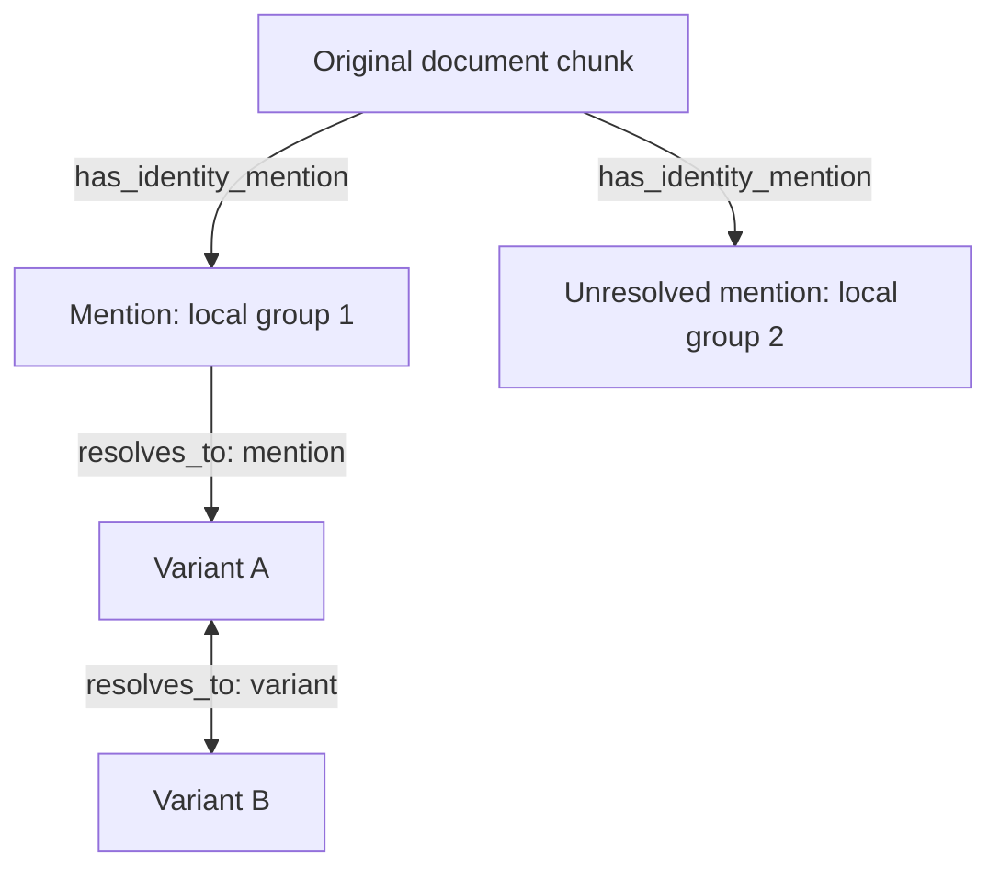

# Stage 5.4.5 — Initial identity representation proposal

**Recorded:** 2026-10-13 (America/Detroit)  
**Project:** cognee-science-lab  
**Baseline:** Cognee 1.6.2, Ladybug/LanceDB/SQLite, shared physical storage.  
**Status reconciled 2026-10-20:** decision record leading to the reviewed Stage-6 contract. Draft forms/serialization, source-bound publisher, contribution aggregation, guarded replacement/withdrawal and explicit caught-failure recovery are implemented for bounded native fixtures. Earlier dated proposals below retain rationale; they are not a current unfinished-work list. See [SESSION_HANDOFF.md](../docs/SESSION_HANDOFF.md) and the [Stage-6 contract](cognee_identity_stage6_handoff.md) for current status and supersessions.

This record supersedes the current design's earlier privileged canonical/variant model and the proposal for one graph support node per assignment. Earlier Stage-5 demonstrations remain historical evidence. The six requirements in [the requirements review](cognee_stage5_4_5_requirements_review.md) remain outcome constraints; the choices here are one proposed way to satisfy them.

## 1. Terminology and visible structure

| Term | Meaning |
|---|---|
| Singleton | An ordinary Entity outside an applicable variant identity group, excluding Entities explicitly marked as mentions. Singleton refers to identity connectivity, not the absence of domain relationships. |
| Identity group | Entities connected through applicable variant relationships; its members are variants. There is no privileged canonical Entity. |
| Variant | A reusable representation within an identity group. Its applicability is declared; reusable does not automatically mean globally applicable. |
| Mention | An Entity representing a locally scoped reference group with one or more exact text occurrences sharing one interpretation. Its classification persists when unresolved or ambiguous. |
| Assignment | A stored result specifying an intended identity relationship or mention classification, exact endpoints/occurrence, applicability and original-input provenance. |
| Generated identity source | A registered Cognee Data item containing the authoritative structured identity description and resolution assignments. Original DocumentChunks anchor and own mention markers; generated identity chunks and prose are not required initially. |
| Contribution | A particular current assignment contributing to a physical resolution edge, with its assignment ID, generated source ID and applicability. |

An Entity used as a reusable variant is not also used as a mention. References with the same surface text use distinct mention Entities when they belong to different local bindings; validated references within one local binding may share a mention Entity. Identity management may create Entity nodes; it does not physically merge the original semantic Entities to establish equivalence.

The design stores authoritative classification and applicability on identity/source relationships and in the structured source, rather than on extra Entity fields such as entity_role. It does not require separate singleton or variant marker edges. No permanent identity-group node or ID is selected here.

## 2. Durable structured source and grouping

Retain the structured assignments and their original-input provenance independently of the materialized graph edges. Graph publication must be reproducible from these records; readable text alone is insufficient.

Initially, use one generated identity Data item for the document-local assignments derived from one original document: I01 for DOC01, I02 for DOC02. Each assignment has its own stable identifier within that grouping. Changing one assignment can therefore require republishing its generated source's set. Cross-document assignments are not assigned a grouping policy yet.

The source must be registered through Cognee's Data lifecycle. Merely creating a text-bearing graph node does not make it a Data item eligible for native Cognify/Update/Forget orchestration. Use one authoritative JSON document registered as the generated Data item. It contains the structured records, source references, revision and enough construction data for replay. The draft runtime schemas are implemented in identity/models.py and the exported JSON Schema; future extensions remain subject to validation. It must survive graph rebuild rather than exist only on generated graph nodes.

At minimum, saved assignments retain the information needed for exact publication and maintenance:

- stable assignment ID and intended assignment kind;
- exact endpoint Entity IDs, including IDs for any new Entities;
- explicit mention classification or variant relationship kind;
- applicable context and scope identifiers;
- original Data/chunk/occurrence locators as relevant;
- original-input provenance and the process that produced the assignment;
- content revision/fingerprint, or a defined invalidation/regeneration path after source changes;
- enough corpus-backed Entity construction information for every endpoint the source is intended to create or retain, including matched existing Entities; use it only for validated missing-node creation/reconstruction.

The run that generated an assignment and the later Cognify run that publishes it are distinct. Original-input provenance is not interchangeable with generated-source ownership. No complete revision archive or scientific support evaluation is required.

### 2.1 Describe-to-Publish boundary — refinement, 2026-10-13

Describe must specify the intended nodes and relationships precisely enough that Publish can distinguish creation from references to existing structures. For identity, this includes exact endpoint IDs, corpus-backed construction data for required endpoints even when they currently exist, the resolves_to relationship to publish, resolution_kind, the assignment's applicability and provenance, and intended endpoint retention.

The saved assignment describes its own contribution. It does not have to copy the complete current property payload of a shared physical edge; Publish constructs that payload from all surviving assignments and applicable persistence rules.

Publish interprets explicit intent, validates endpoints and writes through controlled operations. It can execute named programmatic rules for aggregation, ownership attachment, routing, replay and verification. Domain-specific decisions about what a relationship means or which identity to select belong in Describe/identity reasoning, rather than being silently inferred by the generic publisher.

Declarative graph descriptions plus explicit programmatic publication steps are permitted. The precise DTO/schema and policy-dispatch mechanism are still open; this is not a requirement to implement a universal graph language or an arbitrarily smart publisher.

### 2.2 Publish versus Maintain — responsibility clarification, 2026-10-13

Publish primarily materializes supplied descriptions, initially or during explicitly requested replay. Maintain primarily owns subsequent modification: finding affected inputs/assignments, changing or withdrawing resolutions, recomputing shared contributions, and coordinating original/generated-source Update/Forget.

Maintain may regenerate descriptions and use the same controlled persistence routines as Publish. Capability to update or remove structures therefore belongs in the shared write machinery, while the lifecycle decision and operation sequence belong to Maintain. Publish should not infer those changes on its own.

For mentions, occurrence identity and stored marker classification are independent of accepted resolution. Later resolving, retargeting or withdrawing a resolution primarily exercises Maintain. Preserve the marker when resolution becomes unresolved/ambiguous; explicitly remove obsolete resolution relationships. A full generated-source rebuild may delete/recreate solely owned endpoints and resolution contributions. Original-chunk-owned mention markers survive while their original chunks remain; original-input changes require occurrence validation/regeneration and coordinated marker maintenance.

### 2.3 Maintenance of saved occurrence records — clarification, 2026-10-13

Maintain also owns the policy for propagating changes into the durable occurrence/assignment records. The graph is a materialization of saved knowledge, but native graph operations can change endpoints or properties. Maintenance must assess those changes rather than copying graph state back indiscriminately.

| Situation | Saved-record action | Graph action |
|---|---|---|
| Identity processing accepts a new or changed resolution | Save the accepted target, current interpretation/status, assignment contribution and relevant derivation provenance | Publish/replace the corresponding resolution |
| Identity processing withdraws acceptance or finds ambiguity | Save the unresolved/ambiguous result; preserve occurrence identity/classification | Remove unusable resolution contributions, retain the marker |
| Original source text/occurrence changes or disappears | Validate/regenerate or retire affected occurrence records from the actual source inputs | Replace/remove affected markers and resolutions |
| Native upsert changes an Entity description | Do not treat that alone as a changed occurrence or accepted resolution | Repair/recompute only if a declared identity input actually changed |
| Identity edge or marker is lost while its saved assignment remains valid | Do not infer withdrawal solely from the missing graph artifact | Recreate the expected materialization |
| An endpoint is deleted or remapped | Determine whether this is temporary rebuild loss, a known validated remapping, legitimate retirement or an unexplained failure | Recreate, deliberately rebind or invalidate as appropriate; do not guess a same-name replacement |

Separate captured source occurrence information from derived interpretation in the saved record. Update original text/locators only from validated original-source processing, not by copying an overwritten Entity name/description. Changing interpretation does not itself change the occurrence ID; changing the original occurrence requires explicit validation/regeneration.

After a substantive interpretation/source change, save the intended record change and generate the explicit graph maintenance plan. A saved-record update and graph publication are separate failure points. If publication fails, retain sufficient intended state for retry and withhold affected identity retrieval until the graph and saved current records are consistent. The exact revision/status/transaction mechanism remains open.

The saved-state update policy is part of Maintain, which may invoke Describe and reuse Publish routines. This is not automatic reverse extraction from the graph, a history archive or a requirement to propagate every native write. No implementation or new runtime result is claimed.

### 2.4 Full Describe scope: document information related to corpus identities — clarification, 2026-10-13

Describe includes identity discovery within the document and resolution against relevant existing corpus identities. It must not stop at producing a document-local inventory. It decides the proposed identity relationships and encodes their exact intent; Publish creates the graph structures.

For a new document:

1. Identify reusable forms and occurrence-specific mentions using the document/chunk context.
2. Search eligible corpus singletons and identity groups for candidate identities. Ordinary Entity names/descriptions, saved assignments/definitions and relevant graph context can supply candidate information; record inputs actually supplied.
3. Assess candidates under local meaning and declared applicability. Matching surface text alone does not establish equivalence.
4. Describe exact existing-node references, any necessary new nodes, proposed variant/mention links and scope. Reuse an appropriate existing representation, link a new representation into an existing group, leave a new singleton, or retain an unresolved/ambiguous mention as appropriate.
5. Preserve original-input and relevant external-context provenance for maintenance and explanation.

Candidate search is intended to find relevant corpus matches; it is not a guarantee of exhaustive comparison with every Entity. Mention occurrences are not reusable corpus aliases. No privileged canonical member is required.

For a modified document, apply occurrence identity validation/regeneration and separately reconsider corpus relationships under the updated document and current eligible corpus context. A preserved occurrence ID does not exempt its resolution from reevaluation. Previous valid records may support continuity, but reuse/acceptance of interpretations must follow the selected maintenance policy; that stabilization policy is still open.

An unchanged occurrence can change interpretation because document context or corpus candidates changed. Document grouping defines publication/ownership granularity, not a document-only boundary on reasoning or dependencies.

Looking up existing identities from the new document is part of Describe. Revisiting older unresolved/ambiguous assignments because new corpus knowledge arrived is orchestration under Maintain, invoking Describe for selected old records/sources. Positive input references alone cannot identify every such case: previously absent candidate knowledge can matter when it arrives. Section 41 selects explicit document-level opportunity reconsideration initially, deferring automatic opportunity discovery/global replay.

Add tests for new-document linkage to existing singletons/groups, same-surface non-equivalence, reuse of unchanged occurrence IDs with reconsidered corpus interpretation, and a new corpus arrival enabling reevaluation of an older unresolved mention. Exact candidate retrieval/scoring and maintenance trigger mechanisms remain unimplemented.

## 3. Graph representation

| Graph relationship | Function | Initial properties |
|---|---|---|
| Original DocumentChunk → mention Entity, has_identity_mention | Chunk-owned occurrence classification, independent of accepted resolution | Original Data ID, local reference-group key, versioned exact occurrence ranges and relevant original chunk locators |
| Entity → Entity, resolves_to with resolution_kind=variant | Reusable equivalence within applicable scope | Resolution kind and contribution collection |
| Mention Entity → singleton or variant Entity, resolves_to with resolution_kind=mention | Accepted occurrence-specific reference | Resolution kind and contribution collection with occurrence applicability |

The two-way variant arrow depicts logical traversal; the physical resolves_to edge is stored directionally. The unresolved mention retains its marker without a resolution edge.

Original DocumentChunks supply the source endpoints and native owners of mention markers. The registered generated identity source retains structured records and resolution contributions; its TextDocument is not the mention-marker anchor. Exact multi-chunk marker publication needs validation. No generated identity DocumentChunks are required.

No new graph IdentityResolution node is required for each assignment. Full assignment provenance and generating-process details can remain in the structured source and be reached by assignment ID. Existing AbbreviationObservation, Mention, IdentityResolution and DefinitionSummary prototype classes are not evidence that those forms have been selected for the durable representation. Observation/definition processing can retain suitable intermediates; their final storage and transition from the prototype remain open.

Mention classification is stored by the marker relationship. Removing or changing a resolution does not remove that classification. An unresolved mention has a marker and no usable accepted resolution; it must not be treated as a singleton identity.

Singleton and variant markers are intentionally omitted: they would duplicate current resolution connectivity and require synchronization when groups form or split. Native endpoint ownership still applies without those marker edges.

## 4. Distinct mention Entity IDs

Cognee's DataPoint constructor honors an explicitly supplied id; normal Entity name-based ID generation applies only when no id is supplied. Identity publication supplies an explicit UUID for each saved local reference group. A group can contain several exact occurrences, so the design does not require one Entity UUID per pronoun.

Initial ID construction uses a project/version namespace, original Data ID and a stable local reference-group key. A reproducible initial key may use validated source context and occurrence information; its exact serialization is not yet fixed. Save the resulting group key and Entity UUID. Current offsets, resolution targets and the set of member ranges are not automatically recomputed as the Entity's identity after every edit. Maintenance preserves IDs where continuity is validated, and explicitly handles group splits, merges and retirement.

For example, two uses of "the controller" may share an Entity if Describe groups them into one local binding. Uses referring to different controllers or belonging to distinct local bindings receive distinct UUIDs despite identical text. Replaying the same captured group reproduces the stored UUID. Retargeting its accepted interpretation does not itself change that UUID. The older stage5_entity_layer.py demonstrates explicit occurrence UUIDs but does not implement grouped bindings or the current field-free classification design.

Exact original-text ranges and chunk locators remain available independently of group identity. Source edits or rechunking require validation/remapping/regeneration rather than assuming an ID proves unchanged meaning. Proposed range coordinates and maintenance rules are recorded in section 17.

Explicit IDs solve construction and ordinary ID-keyed persistence. They do not automatically protect mentions from optional name/similarity-based entity consolidation or endpoint remapping. Those operations must be excluded from the initial admitted path or explicitly adapted and tested.

## 5. Native ownership and original provenance

Use native document-level ownership by the generated identity Data item for its resolution contributions and required endpoint retention. Original-chunk ownership applies to mention markers and original semantic output. Native owner refs, source evidence and saved input dependencies remain distinct; merely recording a chunk locator does not attach ownership. No separate evidence mechanism is required for lifecycle deletion.

Each generated source retains every Entity endpoint required by its assignments. Create new Entities with source-bound persistence; attach native source refs to existing Entities without rewriting their ordinary properties. Retaining an edge alone does not retain its endpoints.

| Artifact | Initial owner/publication arrangement | Maintenance implication |
|---|---|---|
| Registered generated Data item and its TextDocument graph node | Native generated-source lifecycle | Group rebuild/Forget operates at source level |
| New mention or other identity-created Entity | Generated source retains required endpoints; original chunks also own the mention Entities they publish | Recreate only valid missing endpoints at stored IDs; remaining owners can preserve nodes during rebuild |
| Existing Entity needed by an assignment | Explicit generated-source node-ref attachment; retain a corpus-backed construction recipe when the source is intended to create/retain it | Existing-node writes bypass construction; validated missing-node replay can use the saved recipe |
| Mention marker edge | Original DocumentChunk owns the edge and is its source endpoint | Preserve across generated-source rebuild/removal while original support remains; remap/reconcile after original-source edits or rechunking |
| Resolution edge | Native refs for each contributing generated source | Surviving owner retains the edge, but custom properties need recomputation |
| Original-input locators and process provenance | Saved assignment records; marker context and assignment references on edges | Original source changes must identify and retire/regenerate affected generated sources |
| Consumed vectors/backend evidence | Enabled-path-dependent lifecycle under R5 | Graph ownership alone does not prove index consistency |

Native owner refs retain artifacts; they do not establish assignment applicability or original-source dependency. Forgetting DOC01 does not automatically Forget I01. The integration must retire or regenerate its derived identity source as appropriate, including assignments whose original inputs were replaced.

Generated-source full-rebuild Update removes old ownership before republishing. An endpoint solely owned by that source can be deleted temporarily and must be recreated with its recorded ID. Resolution contributions can disappear during rebuild; original-chunk-owned markers do not disappear merely because the generated source is rebuilt. Read eligibility and recovery sequencing remain 5.4.5.4 work.

## 6. Contributions on shared resolution edges

Ladybug matches a relationship by source ID, relationship name and target ID. Ordinary properties are replaced on an edge upsert; native ownership references accumulate separately. Different assignment IDs or scopes in properties do not create independently stored parallel resolution edges.

Keep a contribution collection on the shared edge initially. Each entry carries:

- stable assignment ID;
- generated identity source Data ID;
- explicit applicability scope and its identifiers.

Store resolution_kind once at edge level. Full original-input provenance stays in the structured source. A reference to an original document must not be interpreted as a document applicability restriction unless the assignment declares that restriction.

Traversal accepts an edge when at least one current contribution applies. It short-circuits on a match. The initial cost is O(k) applicability checks per visited edge for k contributions. Small k is an expectation, not a measured result; no traversal benchmark has been run.

Identity maintenance publishes the combined collection from current assignments. It must not let individual source writes replace other surviving contributions. Withdrawing an assignment removes its contribution, recomputes applicability, and removes the physical edge only when none remain. Native Forget does not recompute this custom property collection.

The user also permits last-publisher-wins as a simplification. Contributions remain the selected initial proposal because publication order should not inadvertently change scope. No universal contribution/dependency framework is being required. A later simplification can deliberately choose one authoritative assignment per edge, but must make that applicability policy explicit.

## 7. Traversal rules

1. Resolve the query to a singleton, identity group member or exact occurrence before broad semantic expansion.
2. Traverse applicable variant edges bidirectionally and transitively. Group membership is evaluated under the query's identity context.
3. From a marked mention, follow an accepted mention edge only when its occurrence context matches; then expand through applicable variant edges.
4. Do not use mention edges as undirected equivalence edges or as bridges between identity groups.
5. Reverse traversal to collect mentions is a separate, explicitly filtered operation. Do not automatically collect every historical mention during identity expansion.
6. A surface-name query without occurrence context considers reusable identities, not historical mention strings as unrestricted aliases.
7. If applicable targets remain ambiguous across distinct identities, do not expand all targets as an accepted resolution.
8. Exclude identity markers and resolution links from normal subject-matter fact output. Preserve original endpoint/relationship identifiers for attribution and deduplication.

These are project retriever rules. Native graph expansion, generic search and triplet text do not acquire them merely because the edges exist. The current Stage-5.3 code needs adaptation: its privileged canonical selection, Entity role fields and unrestricted identity adjacency are historical prototype behavior.

Only usable accepted resolutions are intended for the initial published graph. If candidate/inactive edges are retained later, they need explicit eligibility data. Marker and mention-resolution context come from the same saved local reference-group record and its occurrence ranges and must be maintained together. Resolution applies only to those covered occurrences under their declared context, not to every reference in the surrounding paragraph. Interrupted publication and failed maintenance require eligibility handling under R4; no atomic-write mechanism is selected here.

## 8. Deterministic construction and native seams

Readable identity text alone cannot guarantee the intended graph. Use structured assignments to compute exact publication intent.

Source-inspected seams:

- calculate_chunk_graphs replaces standard text LLM extraction and can compute graphs deterministically, but its outputs still pass through integration.
- Generic KnowledgeGraph conversion is not an existing-node reference interface: missing endpoints can be skipped; supplied endpoints can be constructed/upserted under native ID rules.
- add_data_points(..., custom_edges=[(source_id, target_id, relationship, properties)], ctx=ctx) can publish ID-based edges while omitting an existing target DataPoint.
- attach_node_source_refs can intentionally retain that existing target without changing its fields.
- A custom loading Task must carry the computed ID-based edges and real source ctx into persistence; the default extraction callback does not by itself provide that loader contract.
- The preferred small B Cognify task-transform extension remains unimplemented. Callback-only routing, Remember forwarding and full-rebuild Update forwarding are not assumed to work automatically.

Both endpoints must exist when edges are written, and resulting edges/owners must be checked. Edge-only/new-node-to-existing-node publication, contribution serialization and marker construction have not been runtime-tested as this combined design. Native triplet indexing and chunk-evidence capture have separate input requirements; neither is made correct merely by custom edge persistence.

## 9. Roadmap impact and next work

No stages are added or renumbered. This direction advances 5.4.5.2 ownership and 5.4.5.3 physical representation together. Neither subphase is declared fully complete: the assignment schema, complete ownership/index matrix, loader/routing and source dependency lifecycle still need review.

Next: walk through actual operation sequences, starting with one generated source adding a new Entity and an edge to an existing Entity. Then cover edge-only publication, an unresolved-to-resolved mention, overlapping contributions, original-source Update/Forget, generated-source rebuild, failure/retry, and selected native operations that might remove or remap endpoints.

Targeted design-dependent checks belong in the remaining architecture work and Stage 6; they do not reopen the completed broad 5.4.5.1 characterization. Stage 6 will implement durable identity sources, explicit local reference-group IDs, marker/edge publication, contributor aggregation, identity-aware traversal and lifecycle orchestration. The post-Stage-6 checkpoint and Stages 7–10 remain in place. Scientific support/justification remains Stage 8.

## 10. Evidence status and source references

No new Cognee runtime probe or performance benchmark was run while recording this proposal. The previous runtime findings remain in [the characterization report](cognee_stage5_4_5_1_initial_findings.md). The code mechanisms below are source-inspected; the combined workflow is proposed.

- [Pinned DataPoint ID construction](https://github.com/topoteretes/cognee/blob/v1.6.2/cognee/infrastructure/engine/models/DataPoint.py)
- [Pinned Entity defaults](https://github.com/topoteretes/cognee/blob/v1.6.2/cognee/modules/engine/models/Entity.py)
- [Pinned graph extraction callback](https://github.com/topoteretes/cognee/blob/v1.6.2/cognee/tasks/graph/extract_graph_from_data.py)
- [Pinned ID-edge persistence](https://github.com/topoteretes/cognee/blob/v1.6.2/cognee/tasks/storage/add_data_points.py)
- [Pinned Ladybug graph/ownership adapter](https://github.com/topoteretes/cognee/blob/v1.6.2/cognee/infrastructure/databases/graph/ladybug/adapter.py)
- [Lab occurrence Entity construction](https://github.com/mrjames313/cognee-science-lab/blob/main/scripts/stage5_entity_layer.py)

## 11. Sequence-driven regression-suite plan — 2026-10-13

**Status:** broader validation inventory, partially implemented. Native and programmatic sequence tests now cover the admitted fixtures; this list is not a claim that every case has passed. The user requested tests alongside the operation sequences. Current coverage and evidence provenance are recorded in SESSION_HANDOFF.md.

Use each walkthrough as a scenario specification: initial original/generated sources and captured assignments; exact operation; expected saved-record changes; graph IDs/properties/native refs; retrieval applicability; actively consumed index results; partial-failure behavior; and replay outcome. Preserve original Entity properties where the sequence promises reference-only publication.

| Scenario | Main assertions | Primary activities |
|---|---|---|
| New B linked to existing A | Create recorded B/edge IDs; deliberately retain A without ordinary field replacement; real generated-source ctx stamps expected owners | Describe, Publish |
| Edge between two existing Entities | Neither node's ordinary fields change; compatible contributions aggregate; unrelated edge fields survive; incompatible existing edge is not silently adopted | Publish |
| Same-text references and unresolved mentions | Different bindings have distinct group IDs; one binding may collect multiple exact ranges; stable captured replay, persistent marker and no accepted resolution or singleton misclassification | Describe, Publish, Retrieve |
| Resolve, retarget or withdraw a mention | Save intended interpretation; retain occurrence identity/marker; explicitly remove obsolete links; enforce occurrence context and ambiguity | Maintain, Retrieve |
| Shared edge: withdraw X, retain Y | Retire X/source; preserve Y's saved assignment; remaining endpoints/edge retain correct owners; remove X's applicability; repair does not reattach retired source | Maintain, Retrieve |
| Original-source change | Validate/regenerate occurrence locators and assignment inputs; retire obsolete materialization; preserve other sources' contributions; test unchanged occurrence with changed document-level interpretation | Describe, Maintain, Retrieve |
| Generated-source full rebuild | Recreate valid solely owned endpoints with recorded IDs; restore the generated source document and resolution contributions; preserve original-chunk-owned markers while original support remains | Publish, Maintain |
| Partial failure and retry | Fail at saved-record update, ref attachment, node/edge persistence and consumed-index refresh as applicable; affected results unavailable; retry completes without duplicate assignments or contributions | Publish, Maintain, Retrieve |
| Graph drift or endpoint remapping | Apply declared saved-record propagation policy; repair still-valid materialization; validate admitted remapping; unrecognized loss does not select same-name substitutes | Maintain |

Initial suite organization:

1. **Description/plan checks:** required references, create-versus-reference intent, deterministic occurrence IDs, contribution identity/scope, explicit retirement plans.
2. **Publication/ownership integration:** isolated Ladybug/LanceDB/SQLite fixtures with actual registered Data and ctx, ordinary field preservation, ref attachment, property collection round-trip and no silent missing-endpoint writes.
3. **Maintenance/retrieval scenarios:** source Update/Forget and generated rebuild; contribution retirement; contextual group/mention traversal; saved-record propagation; failure/retry and current-state eligibility.

Use fixed captured extraction and identity decisions to test orchestration deterministically. Model-assisted interpretation quality remains a separate benchmark. A successful API result or row count is not an adequate assertion; inspect the actual intended records and references.

Only include index/backend evidence/session-cache checks for paths enabled in the scenario. Start with the pinned lab backend/configuration; optional consolidation, remote transport and other backends are additional profiles if admitted.

The exact test files, fixtures, fault-injection seams, eligibility mechanism and CI commands remain Stage-6 implementation decisions. Targeted .4 experiments can resolve design-dependent uncertainties first. No additional broad .1 characterization is required.

### Accepted shared-contribution walkthrough

I01/X and I02/Y publish the same variant edge with explicit DOC01/DOC02 applicability. Retiring I01 leaves Y's saved interpretation unchanged. Native removal of I01 refs retains endpoints/edge under I02; Maintain must separately remove X from the edge's contribution properties and verify consumed representations. If repairing through source-bound persistence, use a surviving source context rather than the retired one.

No remaining contribution means no usable project identity relationship even if other native owners keep the physical edge. Native retention and accepted identity applicability are separate checks. This is the accepted functional sequence to test, not a new measured result.

## 12. Multi-document preservation and Describe consistency — investigation plan, 2026-10-13

### 12.1 Provenance must be used, not merely stored

A shared Entity does not imply one shared interpretation record. Preserve source-specific assignments and applicability. For example, DOC01/M1 and DOC02/M2 can both resolve to A; changing DOC01 so M1 resolves to B must leave independent DOC02/M2 → A unchanged and retain A under DOC02/I02 ownership.

Maintenance uses contributor/input provenance to select the affected assignments, retire only changed-source contributions, recompute shared-edge properties, and retain other sources' assignments and owners. Retrieval must consume the surviving assignments' applicability rather than treating the latest publisher or ordinary Entity properties as the sole identity authority. Native ordinary Entity descriptions may still change; preserving a saved interpretation does not promise restoration of historical node fields.

The guarantee is conditional on dependency: if DOC02's assignment used a definition, graph-derived candidate context or assignment supplied by DOC01, DOC02 is genuinely affected and must be considered for reevaluation. Record context supplied to Describe as operational inputs, including external document/assignment/object references and checked content fingerprints where relevant. Do not claim to identify which prompt snippet causally influenced an LLM. Conservatively treating supplied context as dependencies may broaden maintenance selection.

One generated source per original document groups records; it does not prove that all records depend only on that document. The original-document update sequence must explicitly inspect recorded dependencies rather than infer independence from grouping.

Planned paired regression:

- Independent case: update DOC01's interpretation; DOC02's saved interpretation, applicable resolution and owners remain unchanged.
- Dependent case: DOC02 consumes DOC01 context; the same update identifies DOC02 as affected and triggers declared reevaluation/eligibility handling.
- Shared edge case: remove DOC01's contribution; preserve DOC02's contribution and its scoped traversal.
- Inspect actual saved records and retrieval, not just provenance rows or node survival.

### 12.2 Describe variability has not been measured

Deterministic UUIDs and publication on captured assignments do not establish consistency of model-assisted Describe. Measure semantic behavior separately from lifecycle correctness before selecting stabilization/automatic-acceptance rules.

| Experiment | Inputs held fixed or changed | What to compare |
|---|---|---|
| Repeat identical input | Same document, chunks, candidate graph/context, prompt, model and parameters | Target agreement, resolution status, applicability, invalid outputs and unexplained assignment changes |
| Meaning-preserving edit | Formatting, punctuation or an unrelated sentence; known equivalent interpretation | Corresponding occurrences' interpretation after explicit fixture alignment |
| Meaning-changing edit | Change a definition/referent, including outside the mention's own chunk | Expected changed interpretation, plus preservation of unrelated assignments |
| End-to-end repeated processing | Allow upstream chunk/extraction/graph changes after isolated Describe checks | Attribute variability to input construction versus Describe itself |

Compare both exact target IDs and logical identity agreement against fixed benchmark equivalence groups. Selecting another member of the same expected group can preserve interpretation despite raw output differences. Compare corresponding benchmark occurrences rather than requiring edited text to retain identical chunk/occurrence UUIDs.

Report resolved/ambiguous/unresolved status agreement, target/group agreement, scope agreement, unrelated-assignment churn and correctness against expected cases. Consistent results can be consistently wrong; stability and correctness are separate measurements. Store supplied inputs and generation configuration for each experiment.

A changed Describe result is a candidate for Maintain's saved-record propagation policy; it is not automatically proof that the underlying knowledge changed. Whether Maintain accepts it, preserves a previous valid interpretation or marks uncertainty remains to be decided after evidence. No voting, confidence threshold or human approval workflow is selected now.

**Status:** planned experiments, not measured results. Model-assisted Describe and the final source-dependent maintenance implementation are not established by the existing source-inspected persistence mechanisms.

## 13. Shared stored-representation API — agreed direction, 2026-10-13

Define a shared API for changing the durable representation, alongside controlled graph publication. Describe, Maintain and other admitted writers use it rather than independently editing source files/records. Common record storage mechanics sit below domain-specific helpers; this is an interface direction, not an existing Cognee API.

| Operation | Responsibility |
|---|---|
| Read | Return current description, records and representation revision |
| Apply changes | Create, replace or explicitly retire identified records while preserving unrelated records |
| Replace description | Explicitly replace one source's full record set during regeneration and report retirements |
| Report changes | Return new revision and affected record/publication identifiers for maintenance |

Validate the chosen schema and required provenance. Distinguish withdrawing a resolution from retiring its occurrence. Detect conflicting updates through expected-revision semantics or an equivalent guarded write. Use stable record IDs for replay; no complete revision archive is required.

A representation revision identifies edits to the generated description; source revision/fingerprint identifies its original input. They are different. The API persists supplied intent, rather than deciding whether a graph change warrants an interpretation change. Identity helpers such as set_resolution/withdraw_resolution enforce domain rules and use the shared storage interface.

An accepted saved change creates an explicit publication requirement. Maintain coordinates graph effects and completion; generic storage calls must not hide uncontrolled domain inference or graph mutation. Draft JSON forms, registered/relational adapters, fixture commands, revision/attempt guards and publication coordination are implemented for admitted paths. General record APIs, dependent-source maintenance and standard entry-point hooks remain broader work.

Add tests for conflicting revisions, unrelated-record preservation, explicit full replacement/retirement, distinction between occurrence retirement and resolution withdrawal, replay, and saved-record success followed by graph failure.

## 14. Failure/retry completion protocol — selected initial baseline

This section defines the pending-state/retry baseline, now implemented for admitted Stage-6 fixtures. Section 20 records the publication ledger; the runtime uses backend-neutral relational operations through the configured Cognee session, with SQLite only in the tested profile. Section 15 adds the optional A/B candidate-generation alternative: these retry/verification responses still apply inside the candidate, while the active prior generation can remain coherent. Keep coordination scoped to supported operations.

1. Before changing inputs or applying maintenance, mark affected identity material unavailable/currentness pending. Preserve unaffected sources whose required objects and consumed representations remain valid.
2. Describe and commit the intended current representation through the shared API. Retain its revision and the relevant old/new publication identifiers.
3. Apply the explicit graph reconciliation plan, with intentionally correct source ownership and current surviving contributions.
4. Verify intended nodes/edges/refs, retirement of obsolete contributions, and enabled derived representations.
5. Record publication completion for that exact saved revision and restore current retrieval eligibility only if it is still the current intended description with valid inputs.

If a newer description arrives, an older job must not mark that source current. Guard completion against the latest revision and current attempt; coordinate project writers. The portable relational ledger, exact revision/attempt acknowledgement and verification checks are implemented for supported fixture operations; general dependency/source lifecycle and standard hooks remain. There is no cross-store transaction.

| Failure point | Recovery expectation |
|---|---|
| Invalidation cannot be recorded | Do not proceed with the dependent supported mutation |
| Original Update or Describe fails | Preserve recovery inputs/last records, but do not serve affected old interpretations as current against changed input |
| Saved change fails | Retry the guarded save from retained intent where available; do not assume the intended change is durable |
| Saved change succeeds, graph publication fails | Keep intended saved state pending; retry graph reconciliation from it |
| Graph/index verification fails | Keep affected retrieval unavailable and repair the failed required representation |
| Graph completes but completion recording fails | Reverify and record completion; do not regenerate the interpretation solely because acknowledgement failed |

For a graph retry, reuse the saved description/captured decisions; do not rerun a nondeterministic Describe unless inputs changed or regeneration was explicitly requested. No automatic restoration of prior ordinary Entity properties or whole-store rollback is promised.

On a shared edge, a pending I01 contribution must not be used as current merely because an I02 owner retains the edge. A valid I02 contribution may remain usable while I01 is pending, provided its required graph objects/indexes remain valid. Eligibility is checked by contribution/affected path, not by freezing the entire corpus.

The planned tests in section 11 should inject failures around these boundaries, exercise replay without duplicate contributions, and test that a superseded revision cannot be acknowledged as current. No new runtime result or automatic cross-store atomicity is claimed.

## 15. A/B candidate generations and extensible recovery — proposed direction, 2026-10-13

The user proposed copying the current graph and saved representation, applying changes to the copies, and promoting only after success. Recommend evaluating a complete-store generation for the initial lab, rather than assuming a source-local graph copy isolates shared endpoints. Generation A/B labels are independent of earlier integration option B (the Cognify task-transform extension).

### 15.1 Coherent unit of staging

Active generation A contains a consistent graph, current saved descriptions and the state needed to interpret and manage them. Candidate B starts from a coherent copy of A; apply original-document changes, Describe/storage changes, graph publication and required index changes inside B.

The generation boundary must cover required graph/provenance, saved original/generated records and files, relational Data/dataset/lifecycle metadata, and actively consumed vectors/backend evidence. Copying graph plus one occurrence record is insufficient when relationships, endpoint owners and indexes are shared with other sources.

Audit native cache/history/session writes: replacing a copied relational/cache store must not silently lose writes made in A after the copy. The simplest first lab profile pauses writes to all promotion-copied state for the operation. True concurrent service, or keeping live session/bookkeeping state outside generations, is a later explicit profile. Read-only use of A during staging is possible only when its enabled reads do not mutate promotion-copied state.

Original source files and relational path references must be copied/rebound or otherwise handled so candidate operations cannot mutate/delete A's files. Existing probe clones demonstrate isolated operation execution, not a production-complete source/path snapshot.

### 15.2 Initial sequence

1. Establish a coherent baseline with no writers to copied state and cleanly flushed/closed backend handles; graph checkpoint alone is not a cross-store snapshot.
2. Copy the generation and required files to candidate B; record its base-generation identifier and input/configuration manifest.
3. Run candidate work in an isolated process using B's paths. Do not reuse cached A adapters for the candidate.
4. Validate saved representation, graph/ownership/contributions, required indexes and representative retrieval; verify original A was not modified.
5. Close/flush candidate writers and confirm A is still the expected base.
6. Promote B by a single guarded active-generation selection, with processes/readers consistently resolving that generation's complete state. Retain A for recovery.
7. If validation fails, leave A selected and retain B's report/state for retry, repair, rebuild or discard.

Implement "copy it over" as selecting the prepared generation, not overwriting graph/SQLite/vector/source files one at a time while they are open. Atomic selector replacement does not alone redirect existing handles or supply a cross-backend transaction. Initial batch promotion should restart/reopen readers against selected paths and inspect recovery after an interrupted switch. Exact manifest/locking/durability/reader handoff mechanics remain to be tested.

A generation has a corpus/store identifier distinct from individual description revisions. A complete new generation can retain most sources' prior revisions while changing I01. Native IDs/refs should remain logically stable across physical copies.

### 15.3 Extensible responses

Keep snapshot/preparation, plan execution, validation, promotion and failure policy as separate coordinator components. Record phase, base/candidate generation, source/description revisions, exception and validation results. Retain captured Describe output so persistence retries do not silently create a new interpretation.

Start with the section-14 responses, applied to B. A policy handler can select retry of a recoverable step, targeted repair, rebuild from the baseline plus captured intent, or rejection/discard. Add handlers for observed failure classes over time; do not predefine a comprehensive speculative repair system.

Promotion failures require checking the actual active selector: if promotion happened but acknowledgement failed, blindly rerunning or switching back is unsafe. Guard against promoting a candidate built from an outdated active generation. Failed candidates stay inaccessible as current knowledge.

### 15.4 Evidence and tests

Existing lab scripts clone local stores and run Improve/Memify/Update/Forget fixtures in fresh subprocesses. This is runtime evidence for isolated candidate operations, not for coherent live snapshots or atomic generation promotion. Source inspection shows Ladybug checkpoint and handle lifecycle/cache behavior; no native coordinated graph+vector+saved-record A/B promotion operation was established.

Add targeted tests for copy/path isolation; failed candidate leaving A unchanged; preserved cross-document assignments; vectors/refs/relational records coherent with B; superseded-base promotion rejection; failure before/after selector replacement; reader/adapter rebinding; and retry handlers added without changing the core coordinator.

Cost scales with copied store size. The initial lab can evaluate whole-store staging; performance has not been measured. A source-local shadow graph or versioned projection could reduce copying later but requires separate isolation/reader design and is not assumed compatible with current shared Entity IDs/native indexes.

**Status:** optional architecture experiment and test plan, unimplemented. A/B is not a prerequisite for Stage-6 handoff or the first working iteration. Keep the section-14 pending-state/retry protocol as the available baseline. Reassess A/B while building the basic publication/maintenance path: if coherent copying, path/adapter switching, bookkeeping or promotion require substantial additional machinery, defer it. Judge copying cost and operational complexity against the benefit of retaining an untouched active generation. Keep recovery behavior extensible without building a general snapshot framework in advance. A/B does not isolate an original-source mutation already applied to live A.

## 16. Structured identity source without generated chunks — accepted simplification, 2026-10-14

The generated identity source is initially one authoritative JSON document registered as a Cognee Data item. Data.id identifies this generated source; dataset context remains part of operations. Stable record IDs address individual records within it. The JSON retains original-input references, its representation revision, records and corpus-backed construction information for required Entity endpoints, including existing ones. Record contents and draft serialization are implemented in the runtime models and exported schema. Coordinator state storage is selected in section 20.

Publish consumes the structured description directly through custom Tasks. Generated-source publication creates its TextDocument and required resolution relationships/endpoint retention under its real generated-source context. The document node uses the generated Data ID but does not anchor has_identity_mention. Original-source publication creates chunk-to-mention markers under the original chunks' native ownership, coordinated with the saved identity description. This combined custom-Task publication/ownership workflow now has bounded native fixture evidence. Standard Cognify/Remember/Update routing remains unimplemented; see the session handoff.

No required consumer currently needs generated identity prose. Explanations can be rendered from saved records on demand; optional substantive explanations may be retained as record data. Deterministic rendered prose need not be duplicated in the saved representation. Text embeddings or LLM-facing descriptions may be added later if a specific retrieval consumer needs them.

Original DocumentChunk IDs locate occurrences and provide mention-marker endpoints/ownership. Generated chunk IDs have no initial identity role. Native calculate_chunk_graphs is a chunk-processing computation seam and is not a necessary step in this chunkless publication path. Registration through add alone does not create the semantic graph; custom publication must create its intended graph objects.

The saved JSON and its graph projection remain distinct from coordinator completion metadata. Saving the JSON does not establish that publication succeeded. Preserve the earlier revision/currentness and retry principles; exact backend and record schemas are still open.

## 17. Local reference groups — initial decision, 2026-10-14

**Decision:** Use one saved local reference-group record and one mention Entity per locally scoped binding, with multiple exact text ranges where they share one interpretation. Start with paragraph-bounded contexts and a deliberate identity-reference selection policy. This supersedes the earlier one-record/one-node-per-occurrence recommendation. It is an initial design choice, not a measured scaling result.

**Rationale:** A large corpus can contain many pronouns and repeated local references. Giving every one an Entity, marker and resolution edge creates potentially substantial saved-state, graph and traversal overhead. Local grouping retains the chosen ordinary Entity/resolves_to structure and precise original-text grounding while reducing the number of published objects. Grouping follows accepted shared meaning, not surface-text equality or target equality across arbitrary contexts.

For "The controller adjusts the coils. It monitors temperature. If it detects an excursion, the controller reduces power", Describe may produce one paragraph-local group with four non-overlapping ranges and one accepted target. Publish creates one mention Entity, original-chunk marker relationship(s) and one mention-resolution edge. A paragraph with two different controllers requires separate groups. The paragraph is interpretation context; the mapping covers the recorded ranges, not every reference in that paragraph.

### 17.1 Grouping and maintenance boundaries

- Identify actual identity references; impersonal expressions such as "it is important to..." do not need identity bindings. The full inclusion/selection policy remains open.
- Group references only when a shared interpretation is established within the chosen context. Identical words alone, or merely being unresolved, do not establish a common binding.
- Initially use paragraph-local groups; sections or larger boundaries remain alternatives requiring evidence. An individual occurrence may be long or discontinuous if it is genuinely one reference.
- Keep exact member ranges and their captured text, relevant chunk locators and original-input provenance. Keep surrounding interpretation context separate.
- Preserve group ID and mention Entity UUID when maintenance validates continuity. If only some members change interpretation, split the group explicitly; section 30 defines membership addition/removal and split/combination IDs, while exact occurrence-to-fact attribution remains required.
- Preserve classification after resolution withdrawal. If a previously resolved group becomes unresolved, retaining the group requires an assessment that its members still form one binding; otherwise split it.
- Grouping newly described references does not authorize merging existing native nodes or collapsing semantic relationships. A relation incident to a grouped mention Entity no longer identifies one occurrence by itself: retain exact source attribution where those relations are created or consumed.
- Existing document-level generated-source retention and per-contribution applicability remain in force.

### 17.2 Positions, keys and context — agreed convention, refined 2026-10-15

Use a sorted set of non-empty, non-overlapping [start,end) ranges for the references covered by a group. All members share one bound input-text version. The recommendation is zero-based Unicode code-point offsets into the exact ingested document text, with original chunk IDs as locators. For converted sources, this means the extracted text consumed by Cognee. Record the text fingerprint and validate captured slices; do not use byte offsets or tokenizer-dependent coordinates.

Document coordinates permit cross-chunk spans and deduplication across overlapping chunk views. Chunk-relative offsets may be derived for processing. Native DocumentChunk does not store document offsets in the inspected model; incremental_chunking.chunk_offsets validates sequential mappings when chunks tile the document. Other chunkers require explicit validated mappings; never guess a position from the first matching repeated substring.

Occurrence/group keys are identifiers, not current offsets. Text inserted earlier can shift ranges without changing a binding. Maintenance validates/rebases positions and preserves IDs where justified. A paragraph/section used as context is not interchangeable with a member reference range. Section 29 records the accepted versioned-locator and same-membership continuity rules. Exact serialization and initial grouping-key format remain open; section 30 defines the accepted split/combination ID policies.

### 17.3 Alternatives considered

| Alternative | Saved state / graph | Benefit | Limitation / initial disposition |
|---|---|---|---|
| One record/node per occurrence | Individual references each become Entities and relationships | Straightforward independent maintenance and attribution | Potentially high volume; superseded as the default, still possible for bindings needing separation |
| Selective mentions alone | Only selected useful references are retained/published | Lower volume without changing node semantics | Depends on inclusion policy; selection is combined with local grouping rather than being the sole reduction |
| Local reference groups | One record/Entity, several exact ranges sharing a local interpretation | Reduces objects while retaining visible Entity/resolves_to structure | Selected initially; needs split/merge and range-level applicability handling |
| Detailed records with compact graph | Individual occurrence records feed grouped graph nodes | Preserves fine-grained saved maintenance | Saved-record count remains high; alternative if grouping proves too coarse |
| Positions on resolution contributions | Ranges held in edge/contribution data with fewer mention nodes | Potentially fewer graph objects | More property-aware traversal/classification; deferred alternative |
| Saved-record-only mentions | Structured ranges/resolutions, no ordinary pronoun nodes | Smallest identity graph | Considered but not selected initially: graph traversal and fact endpoints favor materialized groups, including pronoun-only groups (section 22) |
| Larger paragraph/section aggregation | Broader groups with fewer objects | Greater compression | More split/rebinding complexity and scope risk; start with paragraphs |

### 17.4 Validation to plan

Measure saved-record/node/edge counts and retrieval work on representative corpus text; no measured savings or thresholds are claimed. Include repeated references sharing a target, same-surface references with different targets in one paragraph, boundary-crossing references, overlapping chunk views, unresolved bindings, range shifts after edits, partial-group retargeting/splits and source Update/Forget/replay. Test that the ranges—not the whole context—control applicability, and that relation attribution is not lost.

Construction data remains a minimal recipe for required corpus-backed Entity endpoints, including matched existing Entities: explicit Entity UUID, ordinary Entity model, name, required description and only deliberately selected optional fields. It is used for initial creation or validated missing-node reconstruction; existing nodes bypass construction. Do not blindly rewrite existing Entity properties, store populated existing endpoints inside that recipe, or recreate a retired/invalid endpoint merely because a stale record referenced it. Marker/resolution/provenance data remain outside ordinary Entity fields. Draft record schemas and bounded creation/rebuild authorization are implemented; unexpected loss of a consumed reasoning input is not general permission to reconstruct it.

## 18. Saved resolution and variant relationship records — agreed direction, 2026-10-14

Keep the interpretation record separate from the local reference-group record and its captured occurrences. These are saved structured records, not additional graph support nodes. Draft JSON field names and serialization now exist in the runtime models/exported schema; this section records their semantic responsibilities.

| Mention resolution information | Purpose |
|---|---|
| Stable resolution record ID | Address/update/withdraw the assignment and identify its edge contribution |
| Local reference-group record ID | Locate the mention Entity and exact occurrences being interpreted |
| Resolution status | Accepted, unresolved or ambiguous |
| Accepted target Entity ID | Exact target endpoint for an accepted interpretation; absent otherwise |
| Applicability | Bind the resolution to the group's covered ranges and declared context |
| Input references | Identify original document, interpretation context and corpus information supplied when producing the result |
| Derivation provenance | Identify the Describe run, processing configuration and any substantive explanation |

Generated-source identity and representation revision are supplied by the enclosing source; they need not be repeated in each record. Candidate targets may be retained for reconsideration but are not accepted graph relationships.

Example: G17 contains four controller references in a paragraph. R17 refers to G17 and accepts Entity A as target. Publish resolves the exact source Entity UUID from the saved G17 record and creates the directed resolves_to edge to A with resolution_kind=mention and R17's contribution reference. It does not infer an endpoint from text or publish candidates.

Whole-group retargeting updates R17 and replaces its old edge contribution. Retargeting only some covered occurrences requires splitting the group and supplying interpretations for the resulting groups. Unresolved/ambiguous status retains the group and classification marker but publishes no accepted resolution edge. Resolution withdrawal is distinct from occurrence/group retirement; group continuity after interpretation changes must still be validated.

A variant relationship record uses the same stable assignment/contribution and provenance machinery but specifies two exact reusable Entity endpoints, resolution_kind=variant and explicit applicability. It does not reference a mention group. Its physical edge remains directional while applicable variant traversal is bidirectional/transitive. There is no privileged canonical member.

The agreed split is captured references, interpretation, and graph materialization. This does not add scientific support evaluation, require complete history or choose a confidence threshold. Sections 19–20 record construction coverage and publication coordination; source-envelope/input-manifest details remain a proposed serialization layout.

## 19. Construction recipes for corpus-backed required endpoints — selected initial direction, 2026-10-14

Store construction information for every Entity that this corpus-backed source is intended to create or retain, even when Describe matches an existing Entity. Supersede the earlier restriction of recipes to identity-created nodes. Having matched an existing endpoint does not make its later existence guaranteed.

The motivating sequence is DOC01 creates A; I02 (the generated identity source for DOC02) references and retains A; DOC01 Update withdraws its ownership; I02 becomes A's last owner. DOC01's withdrawal alone retains A through I02. A later I02 Forget-then-republish rebuild can delete A temporarily. I02's saved recipe permits reconstruction without recovering DOC01's previous state or inventing a same-name replacement.

### 19.1 Minimal recipe

A construction dictionary keyed by exact Entity UUID is the proposed placement. Initial ordinary Entity recipes contain name and the required description, which may be empty. Entity is the publisher's fixed model initially; no repeated ID or model discriminator is necessary in each value. Deliberately selected optional native fields can be added when a concrete need is established.

Recipes are construction seeds, not authoritative snapshots of current Entity properties. Values must be available from accepted corpus descriptions or selected endpoint information with relevant provenance. Do not copy populated relationships, owner references, feedback state, timestamps or an entire nested Entity object. Classification, ranges, accepted resolutions, applicability and original-input provenance remain in records/relationships. Reconstructing the Entity does not reconstruct arbitrary native semantic edges; replay only relationships actually described by the current source.

### 19.2 Controlled publication rule

| Endpoint condition | Publication action |
|---|---|
| Exact UUID exists and is an eligible endpoint | Bypass construction and ordinary-field writes; attach this source's native retention refs |
| Exact UUID is missing, current corpus-backed intent still requires it and creation/reconstruction is valid for the operation | Construct the ordinary Entity from its saved recipe at that exact UUID; persist under the real source context, including required consumed indexes |
| Assignment/input is stale, endpoint was legitimately retired or remapping is unresolved | Reevaluate/retire/rebind through Maintain; possession of an old recipe is not automatic authority to recreate |
| External or reference-only endpoint is deliberately outside the corpus reconstruction contract | Resolve/validate the reference; do not invent construction information |

The normal admitted corpus path should have a recipe for each required endpoint; genuine reference-only external dependencies are explicit exceptions. Recipes may differ between generated sources sharing one Entity. The source that validly creates a missing node supplies its initial values; sources encountering the existing node bypass them. There is no new cross-source property-authority rule or requirement to overwrite an Entity to match every recipe.

Checking existence and constructing must be coordinated with supported writers. Native add_nodes/add_data_points remain upsert paths; a check followed by an uncoordinated add is not an atomic create-if-absent guarantee. Keep existing-node reference attachment separate from populated DataPoint persistence.

### 19.3 Validation and evidence

Add the last-owner regression: publish DOC01 + I02; remove DOC01 support and verify A survives without property rewrite; rebuild I02 while it is the last owner; verify same UUID, source retention, intended identity links and required indexes are restored from saved intent. Also cover shared owners, differing recipes, repeated replay and a stale/retired assignment that must not resurrect its endpoint. Exact synchronization and combined replay remain unimplemented and untested; inspected native primitives support reference attachment and explicit-ID construction but do not supply this whole policy.

## 20. Publication ledger — agreed initial design, 2026-10-14

Use the implemented project-owned relational ledger and registered JSON snapshot, distinct from Cognee's native pipeline status. Backend-neutral tables/operations use Cognee's configured session; SQLite is the tested profile, not a separate provider-specific implementation. Pending-state/retry does not require A/B copies.

| Field | Meaning |
|---|---|
| Source key | Dataset ID + generated identity Data ID |
| State | pending, current or failed |
| Target revision | Saved revision the current publication attempt is applying |
| Published revision | Last revision whose graph/required-index publication was successfully verified |
| Attempt ID | Current attempt token; older workers cannot acknowledge newer work, including repairs of the same revision |
| Error/report reference | Optional diagnostic information for recovery |

The JSON is authoritative for identity content; the ledger contains coordination information, not duplicated record/provenance content. Input fingerprints, JSON schema version, saved representation revision and publication state remain distinct. Source-envelope/input-manifest serialization is still proposed; input definitions should be shared once and records should reference the inputs/selections they actually use.

### 20.1 Initial mutation/publication sequence

1. Persist pending state before the affected supported original-source or identity mutation. The next saved revision may not yet be known; bind the target revision once the intended JSON is saved.
2. Save intended changes through the guarded representation API and retain captured decisions.
3. Publish/reconcile required nodes, relationships, native retention, surviving shared contributions and actively consumed indexes.
4. Verify the intended materialization, removal of obsolete contributions and required representations.
5. Acknowledge current state only if saved revision, current attempt and relevant input validity still match the verified work; update published revision.

For example, revision 8 can be intended while published revision remains 7 and state is pending. The old published number does not authorize serving revision 7 against changed inputs. Revisions alone are not enough: native damage can require a new repair attempt against unchanged saved revision 7.

Initially, pending/failed state conservatively disables all identity contributions from that generated source. Unaffected sources remain usable where their required shared graph objects/indexes are valid. A pending I01 contribution cannot be used merely because I02 retains its edge. If the operation affects I02's required shared structures, those effects must be included in its affected-set/eligibility handling; source-level status does not prove a shared artifact remains valid.

Failure retains saved intent and pending/failed state for retry. Retry graph reconciliation from the saved description rather than silently invoking nondeterministic Describe again. If acknowledgement fails after graph completion, reverify and acknowledge the matching attempt. Missing/stale coordination state must not establish currentness for project identity contributions.

### 20.2 Implementation boundary

The ledger is not a graph/vector/file transaction. Exact SQL schema, compare-and-set guards, JSON save coordination, pending invalidation hooks and verification checks must be implemented/tested. Native operations do not automatically update this project ledger, and native retrievers do not automatically honor it; supported operation wrappers/custom Tasks and identity retrieval must use the protocol.

Add failure injection before/after invalidation, saved JSON, graph/index writes and acknowledgement; same-revision repair; older-attempt rejection; newer-revision rejection; shared-edge surviving-source eligibility; and restart recovery from durable pending state. If A/B staging is introduced later, its ledger/currentness must correspond to the selected coherent store generation.

Storage/publication and subsequent Describe/lifecycle/Retrieve contract review are complete for the initial design. Draft serialization and bounded runtime coordination are implemented. Current work is partial Stage-6 step 4; candidate algorithms/quality, general dependency lifecycle and broader retrieval remain separately tracked.

## 21. Describe grounding and future decision-model support — review findings and proposed boundary, 2026-10-14

The user wants Describe grounded in existing Cognee code and representative standard approaches, and able to use a decision model instead of an LLM over time. The detailed source review is in architecture reference section 18.19. This is evidence and proposed implementation direction; no trained model or extraction pipeline is selected/implemented.

Cognee's inspected default path asks a structured-output LLM to normalize aliases/pronouns in each chunk, then constructs Entities/semantic relationships and chunk links. It ordinarily uses name-derived Entity IDs, with scoped handling for same-name distinct graph-local nodes in one chunk. There is no separate scored corpus-candidate disambiguation step or exact mention-span/coreference-cluster record in this default schema. Existing-edge lookup is not entity linking. Optional ontology matching, destructive name-similarity consolidation and local GLiNER extraction have different functions and are not substitutes for our scoped reference-group/lifecycle contract.

Standard coreference groups textual references; entity linking retrieves/ranks catalogue candidates. Representative primary references (Maverick and BLINK) are documented in the architecture reference, without a model selection, exhaustive related-work review or claim that their benchmarks transfer to this corpus.

Revise the earlier "LLM decides; code establishes" recommendation into a model-neutral boundary:

- Inference proposes grounded references/groups and identity decisions. Backends may be LLMs, task-specific discriminative models, rules or hybrids; candidate retrieval is replaceable too.
- Adapters normalize native spans, cluster assignments, candidate identifiers, optional scores/actions into the saved record forms. A backend need not generate prose or serialization.
- Deterministic code validates offsets/reference keys/applicability, assigns or preserves stable IDs, constructs required node recipes, and builds explicit publication instructions. Native span-model offsets are validated/converted rather than discarded and recovered by quote search.
- Existing candidate keys map to exact Entity UUIDs/group views in code. New-identity decisions allocate explicit IDs; no inference is hidden in Publish.
- Paragraph-local grouping is a materialization choice. Inference may use wider document/section context or document-level coreference clusters, with validated projection to local groups and retained supplied-input provenance.
- Natural-language explanations and scores are optional. Do not make provenance depend on generated reasoning text or treat all model scores as calibrated probabilities.
- Capture actual source/context/candidate inputs, producer/model/version/configuration and normalized decisions for replay and eventual learning. Keep model-generated proposals separate from validated labels; retain competing candidates so future ranker evaluation/training is possible.

Plan separate evaluation of candidate coverage, span/grouping correctness, identity choice/abstention, and fixed-input repeatability. Existing saved records and benchmark manifest can support test fixtures; they are not automatically training truth. Live accuracy, an initial backend/candidate strategy and maintenance acceptance policy remain open for the next review.

## 22. Pronoun/context-only groups remain graph mentions — selected clarification, 2026-10-14

The user rejects default saved-only storage for categories 4 (pronouns/possessive references) and 5 (demonstrative/context-dependent shortened references). Keep retained local reference groups materialized as mention nodes even when no particular noun phrase names them. The earlier conversational saved-only recommendation is superseded; the grouped graph design remains the initial direction.

### Representation and rationale

One local group may contain exact references such as "it", "its", "this" or "the former" when their shared referent has been established. The captured expressions/ranges/context dependencies live in its saved group record. A group need not contain a preferred noun phrase, and the absence of one does not make the group a separate node class or merely an auxiliary support record.

Use the same selected physical representation as other mention groups: an ordinary Entity with an explicit stable group UUID and explicit mention classification supplied by original DocumentChunk has_identity_mention edges under their native chunk ownership. Entity.name is a display/construction label for the group, not an authoritative reusable pronoun alias; a neutral context/group label can satisfy the required name field. No authoritative entity_role field or additional graph support node is introduced. The Entity UUID/construction recipe remain required for a retained published group.

An accepted group has a directed resolves_to edge to its exact resolved Entity endpoint, resolution_kind=mention and its scoped assignment contribution. Unresolved/ambiguous groups retain their node and marker but have no usable accepted resolution edge. Grouping reduces the number of nodes/edges; there is no one-node-per-pronoun requirement and no default omission of contextual-only groups from the graph.

Graph visibility matters because semantic facts can be attached to the mention node and the identity traversal operates on graph relationships. Discovery of the binding should not require locating/parsing the original passage or consulting a saved-only mention table. Saved records continue to provide durable replay/provenance; ledger and contribution applicability still govern eligibility. Common surface words are local references and do not become reusable corpus aliases through successful resolution.

### Semantic relationships and maintenance

The mention node may be the endpoint of domain facts; an identity-aware reader can follow its accepted reference and inspect relevant facts on the mention and resolved Entity, preserving original-source attribution. This does not establish that native extraction already attaches facts to our explicit group UUIDs. Integrating or deliberately mapping semantic edges onto group nodes remains explicit Describe/Publish/Maintain work, with tests.

Do not transfer all facts wholesale from a group to its target or physically merge the nodes. When a group contains several ranges, preserve which ranges/context generated each semantic relationship; an endpoint alone is not exact occurrence provenance. Partial retargeting/group splitting must preserve/reassign the affected facts deliberately. The source/owner of a semantic relationship is determined by its actual publication/provenance contract, not automatically by ownership of the group or resolution.

Add tests for a pronoun-only paragraph using broader context, a mixed noun-phrase/pronoun group, accepted/unresolved transitions, graph traversal through a group carrying a semantic fact, repeated common text with different referents, and partial group splits preserving fact attribution. No new runtime test is claimed.

Saved-only groups remain an alternative considered for graph-size reduction but are not selected for the initial design. This clarification adds no roadmap stage and does not select a new physical Mention DataPoint class.

## 23. Seeded Describe passes and first end-to-end milestone — selected direction, 2026-10-14

The user selects an ordered, seeded approach rather than independent broad candidate searches from every expression. First extract names/reusable-form candidates and common abbreviation patterns; use those seeds for subsequent semantic similarity, shortenings and finally pronouns/contextual references. The priority is representative examples exercising the whole integration pipeline, followed by iteration—not a perfected extraction/resolution algorithm before Stage 6.

| Initial pass | Work | Result passed forward |
|---|---|---|
| 1. Names and explicit abbreviation seeds | Extract names, identifiers and proposed reusable forms; detect full-name (abbreviation) definitions and straightforward reverse definitions where present; generate first-letter acronym candidates from multiword names | Source-grounded names/definitions plus candidate expansions/initials and their local applicability |
| 2. Semantic matches | Use seeds with local, lexical and vector candidate retrieval to discover related forms and matching corpus identities; assess contextual equivalence rather than similarity alone | Enriched reusable identity candidates, accepted links where established, and unresolved alternatives |
| 3. Shortenings and descriptive references | Find shortened names/noun phrases using the enriched inventory and context | Reusable variants when warranted, or scoped local reference groups when meaning depends on the occurrence |
| 4. Pronouns and contextual references | Use established referents plus surrounding document/section context to interpret categories 4/5, including context-only groups | Grouped exact ranges, accepted/unresolved/ambiguous interpretations and graph-visible mention bindings |

Parenthetical definitions should be sought around initial introductions, without making an untested assumption that every definition is at the document's first occurrence. Exact pattern coverage is a first-backend implementation choice. Generated initials are search hints; they do not automatically publish a variant or global alias absent a grounded, accepted assignment. Observed abbreviation collisions and scope still matter. Earlier passes propose reusable candidates rather than declaring every detected name globally reusable.

The previous combined local/lexical/vector candidate approach remains useful within these seeded passes. For generic contextual words, use antecedents/document context rather than corpus similarity on the word "it". A surface shortening may remain occurrence-specific. Later passes can use earlier results; one native model call per pass or one graph publication per pass is not required. Start with a simple forward sequence; more elaborate iteration/backtracking is not an initial prerequisite.

All passes remain inside Describe and produce the already selected saved forms. Adapters/code validate locations, IDs and explicit intent; the saved API, publication ledger, controlled Publish, Maintain and Retrieve are exercised as the downstream integration. Existing native semantic graphs/typed extraction can provide inputs without requiring the old prototype support-node classes as the durable schema. Backend implementations remain replaceable by rules, LLMs or future decision models.

### 23.1 First milestone and evaluation boundary

Build a small representative fixture set covering named reuse, explicit abbreviations/initial matches, semantic/orthographic variants, contextual shortenings, mixed noun/pronoun groups and pronoun/context-only groups. Include a few distinct-same-name, ambiguous or unresolved cases. Exercise Describe -> saved source -> graph publication -> identity-aware retrieval, with selected update/replay cases through Maintain. Verify graph-visible resolution and source attribution for an example fact attached to a mention group.

Existing lab seeds for fixtures include VCS/Vertical Control System, AFRL/Aurora Fusion Research Laboratory, H-1/Helios-1 and the two different controller referents in stage5_identity_benchmark_v0.1.yaml. These names and expected interpretations are benchmark inventory, not proof the current backend extracts them. Hidden manifests are evaluation truth/expected cases and must not be supplied to Describe as inferred input.

If the corpus lacks a needed reference type, add a small explicit test passage rather than claiming it is already present. Persistence/retrieval tests may replay captured decisions; automatic Describe quality must be assessed separately. No initial accuracy threshold, comprehensive linguistic coverage or new training project is a Stage-6 prerequisite. Initial algorithm/model/prompt quality is intentionally iterative. No implementation or new runtime result is claimed.

The remaining review can focus on integration and concrete decision/continuity behavior, rather than deepening related work or fully specifying every language case in advance.

## 24. Identity-source routing investigation and semantic fact placement — open review, 2026-10-14

The user asks to investigate native routing before selecting its implementation and discuss semantic fact placement explicitly. The preceding conversational native-Cognify-first sequence is provisional: exact occurrence/fact binding may require identity-aware work before final semantic persistence. Neither task order nor a fact-remapping policy is finalized here.

### 24.1 Routing: source-inspected findings and next probe

- Ordinary JSON classifies as TextDocument and goes to the STANDARD Cognify route. A kind field inside the file or a user external_metadata hint does not automatically select identity publication.
- Cognee's document_class_for/cognify_route_for policy reads persisted system_metadata/extension without I/O. Its built-in routes cover standard text, DLT, code files and code repositories. DLT/code routing provides a native precedent for validated source stamps and per-item Task lists.
- The full dataset-aware runner already accepts a per-item Task resolver. Cognify itself currently supplies a fixed policy over its built-in routes. A transformation applied uniformly to STANDARD Tasks does not alone solve mixed ordinary/identity JSON dispatch.
- Ingestion accepts loader-returned system metadata and re-add replaces a row's route stamp from the new content/item, including clearing it when absent. Any identity marker must be regenerated/validated on replacement and survive restart by persisted content-derived state; do not assume an old metadata hint persists.
- Full-rebuild Update re-adds the pinned Data ID then calls dataset Cognify. A standalone custom publisher can test publication but does not automatically prevent this native route from parsing identity JSON as ordinary text.
- The dataset-aware runner has reentrant lock handling; nested runs are not automatically proven to deadlock. Source-bound context, recursion, batching and rollback still need explicit tests.

Investigate a project-specific per-item resolver extension at the selected Cognify seam, using a validated durable identity-source discriminator, versus a controlled source-specific custom pipeline with an explicit guard against inappropriate standard Cognify. Keep ordinary JSON on its native path. Do not hard-code an identity-specific core route or build a universal registry without evidence it is needed.

Small probe: register one ordinary source and one identity source; run mixed Cognify and record which Tasks see each item; reopen/reload and repeat; replace the identity source with a new revision through the admitted Update path; verify marker regeneration, exact data_id/context, source document graph anchor and failure handling. Confirm no semantic extraction/chunking of identity records, no accidental processing of the other route, and the publication ledger does not acknowledge a failed route. This is source investigation/test planning, not a completed runtime result or a selected patch API.

### 24.2 Semantic facts: what native provenance can and cannot establish

The generic extraction schema supplies graph-local node IDs/names and relation endpoint IDs plus optional generated relation descriptions. Construction records each chunk's produced edge identities and generated edge_text before edge deduplication. Native graph owner refs and optional relational edge evidence associate edges with original Data/chunk/run. The opt-in audit ledger also records lineage; it is best-effort and errors do not fail ingestion. None of those default shapes provides exact subject/object mention-span bindings sufficient for arbitrary post-hoc attachment to our reference groups.

Consequently, a chunk containing two occurrences of "the controller" with different referents cannot be resolved by copying every edge incident to a same-name native Entity onto one group. Native prompt-based normalization can also put a fact directly on a resolved/named Entity, leaving no separate contextual node to connect. Existing provenance is useful input but is not proof of a unique local endpoint mapping.

### 24.3 Placement choices for discussion

| Choice | Benefit | Consequence |
|---|---|---|
| Keep a contextual fact on local mention M, with M resolves_to A | Preserves local expression and source anchoring; an identity retarget can change the resolution without moving the semantic edge | Extraction/publication needs explicit fact-endpoint-to-group bindings; retrieval must include eligible mention facts |
| Put the fact directly on resolved A, retaining occurrence provenance | Direct fact access from A | Retargeting may need to withdraw one source's old semantic contribution and publish it under another endpoint without harming other sources |
| Source-grounded identity-aware materialization after native extraction | Can reuse existing semantic graphs where endpoint attribution is unambiguous | Needs guarded per-occurrence mapping or selective re-extraction; coarse chunk evidence/name similarity is insufficient in ambiguous cases |

Local-group anchoring is now selected for genuinely contextual facts, while explicit named-Entity facts may remain direct (section 25). Preserve exact fact origin when groups split/retarget. This is not authority to rewrite native edges wholesale or introduce a scientific-support schema.

If local mention facts are retained, identity-aware retrieval must explicitly collect eligible facts associated with an already identified Entity through its mention references. This is different from treating common mention strings as reusable aliases or allowing unrestricted mention equivalence. Its scope, direction and deduplication policy belong in the pending Retrieve contract.

Investigate capturing fact subject/object occurrence/group IDs as part of extraction or identity-aware conversion, potentially before final graph persistence. Thus "fully persist native graph, then infer every binding afterward" is not yet established as the right pipeline. No implementation or new runtime accuracy claim is made.

## 25. Fact generation responsibility and custom Task placement — local anchoring agreed, pipeline refinement proposed, 2026-10-14

**Settled:** facts genuinely expressed through local contextual references are anchored on their local mention-group node. Its accepted resolves_to link supplies the reusable identity interpretation. The user asks how new semantic facts are generated initially, before discussing later retargeting.

**Correction:** finishing ordinary native graph extraction/persistence before all identity work is not a required ordering. Custom coded Tasks can replace native extraction/construction. There is an appropriate boundary before semantic edges are finally constructed/persisted.

### 25.1 Actual native seam

get_default_tasks currently runs classify_documents -> extract_chunks_from_documents -> extract_graph_and_summarize -> add_data_points, with optional later stages. extract_graph_and_summarize combines graph extraction/conversion with summarization; graph extraction calls extract_content_graph and then integrate_chunk_graphs. We can insert identity preparation and replace/adapt the extraction/conversion Task while retaining reusable summarization, storage and native pipeline infrastructure.

A project custom pipeline can supply its own Tasks now. Integrating the selected lists with native Cognify/Remember/Update still uses the planned extension seam; selecting the identity JSON's list is the separate routing investigation. The runner's ability to execute identity processing is not blocked by the unresolved JSON route.

The calculate_chunk_graphs callback can replace graph computation, but a bare KnowledgeGraph with a Node.id equal to a desired UUID does not guarantee that UUID becomes the stored Entity ID. The generic converter normally derives Entity IDs from names. An identity-aware converter must map explicit binding keys to chosen IDs and use controlled reference/new-node persistence rather than rely on that default derivation.

### 25.2 Recommended responsibility split

| Component | Responsibility |
|---|---|
| Identity Describe Tasks | Run the selected seed/semantic/shortening/context passes; identify reusable variants and local groups, choose/reuse exact Entity IDs and record interpretation/applicability |
| Identity-aware semantic/relation extraction Task | Read original text plus those bindings and relevant context; extract text-grounded facts and bind each endpoint to an explicit mention/variant/existing Entity or declared new object |
| Assembly/validation | Resolve model-local keys to exact IDs; validate source ranges/group membership, declared new objects and explicit relationships; retain captured extraction output for retry |
| Publish | Materialize the supplied nodes/relations with intended source ownership/contributions/indexing; creating an Entity does not automatically invoke further extraction |

These are conceptual components; a first backend can combine calls while preserving the input/output distinction. Relation extraction is part of describing document knowledge, not inference hidden in the publisher. It may use an LLM initially, or a learned relation model/rules later. A model's returned labels/keys do not independently choose UUIDs.

### 25.3 New mentions and variants

For an original passage defining Edge Density Controller (EDC) followed by "It increased gas flow", identity processing can declare reusable variant B and a distinct local mention M for "It", with an accepted reference to B. The relation extractor receives the original passage and the explicit binding of this occurrence to M, plus its interpreted referent/context. It emits the gas-flow fact with M as subject. It does not replace M with B merely because B is the known identity.

If another sentence explicitly names EDC, the occurrence can bind to reusable variant B and its fact can use B as endpoint. Known facts elsewhere remain reachable through applicable variant equivalence; creating B does not require copying all of them onto B. Only facts actually extracted from the relevant source text are newly published, with original-source provenance. Necessary additional objects can be declared by semantic extraction.

An unresolved mention group may still have a locally extracted semantic relationship; it is not thereby attributed to a guessed reusable Entity. Group membership and semantic endpoint interpretation must be grounded even when corpus identity is unknown.

### 25.4 Recommended first sequence and boundaries

Prepare original text/chunks -> identity-aware Describe -> semantic extraction using supplied bindings -> assemble/save captured outputs -> controlled publication/verification. Identity nodes can be declared in memory with fixed IDs before fact extraction; they need not be physically published first. Keep the document-level seed inventory available across chunk batches; the native runner streams downstream work per upstream batch, so appending one Task after a chunk iterator is not automatically a document-wide barrier.

Keep raw text and its source positions available rather than relying on a pronoun-replaced paraphrase. Capture subject/object group or span references with extracted facts while those references are known; do not plan to reconstruct every binding from a final merged native graph.

The original document remains the source provenance for its semantic facts. Exact durable placement of captured semantic output and original-versus-generated source retention/publication sequencing remain integration details to test; no claim is made that all semantic edges belong to the identity Data item or that the current identity-only record schema already covers semantic replay.

First example must show a newly declared variant, a contextual mention group and a new semantic fact actually extracted using those bindings, then published and retrieved through the graph. Static identity edges plus preexisting facts alone would not demonstrate this responsibility. No new scientific reasoning/support schema or runtime result is introduced.

## 26. Native versus identity-aware fact extraction — deferred measurement, 2026-10-14

The user requests measuring how much relevant semantic extraction already occurs in the native pipeline. Do not investigate or run experiments now. Native LLM graph extraction may already produce some or many of the facts needed by the identity-aware workflow; current source inspection does not quantify coverage or establish which additional processing is necessary.

Use the first small representative fixtures in Stage 6 for a native baseline versus identity-aware comparison. Record original text/version, chunking, model/prompt/configuration, relevant initial graph state and producing run. Keep comparison runs isolated or replay captured outputs rather than having the baseline's writes silently alter the other run's input. This is ordinary controlled evaluation, not a prerequisite to implement full-store A/B promotion.

Distinguish:
- factual content captured by both paths;
- facts gained, missed or misinterpreted by either path;
- the same content expressed on different endpoints (e.g. native named Entity A versus local M with M resolves_to A);
- differences in qualifiers, applicability and original-source attribution;
- provenance actually available for mapping a fact to its subject/object occurrences, not just whether a graph edge exists.

Compare source-grounded meaning under validated identity/scope mappings, not raw edge UUIDs or wording alone; do not silently turn ambiguous native endpoints into correct matches. Existing benchmarks/manual checks can adjudicate the first cases. Preserve producer lineage separately from original-document provenance: duplicate extraction of one source statement is not a second source statement.

Results should inform reuse/adaptation of native extraction, endpoint mapping, duplicate handling and provenance design. Do not assume identity-aware extraction necessarily adds new factual content when it may instead improve binding or attribution. Keep the current Task architecture adaptable pending this evidence. No measurement result or extra completion gate is claimed.

## 27. Native-first semantic relationship and provenance baseline — goal agreed, source findings, 2026-10-14

The user selects this starting goal: semantic relationships generated using identity bindings should follow Cognee's ordinary relationship representation, provenance and lifecycle behavior as closely as possible. Identify and test concrete incompatibilities caused by the new endpoint identities, extraction/conversion or maintenance; do not presume compatibility, and do not introduce a separate semantic-fact storage/provenance framework without a demonstrated need.

This concerns ordinary source-grounded semantic facts. The selected saved identity assignments, contribution-bearing resolves_to edges, mention markers and publication ledger remain separate responsibilities. Native provenance does not establish scientific support. The deferred native-versus-custom factual-coverage comparison remains deferred.

### 27.1 What the pinned native path actually supplies

Source inspection is against Cognee 1.6.2 commit ba3631f2ed363a6ea50d649c34c56885af6b36fe, particularly expand_with_nodes_and_edges, integrate_chunk_graphs, add_data_points, chunk_ownership, edge_evidence and the unified provenance deletion planner.

| Concern | Native behavior to retain |
|---|---|
| Fact representation | An ordinary directed Entity-to-Entity relationship with a relationship name and normal properties, including generated edge_text when supplied. No per-fact graph support node is required by this path. |
| Physical relationship identity | Source Entity ID + relationship name + target Entity ID. Matching output from multiple chunks/documents can share one physical relationship. |
| Source ownership | Original DocumentChunks record the nodes and relationships their extraction produced. Native source refs retain all producing owners, including when the relationship already existed and is not written again. |
| Source evidence | The edge-evidence sidecar records original Data, chunk, run and edge identity. Its setting defaults to enabled, subject to runtime configuration. It is distinct from ownership and the separate opt-in audit ledger. |
| Ordinary indexing | Use native Entity indexing and relationship-text/EdgeType indexing. Optional Triplet embeddings are a separate configured path. |
| Update/deletion | Native source removal withdraws the selected owner refs and deletes last-owned output, with native vector cleanup. Surviving owners preserve shared output. Endpoints must be retained separately; retaining an edge does not protect an unowned endpoint from deletion. |

The intended baseline is therefore to publish semantic facts through the original document's native chunk path and context. For example, a fact extracted from DOC01's paragraph and attached to mention M is still DOC01/chunk output, even though generated identity source I01 supplies M's classification and resolution. Reusable variant B and local M remain ordinary Entity nodes. Their distinct semantics do not alone require a different storage format for M's ordinary relationships.

Do not silently transfer original semantic-fact ownership to I01 merely because the identity-aware extractor was custom code or its output was captured alongside identity records. Producer/run attribution remains distinct from original-source provenance.

### 27.2 Concrete adaptation points and limitations

| Situation | Source-inspected issue | Initial response / open work |
|---|---|---|
| Choosing exact existing, variant or mention endpoints | Generic KnowledgeGraph conversion derives stored Entity UUIDs from names, with a special same-name collision rule. A model-local Node.id is not an instruction to reuse that exact stored UUID. | Identity-aware conversion must bind declared keys to the saved/existing UUIDs. Keep ordinary Entity/relationship storage after that binding. |
| Reusing an existing Entity | A populated nested DataPoint is traversed into the write set. Reusing it in chunk.contains/relations is not automatically reference-only and can upsert its fields. | Coordinate existing-node reference/retention without unnecessary Entity property writes. Preserve native chunk-to-node attribution and normal ownership; exact adapter implementation needs validation. |
| Taking an ID-only custom_edges shortcut | add_data_points writes custom_edges separately with current document-level ownership. Merely supplying those edges does not reproduce native extracted chunk relationship bookkeeping or extracted-edge evidence. | Prefer/adapt the native chunk integration path. Preserve each chunk's produced-edge record and evidence capture, including an already-existing relationship. Reuse native helpers rather than assume any graph write has equivalent provenance. |
| Maintaining a local group's facts | Native chunk evidence identifies supporting chunks, not exact subject/object occurrence ranges or our group-binding decisions. Evidence rows are deduplicated by source/run/chunk/edge/kind, not by every textual mention. | Retain the already planned endpoint/group/range bindings in captured extraction intent where needed for replay and group splits. This is a small addition to extraction intent, not a replacement for native provenance. Exact durable placement remains open. |
| Removing/rebuilding I01 while DOC01 remains | The earlier I01-owned marker could disappear while DOC01 retained M/facts. | The accepted section-28 change makes original chunks the marker endpoints/owners. Test that markers survive I01 operations while original support remains; source-dependency maintenance is still required. |
| Optional Triplet indexing of reference-only edges | The current Triplet builder looks up both endpoints only in the current expanded node batch; absent endpoints cause the edge to be skipped. Relationship-text indexing is separate. | If this index is admitted, verify both endpoints receive suitable text without forcing property rewrites, or adapt that index input. Do not claim a successful graph write proves every configured index is populated. |

The current native converter attaches only newly stored relationships to DataPoints, but still records each chunk's production of an already-existing relationship for ownership/evidence. Preserve that behavior rather than unconditionally upserting every ordinary fact. The Ladybug add_edges path replaces the ordinary property bag on a matching edge when it is actually called; native owner refs accumulate separately. Multiple sources do not automatically get independent authoritative copies of every edge property or qualifier.

That shared-edge/property behavior is an existing native limitation, not a new identity-specific requirement to build semantic contribution collections. Start with the native behavior for ordinary semantic facts, preserving source attribution. If the fixtures expose a concrete qualifier or per-source interpretation loss that matters, record it and decide a focused extension. The selected contribution collection on identity resolves_to edges is not automatically applied to every ordinary relationship.

### 27.3 First validation sequences and remaining decisions

Use deterministic captured extraction outputs initially so lifecycle behavior can be checked separately from LLM variability:

1. Extract a fact anchored on new local M and a fact anchored on reusable B. Verify exact endpoints, original chunk contains links, normal edge properties/indexes, native node/edge owner refs and edge-evidence rows.
2. Have two original chunks/documents produce the same reusable-endpoint relationship. Verify the later chunk receives ownership/evidence even when no new edge is attached; removing one producer must retain the other's relationship.
3. Reference an existing Entity with a deliberately changed stored description. Verify identity-aware publication does not restore construction values while attaching required native retention/provenance.
4. Update/remove an original source and separately rebuild/remove its identity source. Inspect both facts and mention classification; include the surviving-M/missing-marker case above.
5. Retarget a whole group, then split a partially changed group. Whole-group retargeting should not move locally anchored facts merely because its identity target changes; a split needs the captured fact-to-occurrence bindings.
6. Verify the graph plus the indexes actually admitted by the retrieval contract, including optional Triplet indexing if enabled; retry from captured intent after a failed write.

These are planned Stage-6 integration checks, not new runtime results or a completed implementation. Use existing publication-currentness/failure handling rather than adding a second completion framework. Still to settle: the smallest durable home for captured semantic extraction/binding output and the exact reference/conversion adapter. Section 28 selects chunk-owned markers and coordinated source maintenance; section 29 selects versioned locators and conservative occurrence continuity. Section 30 selects mention membership/split/combination rules. Combined runtime validation, broader assignment continuity and Retrieve's eligible local-fact traversal remain open. No new stage or comprehensive scientific fact/provenance schema is added.

## 28. Mention-marker ownership and derived-source maintenance — agreed 2026-10-15

### Decision and supersession

Original DocumentChunk C01 -> has_identity_mention -> mention Entity M is owned by C01. This replaces the earlier generated-identity-TextDocument endpoint and ownership. The representation table, diagram, ownership table and current publication descriptions above have been updated accordingly.

Generated identity source I01 retains the authoritative identity records, its resolution contributions and the required Entity endpoints. Ordinary source-grounded semantic facts retain their original chunk ownership/provenance. Native ownership, original-input dependency, applicability and producer/run remain distinct. No new graph support nodes or authoritative Entity role fields are introduced; generated identity prose/chunks remain unnecessary initially.

| Artifact | Intended owner arrangement |
|---|---|
| Mention Entity M | Original chunks publishing M plus I01's required endpoint retention |
| C01 -> has_identity_mention -> M | Original chunk C01 |
| M -> increased -> G extracted from C01 | Original chunk C01 |
| M -> resolves_to -> A | I01's contribution; existing shared-edge ownership/contribution rules apply |

Removing/rebuilding I01 while DOC01 remains must not remove C01's marker merely because I01's interpretation disappears. M remains classified as a mention rather than becoming an apparent singleton. Exact marker publication for groups spanning multiple chunks still needs validation.

### Derived-source dependency maintenance

Native Cognee deletion does not automatically cascade from a chunk/document to a separately registered generated Data item. Saved input references identify dependencies for our integration; they do not implement native source deletion cascades.

| Original-source operation | Coordinated response |
|---|---|
| Delete DOC01 entirely | Normally retire/remove I01 under the initial one-generated-source-per-original-document grouping |
| Remove/replace C01 while other DOC01 content remains | Reevaluate affected records, retire/regenerate obsolete assignments, and republish I01 while preserving valid remaining records |
| Rechunk unchanged text | Validate/remap occurrence/chunk references and marker ownership; preserve group IDs only where continuity is established |

Use the existing publication-currentness protocol before supported mutations and restore eligibility after reconciliation/verification. C01 removal can leave M retained by I01 until maintenance completes; surviving ownership does not prove that an occurrence or resolution is still valid.

Verify original-source Update/Forget and independent generated-source rebuild/removal, including intermediate failures, marker survival, endpoint retention, resolution withdrawal, native fact ownership and retrieval eligibility. These are design decisions and planned tests, not a combined runtime compatibility result.

## 29. Versioned text locators and conservative occurrence continuity — agreed 2026-10-15

### Positions are replaceable locators, not identities

Every occurrence range is bound to the exact ingested/extracted document-text version and fingerprint. Use sorted non-empty non-overlapping zero-based Unicode code-point [start,end) ranges; input/version information can be shared in the source manifest and referenced by records rather than duplicated everywhere. For converted documents, coordinates address the extracted text actually consumed, not the original PDF/file bytes.

Insertions/deletions can shift every later range. A position shift alone neither changes the saved group ID/Entity UUID nor requires a fresh identity decision. Do not regenerate existing IDs from their new offsets.

Keep the previous exact extracted text available while preparing an update, or capture an equivalent edit mapping before replacement. No complete historical text archive is required. Map old locations to the new text, validate captured expressions and relevant context, and update every dependent locator: saved occurrence ranges, marker properties, captured fact bindings, assignment source references and chunk mappings. Reusable-variant records with text provenance also need locator maintenance.

Repeated text must not be relocated by blindly choosing its first matching substring. Old coordinates must never be silently interpreted against a new text version. Uncertain mapping requires explicit regeneration/review rather than presumed continuity. Validating a location does not establish that its interpretation is unchanged.

### Same-membership group continuity

The following rules initially assume group membership is unchanged. M identifies the local reference group, not the reusable Entity selected by its resolution.

| Change | Agreed initial behavior |
|---|---|
| Unchanged reference shifts because earlier text changed | Preserve group ID and M UUID; rebase/validate positions |
| Rechunking with unchanged extracted text | Preserve validated document ranges/group IDs; rebuild chunk mappings and chunk-owned markers |
| A traceable local edit changes the expression, e.g. the controller -> it | Preserve group ID/M where the reference continues the same local group; reconsider interpretation as needed |
| Surrounding context changes while the expression remains | Preserve IDs where occurrence continuity is clear; reassess interpretation using changed context where relevant |
| The whole group's accepted target changes A -> B | Preserve the continuing group/M and update its resolution record/contribution; do not move local semantic facts solely because the target changed |
| Extensive rewrite makes old/new reference correspondence ambiguous | Do not guess continuity; retire unmatched old groups and create new groups/UUIDs |

Source facts still undergo ordinary source updating: keeping M does not authorize retaining obsolete facts or copying all incident facts into newly extracted text. Producer/input provenance and saved interpretation are updated to match the actual decision; continuity does not validate the old target.

Start with conservative explicit continuity matching. New IDs are preferable to elaborate or ambiguous historical matching. This is a policy, not a selected diff algorithm, model, matching threshold or implemented native Cognee capability.

### Remaining review and regression cases

Section 30 selects membership additions/removals, empty retirement and fresh IDs on split/combination. Partial-group interpretation changes require a deliberate split. Section 31 records accepted reusable-variant assignment continuity; section 32 selects mention-versus-reusable representation changes; section 33 selects retry capture and semantic regeneration; exact capture storage and remaining Maintain/Retrieve policy remain under review.

Add deterministic fixtures for a prefix insertion shifting many references, repeated identical expressions, traceable expression replacement, changed antecedent/context with stable occurrence IDs, whole-group retargeting, unmatchable rewrite retirement, rechunking and stale-version rejection. Distinguish position-mapping success, occurrence/group continuity and semantic-decision validity in expected outputs.

## 30. Mention-group membership, split and combination rules — agreed 2026-10-15

This section covers local mention groups, not connectivity changes among reusable variant Entities.

| Membership change | Group record and mention Entity IDs | Resolution assignment |
|---|---|---|
| Add occurrences belonging to the same local binding | Preserve IDs; extend exact membership | Preserve assignment ID; update applicability, input references and decision provenance as needed |
| Remove some occurrences with a valid group remaining | Preserve IDs; reduce exact membership | Preserve assignment ID; update applicability and inputs |
| Remove all occurrences | Retire the group and its materialization intent | Retire the assignment and withdraw its contribution |
| Split one group into several | Create fresh group IDs and Entity UUIDs for every result; retire the parent | Create explicit assignments for the resulting groups and retire the parent's assignment |
| Explicitly combine groups | Create a fresh group ID/Entity UUID; retire predecessor groups | Create a new assignment and retire predecessor assignments |

Fresh IDs on split/combination avoid arbitrarily privileging one child or predecessor as the continuing identity. This incurs more graph replacement but keeps the first rule clear. These operations regenerate controlled mention representations; they do not authorize native physical merging of arbitrary existing Entity nodes.

For example, if four references in M separate into two identifying A and two identifying B, create M1/M2 with exact memberships and explicit interpretations, then retire M. Move or regenerate each semantic fact only according to its source-occurrence binding. Do not copy every incident fact to both children.

Equal accepted targets alone do not justify combination. References must satisfy the local-context and shared-binding rules. Avoid automatic combination initially; explicit validated regrouping uses the fresh-ID rule.

Regrouping reconciles original chunks' mention markers, contains links, semantic fact endpoints and required indexes, as well as I01's saved records, resolution contributions and endpoint retention. Editing resolves_to alone is insufficient. Use the existing pending/current protocol and native source-ownership reconciliation. Retiring a group/assignment withdraws its intended contributions/owners; do not forcibly delete shared graph objects by UUID or erase unrelated sources' support.

Add captured-input regression sequences for extension, partial removal, empty retirement, two-way split, explicit combination, equal-target non-combination, exact fact attribution and failed/retried regrouping. Check saved IDs/membership, original chunk markers, source-owned facts, native retention, resolution contributions and retrieval eligibility. No implementation, measured cost or runtime test result is claimed.

Section 31 records accepted reusable-variant assignment continuity and identity-group topology. Section 32 selects mention-versus-reusable representation changes. Section 33 selects retry capture and semantic regeneration; maintenance triggers/refresh scope and remaining Retrieve policies are next review topics.

## 31. Reusable-variant assignment continuity and group topology — agreed 2026-10-15

These rules concern relationships between reusable Entity nodes. They do not apply the fresh-child-ID policy for local mention-group splits to ordinary variant connectivity.

| Change | Agreed treatment |
|---|---|
| Reevaluate the same assignment with the same result | Preserve assignment record ID and Entity UUIDs; update derivation/input information as needed |
| Change the same assignment's applicability | Preserve record ID; update its contribution and reconcile affected scopes |
| Correct an endpoint of the same stored assignment | Preserve assignment ID; withdraw its old physical edge contribution and publish the corrected one; preserve the involved Entity UUIDs |
| Another document independently supports the same variant relationship | Create a separate assignment for that source, contributing to the shared physical relationship |
| Withdraw an assignment | Remove its contribution; retain other valid contributions/native owners |
| Add/remove links that join/separate applicable identity groups | Recompute applicable connectivity without replacing the participating Entity UUIDs |

An assignment record is an addressable stored decision, not the physical edge's identity. Editing that decision can change the physical edge while preserving the record ID. An independent decision gets a separate record. Reconciliation must account for all surviving contributions rather than overwriting/removing another source's support.

Identity groups have no selected permanent group IDs. Their membership follows applicable variant connectivity. Removing B-C separates C from A-B only if no other applicable path connects them; C then becomes a singleton in that context, preserving its UUID and facts. Physical directional storage does not introduce a privileged canonical member.

Changing a variant assignment alone does not move, copy or delete ordinary facts attached to the Entity endpoints. Facts retain their own source ownership; ordinary source updates/deletion can separately withdraw them. Entity descriptions or source-owner counts alone do not establish an accepted identity decision.

Add planned same-result replay, scope change, endpoint correction, independent-document support, one-contributor withdrawal, bridge addition/removal and alternate-path fixtures. Verify saved assignment IDs, physical edge contributions/native refs, scope-aware connectivity, stable Entity UUIDs and unchanged independently supported facts. No implementation or runtime compatibility result is claimed.

Section 32 selects mention-versus-reusable representation changes. Section 33 selects attempt-scoped retry capture and native-style semantic regeneration. Exact capture storage, remaining Maintain triggers/retirement and Retrieve contracts remain under review.

## 32. Mention-versus-reusable representation changes — agreed 2026-10-15

Singleton/variant membership changes preserve the reusable Entity UUID and follow applicable connectivity. A local mention Entity instead identifies particular grouped occurrences, so changing between local-reference and reusable representation requires controlled source-specific replacement rather than silently changing that node's purpose.

| Situation | Agreed treatment |
|---|---|
| A mention expression is recognized as reusable | Create/reuse the appropriate reusable Entity V and remove those occurrences from the mention group's membership |
| Other contextual references remain in the group | Preserve the remaining group/M where it is still one valid local binding, applying the partial-removal rule |
| No occurrences remain | Retire the mention group and its resolution assignment |
| An expression treated as reusable is found to be occurrence-specific | Create appropriate local mention groups and withdraw incorrect variant contributions without disturbing valid uses elsewhere |
| An assignment changes between mention and variant kind | Create a new assignment of the appropriate kind rather than repurposing the old record |

Do not convert M itself into V in place. Its saved UUID represents a local group and may carry facts expressed through pronouns/context; making that node reusable could accidentally broaden those facts' applicability. A reusable variant and a mention remain distinct representations. A scope change alone does not automatically make a reusable variant a mention.

Example: M contains an EDC occurrence and an it occurrence. Recognizing EDC as reusable creates/reuses V, removes that named occurrence from M, and retains M for it if the remaining group is valid. Facts expressed through EDC can be rebound to V using explicit source-occurrence bindings; facts expressed through it remain on M. Retain or update M's accepted resolution as appropriate. This is partial removal, not automatically a split into several new mention groups; actual multi-group splits follow section 30.

Reconcile affected original-source markers, occurrences, semantic facts, ownership/index state and generated-source assignments through the existing controlled write/currentness path. Do not migrate every incident fact, remove another source's valid contribution, or assume a missing marker alone licenses treating an old M as reusable.

Plan fixtures for mixed name/pronoun groups, named-only empty retirement, reuse of an existing V without field rewriting, source-specific correction of an overbroad variant, kind-change record replacement and failure/retry. These are accepted design rules, not an implemented role-conversion API or runtime result.

Section 33 selects attempt-scoped retry capture and source-specific semantic regeneration instead of a permanent comprehensive semantic-output archive. Next review covers maintenance triggers/refresh scope and Retrieve policies.

## 33. Native-first semantic regeneration and attempt-scoped retry capture — revised recommendation agreed 2026-10-15

Do not require a permanent comprehensive semantic_outputs section in the authoritative identity source. The earlier conversational proposal was not approved and is superseded by this narrower direction.

### Native comparison

Source inspection of pinned Cognee 1.6.2 shows durable source chunks, merged graph output, native node/edge source refs, chunk-to-edge evidence and pipeline status. Optional audit provenance records lineage/version information. These are related mechanisms, not a complete per-chunk pre-conversion extraction payload with exact local occurrence bindings.

extract_graph_from_data passes KnowledgeGraph output to integration; DocumentChunk's _produced_edge_identities and _provenance_edges are private in-memory records whose ownership/evidence consequences are persisted. The inspected data_cache path skips already processed items rather than replaying stored extraction responses. Session LLM usage tracking accumulates usage rather than storing replayable input/output bodies.

Incremental Update preserves surviving graph output and extracts fresh chunks; full rebuild withdraws the document's graph ownership and runs Cognify again. Shared native ownership preserves artifacts but does not reconstruct an older source-specific property snapshot. These are source-inspected findings, not a new runtime experiment.

### Selected initial direction

- Keep authoritative identity records and use native graph/source ownership and edge evidence.
- Capture validated semantic extraction/assembly output long enough to retry publication of the same attempt without another model call.
- During substantive maintenance, regenerate affected semantic output from original source text with the current identity bindings rather than requiring indefinite replay of every old semantic output.
- Add a permanent semantic-output cache later only if observed extraction cost, variability or a concrete maintenance need justifies it.

Retry capture must be durable enough for the selected restart/retry protocol and associated with the intended revision/attempt and actual source/context/binding inputs. It supplies the exact nodes/relationships/bindings needed by that publication attempt; it is not a new authoritative fact registry or a snapshot of current populated graph DataPoints. Do not rerun nondeterministic extraction merely to retry failed persistence.

Retain capture through publication/verification and matching acknowledgement. Its physical storage, retention/cleanup details and exact schema remain implementation work; no permanent embedding inside I01 is selected. Changed inputs invalidate capture for that work and require an explicit new/regenerated attempt, not silent replay against incompatible text or interpretations.

Capturing semantic intent does not transfer original-document/chunk ownership to I01. Keep semantic writes in their actual original-source context and identity contributions in generated-source context.

### Maintenance and remaining seams

When regrouping or representation corrections change fact endpoints/interpretation, use current identity bindings to re-extract affected source passages/chunks rather than guessing how every old incident fact should move. Previously captured valid occurrence bindings may help, but a permanent per-fact mapping archive is not an initial requirement.

Native unchanged-text detection does not automatically recognize changed identity inputs. An explicit maintenance path must force appropriate refresh when the text is unchanged but the bindings/context used for extraction changed. Section 34 selects input-based invalidation and the original-document work-set fallback. The targeted refresh API and coordination with original/generated source publication remain implementation work. Do not claim ordinary incremental Update alone supplies this integration.

Plan retry-without-new-model-call, restart/acknowledgement failure, stale-capture rejection, source-owned regeneration, unchanged-text/changed-binding refresh and shared-owner preservation fixtures. No full-cache implementation, measured extraction coverage or combined runtime result is claimed. Section 34 selects context-based scope and cross-chunk direction. Section 35 selects the initial context policy. Remaining review: maintenance-opportunity policy and Retrieve contracts.

## 34. Text-edit scope, selected context and chunk boundaries — direction agreed 2026-10-15

Distinguish the native text-rechunking region from the identity/semantic decisions whose interpretation inputs changed. They need not coincide. A preserved chunk can require identity/fact refresh after its antecedent, heading, seed inventory or supplied corpus context changes.

### Input-based invalidation

1. Remap versioned document positions and identify changed structural passages.
2. Recompute context selection where edits could change it, including inserted neighboring passages rather than looking only for edits inside old positive input references.
3. Compare selected text, identity seeds/bindings and other supplied context.
4. Reconsider decisions with changed interpretation inputs and refresh affected semantic output through the controlled maintenance path.

A source-version fingerprint binds locators to exact extracted text. A selected-interpretation-input fingerprint identifies the actual supplied content/context. Updating every locator to a new document version does not alone require new model calls if mapped selected content/context and seeds are unchanged.

| Change | Scope implication |
|---|---|
| Unrelated insertion earlier in the document | Rebase positions; do not infer changed identity solely from shifted offsets |
| Changed antecedent sentence | Reconsider dependent mentions even if their expressions/chunk text are unchanged |
| Changed supplied heading/definition | Reconsider decisions receiving that context |
| Changed document abbreviation/identity seed inventory | Reconsider dependent decisions; the complete inventory supplied to all decisions can make the affected set document-wide |
| Unrelated passage outside selected inputs | No extra identity work if context selection, supplied content and seeds remain unchanged |

Use the relevant original document as the safe fallback when a narrower invalidation set cannot be established. This work-set fallback does not require one unbounded whole-document model prompt. Cross-document effects follow known supplied dependencies and separately admitted reconsideration policy; no automatic whole-corpus replay is selected.

### Native re-chunking findings

Pinned 1.6.2 incremental Update diffs old/new processed text, expands changed spans to overlapping old chunk boundaries, merges touching replacement regions and re-chunks them at recorded budgets. Untouched chunks remain; matching replacement chunks can be reused. Full rebuild reprocesses the document when selected or when incremental preconditions fail.

The default TextChunker uses sentence/paragraph processing under a token budget; it can pack multiple paragraphs or split long ones and does not guarantee complete semantic contexts. The incremental path requires exact non-overlapping text reconstruction and matching chunker provenance. Physical overlap/custom chunker changes can force a fallback, and custom chunker propagation across ingest/update/full rebuild must be verified. These are source-inspected facts, not new runtime measurements.

Identity-only changes do not automatically trigger native re-chunking or extraction. A controlled semantic refresh must be explicitly invoked when its inputs changed despite unchanged chunk text. Re-chunking/position changes alone do not automatically imply a new identity decision.

### Cross-chunk identity and initial chunking direction

Prepare shared document-level identity state and use the same selected Entity/group UUID mapping across chunk batches. Document-coordinate references and paragraph-local groups are not defined by physical chunk boundaries. A paragraph-local group crossing chunks still has one M.

Original chunks covering actual member occurrences publish chunk-owned markers to that M; context-only chunks are interpretation dependencies rather than automatically owning the mention. Native fact ownership remains tied to actual producing chunks, separately from additional interpretation context. Exact multi-chunk marker/long-reference and cross-boundary fact cases need integration tests.

Start with sentence/paragraph-aware non-overlapping source chunks, supplying wider reasoning context separately. Prefer natural structural boundaries where practical, without requiring learned semantic segmentation or a chunking redesign before initial fixtures. Better boundaries can reduce boundary cases but cannot replace context/dependency maintenance.

### Remaining choices and verification

Section 35 selects the initial context configuration: containing paragraph, section-heading path, preceding paragraph, document identity/abbreviation inventory and selected corpus candidates needed for resolution, with recorded wider section context when needed. Expansion/token limits are tunable versioned configuration. Record the actual selected context and relevant selection policy/version so changes are detectable. This is distinct from accepting an arbitrary fixed-distance invalidation window as universally sufficient.

Implementation must supply validated text/chunk mappings and input signatures, coordinate document-level state with streaming Tasks, and force appropriate semantic refresh through admitted native/custom paths. A document-level fallback is accepted; a minimal targeted refresh API is not yet implemented.

Plan changed-antecedent/unchanged-chunk, inserted-context, heading/seed-change, harmless-prefix edit, paragraph-crossing-chunk, long reference, unchanged-text/changed-binding, overlapping/custom-chunker fallback and restart/failure fixtures. Preserve the earlier no-forced-resolution, owner/provenance and publication-currentness rules. No extraction-coverage measurement or combined runtime result is claimed.

## 35. Initial interpretation context versus stored group membership — agreed 2026-10-15

The initial context-selection policy supplies Describe's reasoning input; it does not define which occurrences belong to a saved mention group. The phrase starting each mention group with context is replaced by: for each candidate reference or group being evaluated, initially supply interpretation context.

### Selected initial configuration

Supply the containing paragraph, its section-heading path, the immediately preceding paragraph, the document's identity/abbreviation inventory, and selected corpus candidates needed for resolution. Permit expansion to wider section context when needed and record what was actually supplied. If the available context remains insufficient, preserve unresolved/ambiguous status. Exact expansion/token limits are versioned configuration to tune with initial fixtures, not a new identity representation.

For a new group, selection can start from a candidate reference or paragraph before the group exists. For maintenance, it can start from the existing group's mapped occurrences.

| Concept | Responsibility |
|---|---|
| Context-selection policy | Choose source passages/headings, seeds and corpus information to provide |
| Selected reasoning input | The actual content supplied to Describe for discovery/grouping/interpretation |
| Saved mention group | Only its selected member occurrence ranges and group/construction identity |
| Saved input/provenance references | Identify supplied context and relevant selection policy/configuration, using the shared manifest and exact source/version locators |

Do not copy every context passage into group membership or duplicate full paragraphs in every saved group. Reuse shared input definitions/source references. Context selected beyond the initial window is also part of the recorded supplied inputs.

Example: paragraph 12 contains the controller and it; paragraph 11 defines the controller. Both can be reasoning input, while the group contains only the selected paragraph-12 occurrence ranges. Input references identify paragraph 11 as context. It does not acquire a group member or marker merely because it supplied context.

This closes the initial context-selection choice for the current review. Validated position/chunk mapping, input-signature serialization, selection/version plumbing, document-level state across streaming batches, explicit identity-only refresh and boundary/failure tests remain implementation work. Retrieve contracts and the broader maintenance-opportunity policy remain open. No runtime result or comprehensive language coverage is claimed.

## 36. Retrieve request review: fact-source filtering excluded — scope decision 2026-10-15

The user excludes extending retrieval with a new fact-source restriction/filter feature for this iteration. Preserve source ownership, attribution/evidence and native dataset/access behavior; these do not require adding arbitrary original-document fact filtering to the project request contract. The earlier four-input conversational proposal was not approved as a whole and its fact-source-filter component is withdrawn.

Section 37 selects an unchanged initial public request and internal resolved IDs/context. Exact Entity/mention seeds and explicit caller interpretation context are deferred possible extensions requiring concrete caller use; ordinary questions do not require graph IDs/source coordinates.

### Pinned native comparison

Native local search exposes query_text, dataset selection/user context, retriever selection, node-set/name controls and retriever_specific_config. With default node_type=NodeSet, node_name commonly means ingestion node-set tags. Session context and only_context have conversation/output-preview meanings, not structured identity-assignment applicability semantics.

Native dataset authorization/database routing is reusable, but the dataset argument is not a universal row-level filter over manually shared physical graph/vector storage. With backend access control disabled, native search runs against shared configuration. The custom path still needs correct corpus membership and applicable identity traversal; dropping the new fact-source-filter feature does not change these existing boundaries.

The standard semantic request has no general exact Entity UUID seed or document/passage/group interpretation-context field. Registered custom Retrievers receive kwargs including retriever_specific_config, providing a local extension seam if later justified. The HTTP payload and remote forwarding path do not carry that general config, so remote support would require explicit transport work rather than being assumed.

### Review boundary

Separate the internal IDs/context used after query resolution from additional caller-facing request fields. Scoped resolution contributions must be interpreted correctly whether their context comes from selected source evidence or an explicit caller anchor. An exact internal Entity UUID does not itself establish every scoped variant relationship or authorize unrestricted mention traversal.

A caller-provided source anchor or already selected Entity can optionally shortcut discovery in future applications; section 37 records these deferred extensions and the selected minimal public contract. No new custom request type, transport extension or fact-source-filter implementation is selected here. Existing traversal/currentness/attribution and the unified eligibility/annotation rules in section 38 remain applicable.

Source-inspected files: api/v1/search/search.py; api/v1/search/routers/get_search_router.py; modules/search/methods/search.py; modules/search/methods/get_search_type_retriever_instance.py; modules/retrieval/chunks_retriever.py; modules/retrieval/hybrid/entities.py; modules/retrieval/utils/brute_force_triplet_search.py. No new runtime result is claimed.

## 37. Initial Retrieve request unchanged; optional anchors deferred — agreed 2026-10-15

Use the existing Cognee search envelope: ordinary query text, dataset selection and native existing controls, with the selected project registered Retriever/SearchType. Do not add caller-facing exact Entity/mention IDs or structured interpretation-context fields to the initial request. Do not silently replace native retrieval types/defaults. The project fact-source-filter feature remains excluded.

Query/candidate resolution produces selected Entity UUIDs and applicable interpretation context internally, then hands them to identity expansion and fact retrieval. Context can come from query understanding and selected source evidence; callers need not know graph IDs/source coordinates to ask ordinary questions. Preserve ambiguity rather than union incompatible candidates as an accepted identity.

Internal IDs/context remain necessary for scoped contribution/currentness checks. Supplying a known Entity UUID would not make every scoped variant edge eligible; a known mention-group UUID can locate its saved occurrence context rather than requiring redundant caller context.

### Possible future extension points

| Extension | Concrete use | Initial status |
|---|---|---|
| Optional exact reusable-Entity seed | Graph-browser selection or agent follow-up on an already selected Entity, avoiding another candidate/name/vector lookup | Deferred; no public field required initially |
| Optional exact mention-group/occurrence seed | Follow a selected contextual reference and read its current accepted interpretation | Deferred; the saved group supplies its occurrence context |
| Optional caller document/passage anchor | An application already knows the source passage needed to distinguish same-text local references | Deferred until a concrete caller requires it |
| Local custom Retriever configuration | retriever_specific_config can carry optional project seeds/anchors if later adopted | Existing native local seam; no new meanings implemented yet |
| HTTP/remote transport of adopted options | Expose justified optional anchors through a remote application | Separate explicit transport work; not automatically supported by the local config seam |

Keep query/candidate resolution separate from identity expansion so an internally selected seed or a later caller-provided seed can use the same downstream traversal. This is a narrow implementation boundary, not a required new public API, universal request language or permanent context store.

A bare ambiguous phrase such as the controller does not become unambiguous through an empty optional parameter. Selected passage evidence can locate M, whose valid current resolution leads to A; an exact application seed can optionally shortcut that discovery in the future. These contexts interpret identity and do not introduce fact-source restrictions.

Initial fixtures should exercise ordinary query-text requests, internal resolved IDs/context, same-text ambiguity and source-anchored discovery without requiring new public fields. Internal deterministic seeded tests may isolate traversal. Future anchors must preserve existing dataset/currentness/applicability rules rather than bypass them. No implementation or runtime compatibility result is claimed.

Sections 38–40 record the selected eligibility, bounded expansion, conservative deduplication/attribution and unified output annotation policies.

## 38. Identity eligibility and unified retrieval annotations — agreed and consolidated 2026-10-15

This section is the single identity-state and delivery contract for the project Retriever. Eligibility checks, returned objects, receiving-LLM context and user-facing rendering use the same interpretation results. Do not add a second overlapping outcome/status mechanism. Section 39 supplies bounded identity traversal and diagnostics; section 40 supplies deduplication/attribution.

### Eligibility and narrowed conflict rule

Use current, accepted and applicable identity contributions with valid required endpoints, occurrence markers and publication state. A valid independently supported contribution can remain usable while another is pending/withdrawn. Physical edge retention does not authorize an unavailable contribution. Collect mention-linked facts across documents using each mention's own occurrence context, including variant paths valid in that same context. Preserve local endpoints and evidence; reverse mention collection is not equivalence or a bridge between identities.

Detect competing current accepted targets for the same mention/context only when they are established as outside one applicable identity group. Treat this as an inconsistent interpretation that is unavailable for accepted attribution. One-current-resolution-record-per-group publication should prevent this during normal retargeting. Variant edges V-A and V-B ordinarily establish one group, not a semantic conflict. Different UUIDs alone do not prove different real identities. Failure to establish connectivity because identity expansion was limited does not establish disconnection/conflict. Semantic reconsideration of accepted equivalence belongs in Describe/Maintain.

### One annotation mechanism

Use one scoped identity annotation wherever relevant: a query reference, local mention/group or affected identity branch. It identifies the reference/context and carries the effective state, accepted target or separately labeled candidates where applicable, and any needed reason or identity-expansion limitation. These are parts of the same annotation, not competing classifications or independent status registries. Exact serialization remains implementation work.

| Effective identity state | Meaning and delivery behavior |
|---|---|
| Accepted | A usable interpretation is established for this reference/context. Return eligible facts/passages with original attribution. A resolved singleton needs no identity links to retrieve its ordinary facts. |
| Unresolved | No referent is established. Relevant independently retrieved passages may still be returned, without asserting attribution to a reusable Entity. |
| Ambiguous | Alternatives remain and none is selected for this reference. Return a bounded, separated set of candidate summaries/evidence, with a clarification indication rather than combined attribution. |
| Unavailable | The relevant current interpretation cannot be relied on. Attach its reason, such as pending/failed publication, inconsistent accepted bindings or an incomplete required identity check; preserve unaffected usable evidence. A proposed target may be known. |

These effective delivery states are derived from existing query/identity decisions and publication checks. They do not overwrite the durable saved assignment status or replace the publication ledger. Preserve actual causes: an inconsistent graph is not ordinary linguistic ambiguity, and pending publication does not imply no candidate is known.

Candidate alternatives may carry their own evidence, conditional on the candidate, while the query-reference annotation remains ambiguous. An intentional multiple-Entity question is not automatically ambiguous. Local unresolved/ambiguous/unavailable mention facts cannot establish accepted attribution to a reusable Entity. Original semantic output whose extraction inputs/bindings changed still needs the selected semantic refresh.

### Specific identity-expansion limitations

When bounded variant/mention traversal stops early, attach an explicit identity-graph expansion limit note to the affected annotation/branch. Include the relevant starting Entity/context and reason/counter as needed; keep detailed diagnostics out of normal LLM context unless useful. Do not call this generic exploration or imply all retrieval was truncated.

An accepted binding and limited identity expansion can coexist: M resolves to A is validated, but further variant/mention collection from A stopped at its identity-work limit. Retain the accepted binding and validated evidence, with the identity-expansion limitation. Do not automatically change the binding to ambiguous/unresolved. If a required identity-resolution/consistency check itself cannot finish, describe that specific incomplete check and withhold the unestablished interpretation; do not label it an accepted conflict.

Semantic-neighborhood depth, final top_k and context/token selection are their own retrieval limits. Do not report them as identity-expansion limits. Neither identity expansion limits nor empty evidence prove that an Entity, fact or relationship does not exist. Report only the actual evaluated scope and limitation, rather than claiming an exhaustive corpus pass.

### Delivery and consumer interpretation

Use the same annotation objects to produce compact per-binding explanations and one shared identity-semantics legend/instruction block per self-contained delivery. A controlled integration may supply the same definitions through reliable consumer instructions. Bare status codes are insufficient; the receiving LLM must understand what each state permits it to attribute, and distinguish source statements, recorded identity and its own new inference. Accepted identity is not scientific validation of the statement.

Return unaffected eligible evidence when one branch is unavailable. If identity cannot be established, relevant independently retrieved source passages remain useful with their local annotations and existing dataset/access boundaries. Passage retrieval does not establish a missing identity link or authorize unrestricted graph expansion. If there is no usable evidence, return the normal empty evidence result with a concise reason where appropriate; this is evidence absence in the result, not a fifth identity state or a new global retrieval status.

Reuse native retrieved-object/context/completion/evidence machinery. Put scoped identity annotations in custom result objects and render essential meaning into receiving-LLM context and ordinary output where relevant. Ensure ordinary, verbose and only_context modes preserve the meanings; metadata visible only in verbose output is insufficient. Do not require a new public request type or global native result-status extension. Existing native access/storage/search errors retain their actual meaning.

Generate annotations, reasons, legends and bounded-result explanations programmatically from the same validated interpretation/traversal data; no extra LLM call is inherently needed. Query disambiguation may use rules/a replaceable model and final answer generation may use an LLM separately.

### Cost, verification and remaining work

Measure shared explanation/per-binding annotation tokens relative to substantive evidence and total model input, evidence displacement and consumer interpretation accuracy during future tuning. Keep annotations relevant and shared text compact; choose numeric budgets after representative measurements. This adds no pre-implementation benchmark gate or telemetry framework.

Plan deterministic fixtures for accepted/singleton, unresolved/ambiguous query/local references, inconsistent/pending/failed bindings, independently valid other-source evidence, empty evidence, accepted binding with limited identity expansion and an unfinished required identity check. Verify one annotation source drives all delivery modes without contradictory labels, plus separate model-consumer comprehension checks and original provenance. These are planned tests, not runtime results.

Section 41 selects the minimal document-level Maintain/reconsideration boundary. The consolidated Stage-6 handoff, draft forms and bounded publication/maintenance/retrieval fixtures now exist. Retrieve's initial policy review is complete; broader corpus traversal/delivery, source/dependency lifecycle and general extraction remain implementation work. Retrieval evidence suggesting missing resolves_to relationships remains a noted Describe/Maintain follow-up, without automatic acceptance or publication.

## 39. Bounded identity expansion and offline identity-graph diagnostics — agreed 2026-10-15

### Retrieval expansion, ranking and limits

Identity traversal and semantic expansion have separate meanings and work budgets. Applicable variant traversal and valid mention resolution/collection do not consume subject-matter semantic hops. A fact M controls D is one semantic hop from the resolved identity even if reaching M required several identity links. At subsequent semantic steps, interpret newly reached Entities under the same scope/direction/currentness rules; mentions remain local references rather than equivalence bridges.

Zero semantic hops does not mean unlimited work. Use configurable internal limits for variant traversal/contribution checks, candidate mentions/facts and total request work. Track visited states using Entity IDs and applicable interpretation context. Choose/tune numerical defaults through initial fixtures rather than hard-coding them into the representation or adding public request fields.

Eligible mention facts can enter the candidate pool even when common mention names had weak initial vector matches. Rank substantive fact/source content using suitable existing native vector/lexical signals, with a programmatic fallback where scores are absent. Do not discard a fact solely because its mention is named it. Exact initial score combination is implementation work, not a requirement for a new LLM reranking pass.

An accepted identity path supplies eligibility rather than automatic relevance. Do not penalize a fact merely for variant-path length or reward it merely for multiple alias paths. Apply final result/context limits to substantive evidence with necessary annotations. Use bounded batches/stable ordering and a simple allocation across resolved identity branches under an overall cap, so one high-fan-out identity does not exhaust every branch's candidate budget.

If an identity-work limit halts variant/mention expansion, retain validated results and attach the specific identity-graph expansion limitation through section 38's unified annotation. Unvisited identity paths do not prove absence of a relationship or disconnection of candidate targets; identity budget exhaustion cannot establish the narrowed conflict condition. Semantic-depth/top_k/context limits must not be mislabeled as identity expansion. Traversal, allocation, eligibility checks and stopping are programmatic. Native candidate breadth, optional neighborhood depth and final top_k are useful patterns but do not implement these custom identity semantics automatically. Query interpretation/judgment remains separate.

### Identity-graph diagnostic tool

Build a separate programmatic diagnostic tool during Stage 6 alongside the shared traversal implementation. Its main objective is to identify identity structures that hit the configured expansion limits. It is not part of the retrieval request path. Support explicit offline evaluation and invocation after document addition or graph update; automatic post-operation invocation can be an optional integration.

Reuse the same eligibility/applicability predicates, traversal/direction rules, visited-state handling and work counters/limit settings as retrieval. Do not implement a second approximation that traverses every physical resolves_to link as unconditional equivalence. The tool evaluates graph expansion and structural fan-out; query-specific relevance/ranking and final context-size effects need representative query tests separately.

Target corpus-wide coverage of identity groups, with context-sensitive evaluation. Enumerate applicable corpus/document/mention contexts represented by the saved assignments/configuration, and account for each reusable seed's expansion behavior rather than assuming a single representative seed exposes every long-chain/limit issue. Group membership is contextual and has no permanent selected group ID. Findings can be coalesced for presentation by local run/seed/context keys. If coverage is sampled, interrupted or restricted, state the untested seeds/contexts rather than claiming a complete corpus pass. Testing observed contexts does not prove behavior under every hypothetical future context.

For each limit hit, report the seed Entity/mention and interpretation context, budget name/configured threshold, observed counters and stopping point, relevant Entity/edge IDs and source/assignment references, and a bounded example path/frontier sufficient to investigate. Report lower bounds/partial counts when capped rather than inventing the full group size. Summarize coverage and the graph/publication revision or run input state; initially run against a quiescent published state without requiring new snapshot infrastructure.

Additional structural diagnostics can share this pass: high variant/mention fan-out, long paths, large contribution collections, dangling endpoints/markers, unavailable contributions and unexpected competing accepted mention targets. Separate capacity warnings from definite consistency violations. Variant cycles, large valid groups and high fan-out are not inherently incorrect; the tool does not judge semantic equivalence or automatically repair/publish identity changes.

Add deterministic fixtures for long chains tested from different seeds, dense/cyclic groups with bounded visited-state handling, mention fan-out, contribution-scan limits, incompatible scopes, surviving-source/pending contributions and incomplete scan reporting. Compare diagnostic stop reasons/counters with retrieval's shared expansion routines. Keep query-quality and consumer-comprehension tests separate. This tool is planned, not implemented or run by this documentation update.

Section 40 records agreed duplicate handling/attribution. Section 38 consolidates the agreed result behavior with the existing identity-state annotations; no separate outcome mechanism is introduced. Section 41 selects the minimal document-level Maintain boundary; consolidated Stage-6 handoff remains.

## 40. Conservative deduplication, grouped presentation and attribution — agreed 2026-10-15

### Selected initial policy

Remove repeated retrieval of the same graph artifact. If multiple eligible traversal paths reach the same physical edge, include that edge once in substantive results while retaining applicable identity interpretation and available source references. Scope artifact identity to the correct dataset/store; use native edge identifiers or exact source UUID, relationship name and target UUID where appropriate. Do not deduplicate merely by display names/text. Preserve different interpretation contexts when one raw artifact participates in several result bindings.

Distinct physical statements reached through variants or mentions remain separate entries, even when their interpreted endpoints coincide. Present them together under the resolved identity without rewriting graph nodes/edges or creating a permanent canonical member/group ID. Examples A controls D, variant V controls D, and mention M controls D may concern A but still represent different source statements/circumstances. Identity equivalence alone does not establish complete statement equivalence.

| Situation | Initial treatment |
|---|---|
| Same physical edge reached repeatedly | One graph statement entry with retained applicable interpretation/evidence |
| Same edge associated with multiple source chunks | One current graph statement with its available source references |
| Different edges through variants or mentions | Group for presentation; retain separate statement/evidence entries |
| Different relationship names or properties | Preserve the differences |
| Similar wording or apparently synonymous predicates | Retain separately; no initial model-based fact-equivalence collapse |

Remove repeated artifacts before final substantive result selection so repeated paths do not consume duplicate result slots or add relevance weight. Grouping distinct statements for display does not exempt their content from context budgets. More aggressive logical/semantic collapse requires a separately selected explicit statement-equivalence rule covering relationship semantics and relevant qualifiers; it is deferred.

### Two attribution layers

Retain statement provenance: original edge ID, original endpoint UUIDs, relationship/properties and available original Data/chunk evidence. Separately retain identity interpretation: the accepted local mention/variant binding, its applicability and assignment reference explaining retrieval for the resolved identity. The generated identity source is not the original source of a subject-matter fact. Do not rewrite a fact's stored endpoint M to A merely for presentation. Reuse native evidence references/edge-to-chunk lookup where applicable; exact identity locators/bindings augment rather than replace that provenance.

Pinned native source review found hybrid entity-edge deduplication by source UUID/relationship/target UUID and graph evidence keyed by native/generated edge IDs, with source-chunk lookup through the relational evidence sidecar. These mechanisms do not automatically implement identity-normalized statement equivalence. Source files: modules/retrieval/hybrid/entities.py, modules/retrieval/utils/evidence.py, modules/search/models/EvidenceReference.py, and modules/graph/utils/resolve_edges_to_text.py.

### Native information limits and fixtures

Native shared-edge upserts can retain multiple source owners while replacing ordinary properties. Retrieval can expose the current artifact and available source evidence, but cannot reconstruct older per-source property values that were never retained. Do not claim that source lists provide historical assertion snapshots or scientific justification.

Implement these policies programmatically. Plan fixtures for repeated alias paths to one edge, one edge with multiple source chunks, distinct variant/mention edges under the same interpreted identity, same-text/different-UUID nodes, differing predicates/properties, per-context bindings, final-budget behavior and preservation of native provenance. Do not add a semantic equivalence model or permanent fact-output archive for this initial policy. No implementation or runtime result is claimed.

Section 38 consolidates agreed result behavior with the identity-state annotations. The initial Retrieve policy review is complete at the design level; Section 41 selects document-level Maintain/reconsideration; Stage-6 consolidation and implementation/validation remain.

## 41. Minimal document-level Maintain and reconciliation — agreed 2026-10-15

### Initial implementation boundary

Keep caller selection at original-document granularity. Map selected original Data IDs to their generated identity sources. A caller may be code, a maintenance Task or an operator; explicit selection is not a human approval requirement. Accept a list/batch of documents without introducing an arbitrary selection language. Defer caller-facing assignment-, passage- and graph-fragment-level maintenance selection. Internal record IDs, guarded record updates and precise contribution withdrawal remain necessary; this boundary does not remove them.

Reuse two execution paths rather than building a separate repair service:

| Path | Work |
|---|---|
| Reconcile selected saved identity sources | Validate saved intent/inputs, then apply that existing description through the shared controlled publisher/ledger, without fresh Describe reasoning |
| Reconsider selected original documents | Run the document-processing/Describe path with current corpus inputs and existing occurrence/UUID continuity rules, save captured intended output, then use the same publisher/ledger |

Use the relevant document as the conservative work-set fallback rather than first optimizing partial refresh. Reconsideration can include accepted as well as unresolved/ambiguous assignments. Mere publication retries reuse captured decisions, not a new model call.

### Repair is saved-intent reconciliation

Repair is shorthand for the first path, not a third engine. For a valid saved M-to-A assignment whose edge is missing, start a pending publication attempt, reconcile the missing materialization/native ownership/shared contributions/required indexes, verify and acknowledge the matching attempt. The content revision may be unchanged while the attempt token is new. Preserve other valid sources. Existing endpoints bypass ordinary-field writes; valid missing required corpus-backed endpoints use saved exact-UUID recipes under section 19.

A supported rebuild/update invokes reconciliation as part of its publication sequence. Publication/verification failure invokes the same retry path. Unexpected damage reported by diagnostics can lead to an explicit reconciliation request for the affected original document/generated source. Exact entrypoint names, operation hooks and wiring remain implementation work. There is no automatic background repair service, and the diagnostic tool does not automatically mutate the graph.

Reconciliation requires still-valid saved intent and inputs. Legitimate retirement, changed interpretation inputs or unresolved remapping call for reconsideration/retirement rather than blind recreation. Recipes do not restore arbitrary missing semantic facts; substantive fact refresh uses original text and current bindings under the previously selected document-processing path.

### Required invalidation and opportunity reconsideration

Supported original-source changes/removal and explicit assignment corrections must identify known affected inputs/records and preserve the publication/currentness protocol. Invalidate affected dependent generated sources before the supported mutation where required, including known cross-document dependents. Find the initial affected set by scanning saved input references/selection information; no dedicated dependency index or general dependency service is required initially.

Do not leave known invalid interpretations eligible merely because their refresh is deferred. They remain pending/unavailable until refreshed/reconciled and verified. Automatic recomputation of dependent documents can initially be replaced by an explicit refresh of the affected document set; report that set through existing operation diagnostics. Already required lifecycle cleanup/retirement is not postponed by the absence of a reconsideration service.

New-document Describe searches existing corpus identities as already selected. New corpus information with no known consumed-input dependency is a potential opportunity, not a trigger for automatic corpus-wide replay. Initially reconsider selected older documents explicitly. A deliberately requested wider pass can enumerate documents through the same path. Finding promising older records automatically through new names/definitions/lexical/vector matches is deferred.

Adding an applicable variant link can change current retrieval connectivity without rewriting every old mention resolution. Reconsider an older decision when its actual declared inputs/validity are affected, rather than solely because the corpus gained a node. Current publication means consistency with valid saved intent/recorded inputs, not continuous reconsideration against every future corpus addition; this adds no new retrieval state.

### Deferred complexity and verification

Defer fine-grained caller selection, automatic opportunity discovery/scheduling, autonomous repair after arbitrary native mutations and background corpus-wide reconsideration. Keep explicit document-level refresh and saved-intent reconciliation callable from existing Task/coordinator machinery. The ledger, native ownership, source-specific writes and shared contribution reconciliation remain required implementation work; the simplification reduces additional maintenance machinery rather than claiming those foundations already exist.

Plan fixtures for document selection, same-revision/new-attempt repair without Describe, current-input rejection of stale replay, known-dependent invalidation with deferred explicit refresh, preservation of independent sources, new-document opportunity remaining eligible for later explicit reconsideration, and whole-document continuity/semantic refresh. Use deterministic captured decisions for orchestration tests; interpretation quality remains separately evaluated.

This selects the initial maintenance/reconsideration boundary. Concrete schemas, exact source/dependency wiring, supported operation contracts, minimal durable capture storage and consolidated Stage-6 fixtures remain handoff/implementation work. No maintenance command, background service or runtime validation is claimed.
