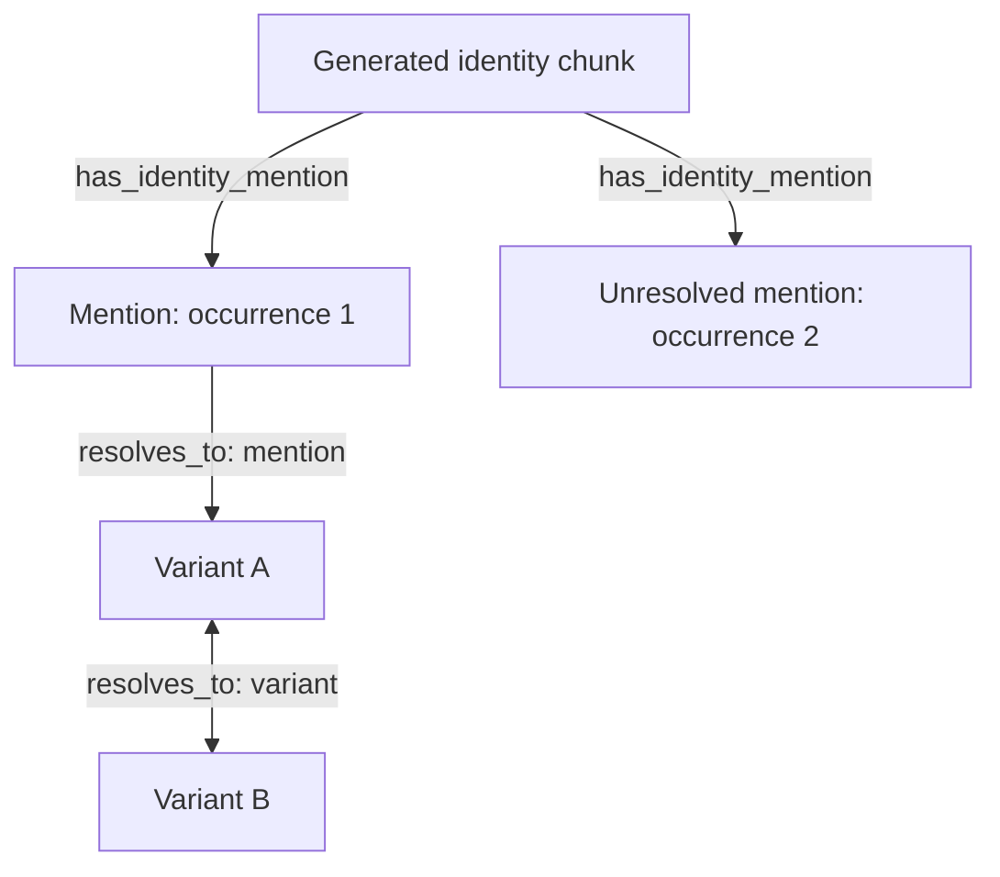

# Stage 5.4.5 — Initial identity representation proposal

**Recorded:** 2026-10-13 (America/Detroit)  
**Project:** cognee-science-lab  
**Baseline:** Cognee 1.6.2, Ladybug/LanceDB/SQLite, shared physical storage.  
**Status:** Selected initial design direction from the discussion. This is a proposal to implement and validate, not an implemented schema or a runtime compatibility guarantee. Exact serialization, Task sequencing, failure handling and operation contracts remain to be settled.

This record supersedes the current design's earlier privileged canonical/variant model and the proposal for one graph support node per assignment. Earlier Stage-5 demonstrations remain historical evidence. The six requirements in [the requirements review](cognee_stage5_4_5_requirements_review.md) remain outcome constraints; the choices here are one proposed way to satisfy them.

## 1. Terminology and visible structure

| Term | Meaning |
|---|---|
| Singleton | An ordinary Entity outside an applicable variant identity group, excluding Entities explicitly marked as mentions. Singleton refers to identity connectivity, not the absence of domain relationships. |
| Identity group | Entities connected through applicable variant relationships; its members are variants. There is no privileged canonical Entity. |
| Variant | A reusable representation within an identity group. Its applicability is declared; reusable does not automatically mean globally applicable. |
| Mention | An Entity representing one particular source occurrence. Its interpretation is occurrence-specific, whether resolved, unresolved or ambiguous. |
| Assignment | A stored result specifying an intended identity relationship or mention classification, exact endpoints/occurrence, applicability and original-input provenance. |
| Generated identity source | A registered Cognee Data item containing readable identity descriptions and durable structured assignments. Its native chunks supply source anchors for published graph structures. |
| Contribution | A particular current assignment contributing to a physical resolution edge, with its assignment ID, generated source ID and applicability. |

An Entity used as a reusable variant is not also used as a mention. A mention of the same surface text uses a distinct occurrence Entity. Identity management may create Entity nodes; it does not physically merge the original semantic Entities to establish equivalence.

The design stores authoritative classification and applicability on identity/source relationships and in the structured source, rather than on extra Entity fields such as entity_role. It does not require separate singleton or variant marker edges. No permanent identity-group node or ID is selected here.

## 2. Durable structured source and grouping

Retain the structured assignments and their original-input provenance independently of the materialized graph edges. Graph publication must be reproducible from these records; readable text alone is insufficient.

Initially, use one generated identity Data item for the document-local assignments derived from one original document: I01 for DOC01, I02 for DOC02. Each assignment has its own stable identifier within that grouping. Changing one assignment can therefore require republishing its generated source's set. Cross-document assignments are not assigned a grouping policy yet.

The source must be registered through Cognee's Data lifecycle. Merely creating a text-bearing graph node does not make it a Data item eligible for native Cognify/Update/Forget orchestration. The exact structured serialization/storage and text-versus-structured-file layout remain open; it must survive graph rebuild rather than exist only on generated graph nodes.

At minimum, saved assignments retain the information needed for exact publication and maintenance:

- stable assignment ID and intended assignment kind;
- exact endpoint Entity IDs, including IDs for any new Entities;
- explicit mention classification or variant relationship kind;
- applicable context and scope identifiers;
- original Data/chunk/occurrence locators as relevant;
- original-input provenance and the process that produced the assignment;
- content revision/fingerprint, or a defined invalidation/regeneration path after source changes;
- enough Entity construction information to recreate an identity-created endpoint.

The run that generated an assignment and the later Cognify run that publishes it are distinct. Original-input provenance is not interchangeable with generated-source ownership. No complete revision archive or scientific support evaluation is required.

## 3. Graph representation

| Graph relationship | Function | Initial properties |
|---|---|---|
| Generated identity DocumentChunk → mention Entity, has_identity_mention | Persistent occurrence classification, independent of resolution | Original Data ID, original chunk ID, occurrence key, available source span |
| Entity → Entity, resolves_to with resolution_kind=variant | Reusable equivalence within applicable scope | Resolution kind and contribution collection |
| Mention Entity → singleton or variant Entity, resolves_to with resolution_kind=mention | Accepted occurrence-specific reference | Resolution kind and contribution collection with occurrence applicability |

The two-way variant arrow depicts logical traversal; the physical resolves_to edge is stored directionally. The unresolved mention retains its marker without a resolution edge.

The generated identity chunk can mark many mentions. It is a normal source/context chunk already required by this proposal, not a separate assignment support node.

No new graph IdentityResolution node is required for each assignment. Full assignment provenance and generating-process details can remain in the structured source and be reached by assignment ID. Existing AbbreviationObservation, Mention, IdentityResolution and DefinitionSummary prototype classes are not evidence that those forms have been selected for the durable representation. Observation/definition processing can retain suitable intermediates; their final storage and transition from the prototype remain open.

Mention classification is stored by the marker relationship. Removing or changing a resolution does not remove that classification. An unresolved mention has a marker and no usable accepted resolution; it must not be treated as a singleton identity.

Singleton and variant markers are intentionally omitted: they would duplicate current resolution connectivity and require synchronization when groups form or split. Native endpoint ownership still applies without those marker edges.

## 4. Distinct mention Entity IDs

Cognee's DataPoint constructor honors an explicitly supplied id; normal Entity name-based ID generation applies only when no id is supplied. Identity publication will supply occurrence-specific UUIDs, preserving the ordinary display name.

Initial deterministic key:

| Key element | Purpose |
|---|---|
| Project/version namespace | Separates mention identity from ordinary name-based Entity identity |
| Original Data ID | Distinguishes documents |
| Original chunk ID | Distinguishes chunks and supplies a content-bound anchor under the pinned chunker |
| Reproducible occurrence index/key | Distinguishes repeated text in the same chunk |

For example, two occurrences of "the controller" receive different IDs while retaining the same Entity name. Replaying the same captured occurrence yields the same ID. Later resolution does not change that ID. The existing stage5_entity_layer.py already demonstrates explicit occurrence UUID construction, although it still writes the older Entity annotation fields.

Exact spans are retained when available. Changes to source text, chunking or occurrence enumeration require invalidation/regeneration or explicit occurrence mapping; stable UUIDs do not establish unchanged meaning across those changes. A finalized span convention and ID key format remain implementation choices.

Explicit IDs solve construction and ordinary ID-keyed persistence. They do not automatically protect mentions from optional name/similarity-based entity consolidation or endpoint remapping. Those operations must be excluded from the initial admitted path or explicitly adapted and tested.

## 5. Native ownership and original provenance

Use native document-level ownership by the generated identity Data item initially. Do not require chunk-to-edge ownership or native chunk-to-edge evidence rows for lifecycle deletion. The marker's original chunk ID is a source locator, not proof of native ownership.

Each generated source retains every Entity endpoint required by its assignments. Create new Entities with source-bound persistence; attach native source refs to existing Entities without rewriting their ordinary properties. Retaining an edge alone does not retain its endpoints.

| Artifact | Initial owner/publication arrangement | Maintenance implication |
|---|---|---|
| Registered generated Data item and native chunks | Native generated-source lifecycle | Group rebuild/Forget operates at source level |
| New mention or other identity-created Entity | Generated source owns the node | Rebuild may require recreation with the stored ID |
| Existing Entity needed by an assignment | Explicit generated-source node-ref attachment | Intentional retention is separate from property writing |
| Mention marker edge | Generated source owns the edge; generated chunk is its source endpoint | Recreate from saved occurrence information |
| Resolution edge | Native refs for each contributing generated source | Surviving owner retains the edge, but custom properties need recomputation |
| Original-input locators and process provenance | Saved assignment records; marker context and assignment references on edges | Original source changes must identify and retire/regenerate affected generated sources |
| Consumed vectors/backend evidence | Enabled-path-dependent lifecycle under R5 | Graph ownership alone does not prove index consistency |

Native owner refs retain artifacts; they do not establish assignment applicability or original-source dependency. Forgetting DOC01 does not automatically Forget I01. The integration must retire or regenerate its derived identity source as appropriate, including assignments whose original inputs were replaced.

Generated-source full-rebuild Update removes old ownership before republishing. An endpoint solely owned by that source can be deleted temporarily and must be recreated with its recorded ID. The marker and resolution edges can also disappear during rebuild. Read eligibility and recovery sequencing remain 5.4.5.4 work.

## 6. Contributions on shared resolution edges

Ladybug matches a relationship by source ID, relationship name and target ID. Ordinary properties are replaced on an edge upsert; native ownership references accumulate separately. Different assignment IDs or scopes in properties do not create independently stored parallel resolution edges.

Keep a contribution collection on the shared edge initially. Each entry carries:

- stable assignment ID;
- generated identity source Data ID;
- explicit applicability scope and its identifiers.

Store resolution_kind once at edge level. Full original-input provenance stays in the structured source. A reference to an original document must not be interpreted as a document applicability restriction unless the assignment declares that restriction.

Traversal accepts an edge when at least one current contribution applies. It short-circuits on a match. The initial cost is O(k) applicability checks per visited edge for k contributions. Small k is an expectation, not a measured result; no traversal benchmark has been run.

Identity maintenance publishes the combined collection from current assignments. It must not let individual source writes replace other surviving contributions. Withdrawing an assignment removes its contribution, recomputes applicability, and removes the physical edge only when none remain. Native Forget does not recompute this custom property collection.

The user also permits last-publisher-wins as a simplification. Contributions remain the selected initial proposal because publication order should not inadvertently change scope. No universal contribution/dependency framework is being required. A later simplification can deliberately choose one authoritative assignment per edge, but must make that applicability policy explicit.

## 7. Traversal rules

1. Resolve the query to a singleton, identity group member or exact occurrence before broad semantic expansion.
2. Traverse applicable variant edges bidirectionally and transitively. Group membership is evaluated under the query's identity context.
3. From a marked mention, follow an accepted mention edge only when its occurrence context matches; then expand through applicable variant edges.
4. Do not use mention edges as undirected equivalence edges or as bridges between identity groups.
5. Reverse traversal to collect mentions is a separate, explicitly filtered operation. Do not automatically collect every historical mention during identity expansion.
6. A surface-name query without occurrence context considers reusable identities, not historical mention strings as unrestricted aliases.
7. If applicable targets remain ambiguous across distinct identities, do not expand all targets as an accepted resolution.
8. Exclude identity markers and resolution links from normal subject-matter fact output. Preserve original endpoint/relationship identifiers for attribution and deduplication.

These are project retriever rules. Native graph expansion, generic search and triplet text do not acquire them merely because the edges exist. The current Stage-5.3 code needs adaptation: its privileged canonical selection, Entity role fields and unrestricted identity adjacency are historical prototype behavior.

Only usable accepted resolutions are intended for the initial published graph. If candidate/inactive edges are retained later, they need explicit eligibility data. Marker and mention-resolution context come from the same stored occurrence record and must be maintained together. Interrupted publication and failed maintenance require eligibility handling under R4; no atomic-write mechanism is selected here.

## 8. Deterministic construction and native seams

Readable identity text alone cannot guarantee the intended graph. Use structured assignments to compute exact publication intent.

Source-inspected seams:

- calculate_chunk_graphs replaces standard text LLM extraction and can compute graphs deterministically, but its outputs still pass through integration.
- Generic KnowledgeGraph conversion is not an existing-node reference interface: missing endpoints can be skipped; supplied endpoints can be constructed/upserted under native ID rules.
- add_data_points(..., custom_edges=[(source_id, target_id, relationship, properties)], ctx=ctx) can publish ID-based edges while omitting an existing target DataPoint.
- attach_node_source_refs can intentionally retain that existing target without changing its fields.
- A custom loading Task must carry the computed ID-based edges and real source ctx into persistence; the default extraction callback does not by itself provide that loader contract.
- The preferred small B Cognify task-transform extension remains unimplemented. Callback-only routing, Remember forwarding and full-rebuild Update forwarding are not assumed to work automatically.

Both endpoints must exist when edges are written, and resulting edges/owners must be checked. Edge-only/new-node-to-existing-node publication, contribution serialization and marker construction have not been runtime-tested as this combined design. Native triplet indexing and chunk-evidence capture have separate input requirements; neither is made correct merely by custom edge persistence.

## 9. Roadmap impact and next work

No stages are added or renumbered. This direction advances 5.4.5.2 ownership and 5.4.5.3 physical representation together. Neither subphase is declared fully complete: the assignment schema, complete ownership/index matrix, loader/routing and source dependency lifecycle still need review.

Next: walk through actual operation sequences, starting with one generated source adding a new Entity and an edge to an existing Entity. Then cover edge-only publication, an unresolved-to-resolved mention, overlapping contributions, original-source Update/Forget, generated-source rebuild, failure/retry, and selected native operations that might remove or remap endpoints.

Targeted design-dependent checks belong in the remaining architecture work and Stage 6; they do not reopen the completed broad 5.4.5.1 characterization. Stage 6 will implement durable identity sources, explicit occurrence IDs, marker/edge publication, contributor aggregation, identity-aware traversal and lifecycle orchestration. The post-Stage-6 checkpoint and Stages 7–10 remain in place. Scientific support/justification remains Stage 8.

## 10. Evidence status and source references

No new Cognee runtime probe or performance benchmark was run while recording this proposal. The previous runtime findings remain in [the characterization report](cognee_stage5_4_5_1_initial_findings.md). The code mechanisms below are source-inspected; the combined workflow is proposed.

- [Pinned DataPoint ID construction](https://github.com/topoteretes/cognee/blob/v1.6.2/cognee/infrastructure/engine/models/DataPoint.py)
- [Pinned Entity defaults](https://github.com/topoteretes/cognee/blob/v1.6.2/cognee/modules/engine/models/Entity.py)
- [Pinned graph extraction callback](https://github.com/topoteretes/cognee/blob/v1.6.2/cognee/tasks/graph/extract_graph_from_data.py)
- [Pinned ID-edge persistence](https://github.com/topoteretes/cognee/blob/v1.6.2/cognee/tasks/storage/add_data_points.py)
- [Pinned Ladybug graph/ownership adapter](https://github.com/topoteretes/cognee/blob/v1.6.2/cognee/infrastructure/databases/graph/ladybug/adapter.py)
- [Lab occurrence Entity construction](https://github.com/mrjames313/cognee-science-lab/blob/main/scripts/stage5_entity_layer.py)

